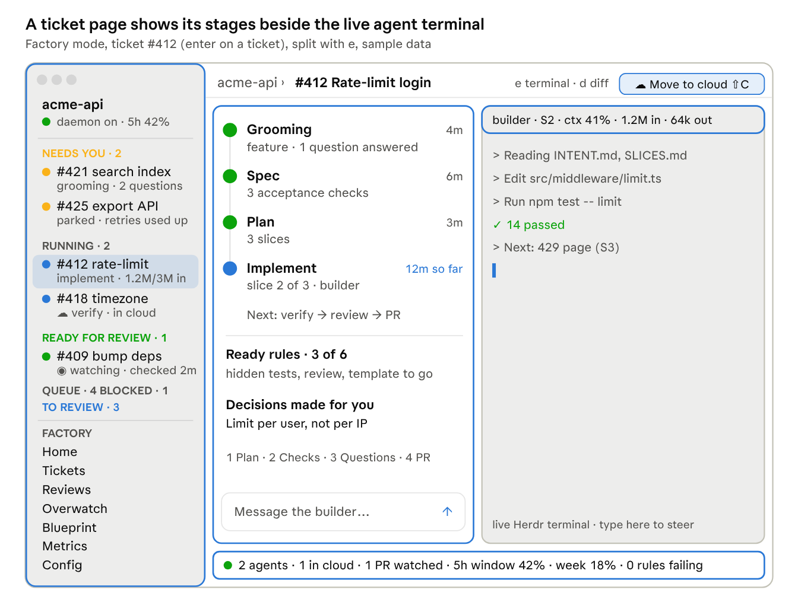
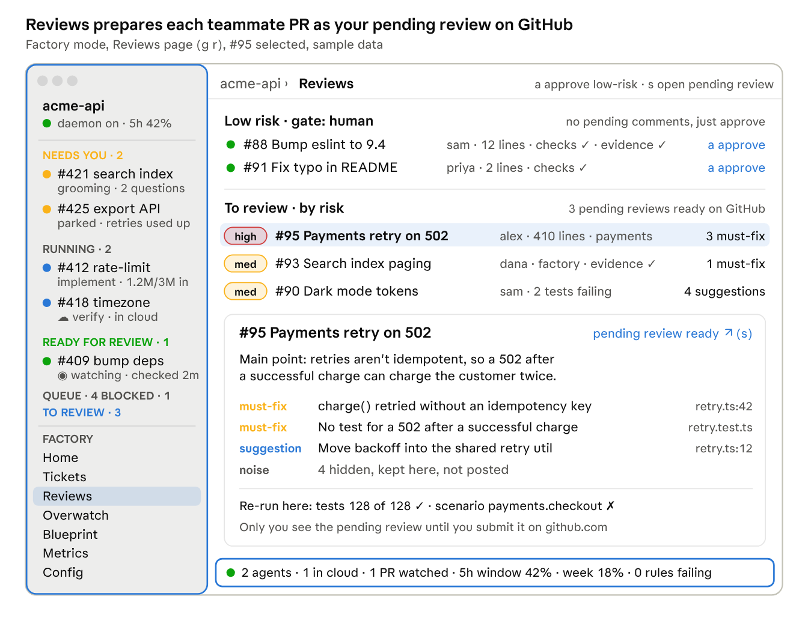

# overkill-factory-herdr

A software factory that runs inside the [Herdr app](https://herdr.dev) as its own mode. It takes a ticket from your GitHub Project queue, grooms it, runs it through a blueprint of agent stages in an isolated worktree, and hands you a PR that has already passed its ready rules. You review and merge; Markdown stays in front, code behind.

Local first: everything runs on your machine through herdr-core, with SQLite as the store. Tickets can move to Claude Code cloud sessions when the laptop sleeps.

Status: design. Nothing is built yet.

## Docs

| Doc | What it is |
| --- | --- |
| [docs/plan.md](docs/plan.md) | The plan: decisions, layout and pages, autonomy and ready rules, `.factory/` files, review loop, learning loop, budgets, away mode, setup and migration, technical design, milestones |
| [docs/prd.md](docs/prd.md) | The product requirements this plan implements (written for a desktop app; the plan changes that to a Herdr mode) |
| [docs/research-software-factories.md](docs/research-software-factories.md) | Background research on AI software factories: StrongDM, OpenAI, Uber, Warp, autonomy levels, verification, risks |
| [docs/layouts/](docs/layouts/) | Mockups of every factory-mode page, with sample data |

## Layouts

| | |
| --- | --- |
|  |  |
|  |  |
|  |  |

## Origin

This repo succeeds [flow-stack](https://github.com/nayanraj210401/flow-stack) v1 as the factory. It copies the parts of flow-stack that check finished work (evidence, blind checks, review, handoff) and leaves out the hooks that interrupt agents mid-work. flow-stack itself keeps working as a Claude Code plugin.
