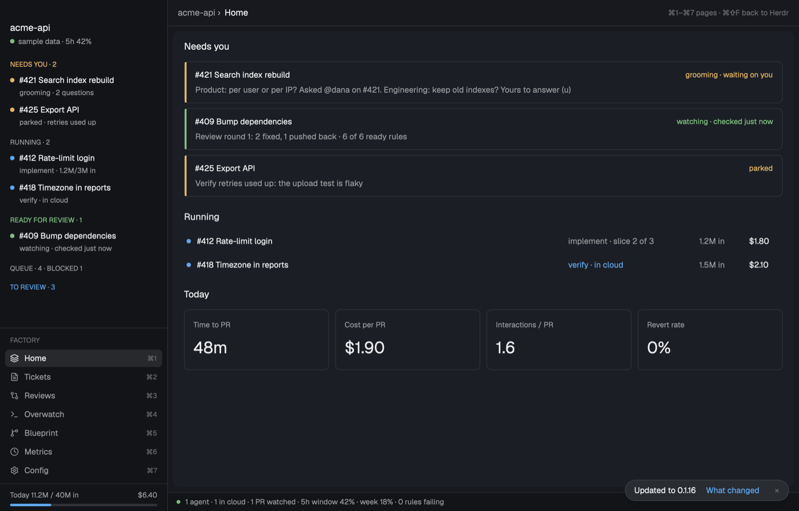

# overkill-factory-herdr

A software factory that runs inside the [Herdr app](https://herdr.dev) as its own mode. It takes a ticket from your GitHub queue (or a goal you type), grooms it, runs it through a blueprint of Claude Code agent stages in an isolated worktree, and hands you a PR that has already passed its ready rules. You review and merge. A babysitter handles review comments, and the factory learns from what you keep and change.

Everything runs on your Mac: a launchd daemon, SQLite as the store, and one Herdr window as the cockpit. Tickets can move to Claude Code cloud sessions when the laptop sleeps.



## Install with your agent

In a Claude Code session, paste:

```
Read ~/.config/herdr-app/AGENTS.md, then add this layout: https://github.com/nayanraj210401/overkill-factory-herdr
```

This is more than a layout: its mods share code in `lib/`, and a daemon writes the data they show. So the agent clones the repo and installs with `scripts/sync.sh` instead of copying folders, as [RECIPE.md](RECIPE.md) says. Then it follows [docs/setup.md](docs/setup.md) to point the factory at a repo.

## Install by hand

You need macOS, [Herdr](https://herdr.dev) with herdr-core (`hc`), Bun 1.3+, Node 22+, the GitHub CLI (logged in) and Claude Code (logged in). [docs/setup.md](docs/setup.md) has each install command and the details.

```sh
git clone https://github.com/nayanraj210401/overkill-factory-herdr
cd overkill-factory-herdr && git checkout develop
scripts/check.sh && scripts/sync.sh          # tests, then install the layout, mods and theme into Herdr

# a `factory` command on your PATH
mkdir -p ~/.local/bin
printf '#!/bin/sh\nexec "%s" "%s/daemon/cli.ts" "$@"\n' "$(command -v bun)" "$PWD" > ~/.local/bin/factory
chmod +x ~/.local/bin/factory
```

Then, in the repo you want the factory to work on:

```sh
factory init && factory setup && factory setup trust
factory setup write --budget 2M/100k --budget-day 10M/1M --merge human --max-running 1
git merge factory/setup && factory validate
factory service install       # the daemon, as a login item; retry once if launchctl says error 5
factory setup                 # repeat until every line shows ✓
```

Open Herdr on that repo's folder, press ⌘⇧F, and press `n` for a first ticket.

Start small: one ticket at a time, a low daily budget, and a human merge gate. Agents push branches and open PRs as your `gh` account and spend your Claude plan. Nothing opens PRs on its own: the maintenance agent ships off.

## Using it

| Key | Does |
| --- | --- |
| ⌘⇧F | factory mode on and off |
| ⌘1–⌘7 | Home, Tickets, Reviews, Overwatch, Blueprint, Metrics, Config |
| `n` | new ticket from an issue, `#number` or a one-line goal |
| `e` | peek at the ticket's live agent terminal |
| `m` | merge a ready PR |
| `x` / `u` | send a PR back with a note / answer a parked ticket |
| `p` / `b` / `d` | pause or resume / change the budget / diff |

You change the factory by asking Overwatch ("add a blueprint for migrations", "turn on the maintenance agent"). The maintainer agent does the work as a reviewable PR against `.factory/`.

## Status

| Milestone | What | State |
| --- | --- | --- |
| M1 Layout | factory mode in Herdr: sidebar, Home, Tickets, Ticket, Config | built |
| M2 Default blueprint | daemon, queue, stages, ready rules, PRs | built |
| M3 Babysitter, away | review rounds, auto-resume after the plan limit, cloud hand-off | built |
| M4 Learning, benchmarks | lessons, bandit experiments, Learning tab | built |
| M5 Auto gates, maintenance | `gate: auto`, broken checks, daily repo health, maintenance agent, lesson upkeep | built |
| M6 Peer review | reviewing teammates' PRs | Reviews page on sample data; designed in [docs/plan.md](docs/plan.md) |
| M7 Agents with territories | Overwatch, maintainer, learner, babysitter; example agent library | built |

macOS only. Claude Code is the only agent harness.

## Updating

```sh
git pull --ff-only
cp ~/.factory/<factory>/factory.db ~/.factory/<factory>/factory.db.bak-$(date +%s)
scripts/check.sh && scripts/sync.sh     # sync.sh restarts the service
```

## Docs

| Doc | What it is |
| --- | --- |
| [docs/setup.md](docs/setup.md) | Setting up on a new Mac: tools, install, pointing it at a repo, managed machines, troubleshooting |
| [docs/flow-stack-skills.md](docs/flow-stack-skills.md) | Which flow-stack skills the factory should take, where each goes, and the build order |
| [docs/plan.md](docs/plan.md) | The plan: layout and pages, agents, blueprints, ready rules, review loop, learning, budgets, away mode, peer review, milestones |
| [docs/slices.md](docs/slices.md) | How each milestone was cut into slices |
| [docs/prd.md](docs/prd.md) | The product requirements the plan implements |
| [docs/research-software-factories.md](docs/research-software-factories.md) | Background research on AI software factories |
| [RECIPE.md](RECIPE.md) | How factory mode's layout and mods are built |
| [docs/layouts/](docs/layouts/) | Mockups of every page |

## Layouts

| | |
| --- | --- |
|  |  |
|  |  |
|  |  |

## Origin

This repo succeeds [flow-stack](https://github.com/nayanraj210401/flow-stack) v1 as the factory. It keeps the parts of flow-stack that check finished work (evidence, review, handoff) and leaves out the hooks that interrupt agents mid-work. flow-stack itself keeps working as a Claude Code plugin.

## License

See [LICENSE](LICENSE).
