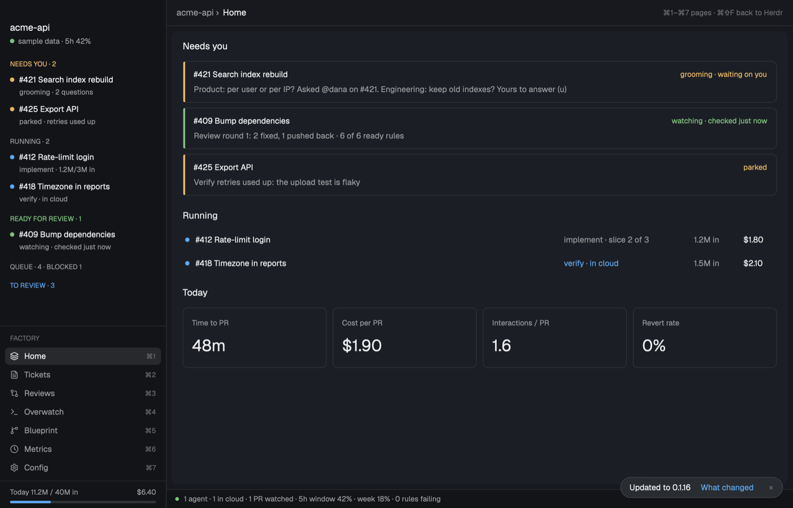

# Factory

Factory mode turns the whole Herdr window into the cockpit of a software factory. A sidebar lists live tickets grouped by what they need (you, an agent, a review, or nothing yet), with the factory menu at its foot and the day's token budget under it. The main area shows one page at a time. Home puts what needs you first, then what runs, then today's four numbers. The other pages are Tickets, Ticket, Config, and coming-soon cards for Reviews, Overwatch, Blueprint and Metrics. ⌘⇧F switches between factory mode and Herdr's normal window. In M1 every number comes from a sample `status.json`; in M2 a local daemon writes the same file.

## What you see

Left to right: a 268 px sidebar (theme `chrome`, 1 px `border` divider), then the work column (theme `canvas`).

- **Sidebar, top (84 px, window drag):** the factory name (15 px semibold `foreground`). Below it, a 7 px dot (`done` when the daemon runs, `dim` when not) and "daemon on · 5h 42%" in 12 px `muted`; with sample data it reads "sample data". On macOS it starts 30 px down, under the traffic lights at (12, 16).
- **Sidebar, tickets (fills the rest):** group headings in 11 px capitals: NEEDS YOU (`blocked`), RUNNING (`muted`), READY FOR REVIEW (`done`), then QUEUE · n · BLOCKED n (`muted`) and TO REVIEW · n (`accent`). Each ticket is two lines: a 7 px dot in its group's color with `#id Title` in 13 px `foreground`, then a 11.5 px `muted` subtitle such as "implement · 1.2M/3M in", "verify · in cloud", "parked · retries used up" or "watching · checked 2m ago". The open ticket's row is `selected`.
- **Sidebar, menu (250 px, 1 px top border):** "FACTORY" in 11 px `dim`, then seven 28 px rows: icon (14 px, from `mods/workspace-chrome/`), title, and its key (⌘1–⌘7) in 11 px `dim`. The shown page's row is `selected`.
- **Sidebar, budget (44 px):** "Today 11.2M / 40M in" and "$6.40" in 11.5 px `muted`, over a 4 px bar (`accent`, or `blocked` past 80%) on `raised`.
- **Header (42 px, window drag, 1 px bottom border):** "acme-api ›" in `muted`, then the page title in semibold `foreground`, or `#412 Rate-limit login` on the Ticket page. Right-aligned in 12 px `dim`: "⌘1–⌘7 pages · ⌘⇧F back to Herdr".
- **Main (8 px padding):** one page:
  - **Home:** "Needs you" cards (`surface`, 8 px radius, a 3 px left strip in `blocked` or `done`, the title with a right-aligned tag, then the question or reason); "Running" rows (dot, title, stage, tokens in, cost); "Today", four tiles (Time to PR, Cost per PR, Interactions / PR, Revert rate) with 26 px values.
  - **Tickets:** state chips (All, Grooming, Queue, Running, Parked, Ready, Merged, each with a count; the active chip has an `accent` border), a 220 px search box, and a table (Ticket, Stage, Blueprint, Tokens in, Cost), newest first. Merged and closed rows are dimmed.
  - **Ticket:** the left card holds the title, STATUS.md's summary sentence, a timeline (12 px dots: `done`, `working` for the stage now with "12m so far" in `accent`, hollow `raised` for stages to come), then tabs 1 Plan, 2 Checks, 3 Questions, 4 PR rendering SLICES, EVIDENCE, GATES and PR Markdown. A 380 px right card names the stage and tokens, says which terminal the agent runs in, and has an "Open live terminal e" button (accent border) while one runs.
  - **Config:** a 40 px **Daemon** bar on top: a dot (`done` running, `dim` not installed, `blocked` stopped or failing), the state ("Running · pid 4242 · starts at login", "Not installed: …", or the CLI's own error), and buttons for the state: Install (accent), or Restart, Uninstall and Logs. Below it, a 240 px list of the `.factory/` files (factory.yaml first, then blueprints, agents, triggers, benchmarks), and the selected file read-only with line numbers and YAML or Markdown highlighting. Each file row ends in ✓ (`done`) or ✗ n (`blocked`). The header holds the path, "Schema check: passes" or "n problems", and "Open in editor ⌘O"; problems are listed under it, one truncated line each (from `factory validate --json`).
  - **Coming soon** (Reviews, Overwatch, Blueprint, Metrics): a centered card with a "Coming in M6"-style pill in `accent` on `raised`, the title (20 px), one line on what the page will do, and the page's mockup from `docs/layouts/` at up to 900 px wide.
- **Status bar (30 px):** a 6 px dot (`done`, or `blocked` while ready rules fail), then "1 agent · 1 in cloud · 1 PR watched · 5h window 42% · week 18% · 0 rules failing" in 11.8 px `muted`.

The theme is `factory` in dark mode (`#1b1e24` background; `accent` and `working` `#5fa8f0`, `blocked` `#e5b567`, `done` `#7fc07f`) and Herdr's `paper` in light mode.

## How it behaves

- ⌘⇧F (global) shows this layout; inside it, ⌘⇧F shows `main` again.
- ⌘1–⌘7, or a menu row, selects a page (`layout.select {stack: "pages", child}`). The menu and header read the shown page from the live layout tree, so keys and clicks always agree.
- Clicking a ticket in the sidebar, a Home card, a Running row or a Tickets row opens the Ticket page on that ticket (`shared("factory.ticket")`). Clicking TO REVIEW opens Reviews.
- Ticket tabs switch by click, ⌘⌥1–4, or bare 1–4 while the page has focus.
- Home, Tickets and Ticket take the keyboard when clicked. `j`/`k` (or arrows) move a highlight, `enter` opens the ticket, and `/` jumps to search on Tickets (escape leaves it). `e` peeks at the selected ticket's live agent terminal (`terminal.peek` with the ticket's `terminal` from status.json; keep makes it a tab), or toasts that no agent is running. `m` on a ready ticket with a PR opens the `factory-ask` dialog ("Merge PR #511?"); Enter runs `factory merge <id>` (`gh pr ready`, then `gh pr merge --squash`) against the factory the window shows, and toasts success or gh's reason. On sample data it toasts instead. The Ticket page shows a Merge button for a ready ticket. `b` opens the same dialog with a text box holding the ticket's budget (`3M/200k`); Enter runs `factory budget <id> <text>`, which reads `3M`, `1.5m`, `200k` or `3M/200k` (`parseTokens` in `lib/model.js`) and refuses anything else. `x` on a ready PR asks for a note (`factory send-back <id> <note>`): it goes in the ticket's REVIEW.md, the ticket reruns its fix stage (the `on_fail` of the last check before `pr`), and on reaching `pr` again the daemon updates the open PR (`gh pr edit`) instead of opening another. `u` on a parked ticket shows why it stopped and asks for an answer (`factory answer <id> <text>`): it goes in GATES.md and the stage it stopped at runs again (a check hands over to its `on_fail`). The Ticket page shows Send back and Answer buttons. `n` (and the Tickets page's New ticket button) asks for an issue link, `#number` or a one-line goal and runs `factory new --start <text>`: an issue keeps its number and title (`gh issue view`, refused if closed or in another repo), a goal gets a local id from 10000, and the first stage's agent starts at once. `p` pauses a running ticket after a confirm (`factory pause <id>`: the stage row ends "paused", its sessions end, then `hc kill` stops the agent) and resumes a paused one (`factory resume <id>`: the stage reruns in a fresh session; one paused at `pr` goes back to waiting on the ready rules). Paused tickets sit in the Queue group as "paused at <stage>". The Ticket page shows Pause/Resume. `d` (and the Ticket page's Diff button) opens the `factory-diff` window: `factory diff <id>` diffs the ticket's worktree, uncommitted work included, against its merge base with the repo's current branch; `lib/diff.js` turns it into numbered rows (cut at 5000), `r` reloads, Esc closes. Herdr's own changes panel follows the focused pane and shows only uncommitted work, so it can't show a ticket. The cloud keys `⇧C ⇧L` toast "<action>: coming in M3" until M3 builds them (`lib/keys.js`). Keys bubble up from the search box, so Tickets ignores them while you type.
- Tickets chips filter by state; the search box matches `#412`, `412`, or words of the title, blueprint, stage or state.
- Config asks `factory service status --json` every 10 s. The buttons run `factory service install|restart|uninstall`, show "Installing…" while busy, and toast the CLI's error if it fails. Logs opens `~/.factory/logs`. Clicking the daemon line in the sidebar opens Config.
- Config reloads when a file in `.factory/` changes. ⌘O or the button opens the selected file with macOS `open`.
- Every view updates when `status.json` changes: one loader watches the folder and republishes.
- Herdr's agent statuses aren't shown on ticket rows yet. Fixture tickets have no terminals, so dots show the ticket's group.

## Built from

- `layouts/factory.json` is generated by `scripts/gen.mjs` from `lib/pages.js` (as is `keys.json`); don't edit it by hand. Its tree: root `row` (`titlebar: none`), with `sidebar` (column: `brand`, `sidebar-tickets`, `sidebar-menu`, `sidebar-budget`) and `work` (column: `header`, the `pages` stack with one block per page, `status`). Node ids are unique across the tree.
- Mods, all `{"place": "none"}`: `factory-chrome` (brand; with `props.footer`, the budget bar), `factory-tickets`, `factory-menu`, `factory-header`, `factory-status`, `factory-home`, `factory-list` (Tickets), `factory-ticket`, `factory-config`, `factory-soon` (`props.page`).
- Shared code in `lib/` is copied into each mod's `lib/` by `scripts/sync.sh`: `pages.js` (pages, keys, icons, milestones), `status.js` (the `status.json` contract and its validator), `model.js` (pure grouping, labels, filters, STATUS.md parser; tested with `node --test`), `store.js` (the loader).
- Data: `factory-chrome`'s brand copy, which is always shown, reads the space's `~/.factory/<name>/status.json`, validates it, and publishes `setShared("factory.state", {at, status, errors})`. It then reloads on `watchFolder`. Other views render from `shared()`. The Ticket page reads `tickets/<id>/*.md`, and Config runs `find` over `.factory/`. `shared("factory.root")` overrides the folder. A space with no factory gets a "start a factory here" Home; the sample shows only after `shared("factory.sample")` is set (Home's "Show the sample instead").
- Herdr functions: `layout()`, `layout.select`, `layout.switch`, `shared`/`setShared`, `readTextFile`, `watchFolder`, `exec` (`find`, `open`), `nextCommand` (`factory-config.open`, `factory-ticket.tab-N`), `agents()`, `theme()`, `appHome()`, `checking()`. gpui-base: `InputState`/`Input`, `EditorState`/`Editor`, `TextView.markdown`.
- Art: the shipped `mods/workspace-chrome/*.svg` icons, the mockups copied to `mods/factory-soon/previews/`, and `layouts/factory.svg`.

## Watch out

- A mod can't import outside its own folder, by relative path or by symlink. Copy `lib/` in.
- `herdr-app check` renders once without loading `shared.json`. Shared data is null there, and a view that bails out on null tests nothing. `store.state()` returns the bundled `lib/sample.js` (written by sync.sh) while `checking()`, so checks render real data.
- Layout ids are global: a sidebar block named `tickets` swapped places with the Tickets page.
- `TextView`, `InputState`, `Input`, `EditorState` and `Editor` come from `gpui-base`, not `gpui-kit`.
- An editor's language is fixed at creation. Make a new `EditorState` per file.
- The window runs the CLI as `bun <checkout>/daemon/cli.ts` (path written to `lib/cli.js` by sync.sh), never `dist/factory`: a binary built from an older commit answered `--json` with plain text.
- `ctrl-1`–`ctrl-4` select spaces and `cmd-1`–`cmd-9` select tabs in `global`; the layout's own section overrides only the cmd ones. keys.json has no key chords, so the plan's `g h` became ⌘1.
- Editing a person's keys.json stops Herdr upgrading its default shortcuts. sync.sh merges keys only with `--keys`, and keeps a backup.
- A Herdr home's socket path has to fit macOS's limit. Use `mktemp -d -t hf` for test homes.
- Bare-letter keys live in the page mods (focus + `on_key_down`), not in keys.json: a layout-level `j` would also fire while typing in search.
- With Herdr running, a started ticket is a worktree space nested under its repo's space (named after the branch), with one tab per stage's agent; without it, agents run as free-floating herdr-core terminals. `e` peeks at either.
- Not built yet: Runs view, cross-repo tickets, and the Reviews, Overwatch, Blueprint and Metrics pages.

## Done when

- `scripts/check.sh` passes: unit tests, generated files up to date, and `herdr-app check` on every mod with sample data.
- `scripts/smoke.sh` passes: an isolated window opens on `factory`, every page in the stack renders without window errors, and `layout.switch` goes to `main` and back.
- Home matches `docs/layouts/01-home.png`: Needs you lists #421, #409 and #425; Running lists #412 and #418; the tiles read 48m, $1.90, 1.6 and 0%.
- The sidebar shows NEEDS YOU · 2, RUNNING · 2, READY FOR REVIEW · 1, QUEUE · 4 · BLOCKED 1 and TO REVIEW · 3.
- The Ticket page for #412 shows three done stages, Implement now with "12m so far", three to come, and the Plan tab's slices.
- Config lists six `.factory/` files with factory.yaml highlighted.
