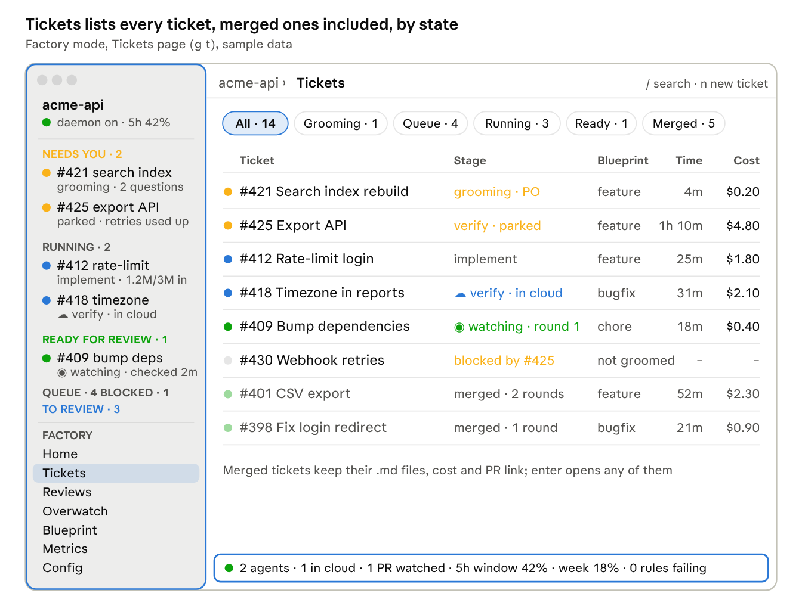
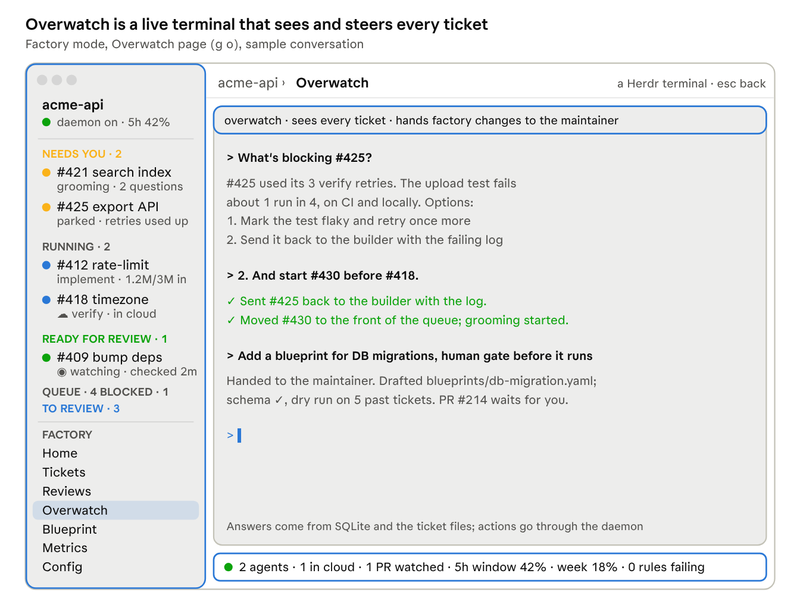
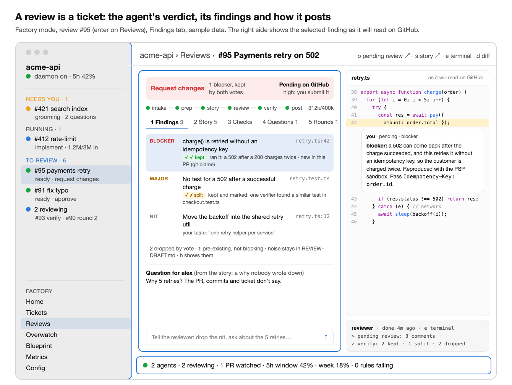
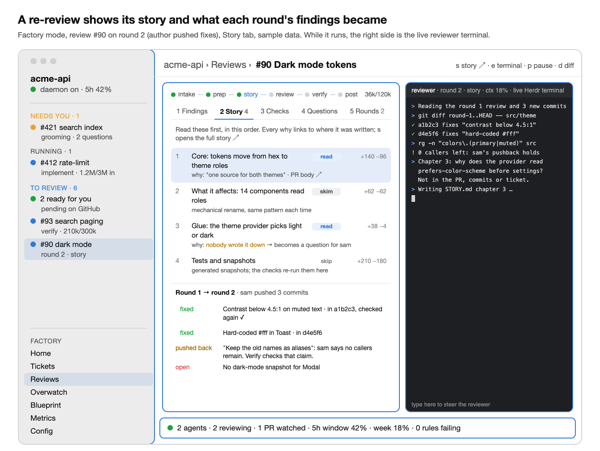

# Factory herdr mod plan


## TL;DR

Build the software factory as a Herdr app layout with its own mods, plus a small local daemon. It does not need a desktop app of its own.

- **Autonomous by default.** A ticket runs from pickup to a PR ready for review without waiting on anyone. Ready rules decide when a PR is ready, not approvals. Your default touchpoint is reviewing and merging.
- **The factory is code.** A `.factory/` folder defines it, and its blueprint is a graph of stages that an orchestrator agent moves through.
- **The whole window is ours.** Like [herdr-roundup](https://github.com/carstenlucke/herdr-roundup), the layout clones Herdr's sidebar, tabs, pane header and status bar and rebuilds them into a factory mode: a sidebar of live tickets with the factory menu at its foot, and pages for Home, a ticket, Tickets, Reviews, Overwatch, Blueprint, Metrics and Config.
- **Markdown in front, code behind.** Every view shows a ticket's Markdown; the diff and the agent terminals are one key away.
- **Measured.** Time to PR, cost per PR, human interactions per PR and revert rate are on screen, and benchmarks replay your own past tickets.
- **Local first, in a new repo.** Everything runs on your machine through herdr-core; a ticket can move to a Claude Code cloud session when the laptop sleeps. The repo is separate from flow-stack and copies the parts of flow-stack v1 that check finished work.

The PRD changes in one place: section 7.2's "Ship as a desktop app" becomes "Ship as a Herdr app layout plus a daemon".

## Decisions this plan settles

Earlier drafts and the research pulled in different directions. Each clash is settled here, and the rest of the doc follows these answers.

| Clash | Settled as |
| --- | --- |
| Human approval gates (spec, PR, approve in an inbox) vs. an autonomous factory | Autonomous after grooming. Questions are settled while the ticket is groomed; after that it runs to a ready PR without stopping, and you merge |
| A fixed list of stages vs. Warp's graph of stages | A graph. Each stage lists the stages that may follow, and an orchestrator agent picks one |
| Keep Herdr's shipped sidebar vs. our own | Our own. Shipped mods are cloned under a `factory-` prefix and rebuilt, as herdr-roundup does |
| Reuse flow-stack's task folders vs. a new repo | A new repo. flow-stack parts are copied in; its task folders are only test data for M1 |
| "Agents write their state to Markdown" vs. "only the daemon writes .md" | Agents write their prose outputs (INTENT, SLICES, PR). The daemon writes the state files (STATUS, EVIDENCE, GATES, REVIEW) from SQLite rows |
| A separate inbox mod vs. fewer mods | No inbox mod. "Needs you" is the top of Home, with a badge in the sidebar |
| Autonomy levels L0–L5 per loop vs. ready rules | A gate per blueprint stage, human or auto; merge is human by default. No GitHub labels anywhere. L0–L5 stays as the PRD's vocabulary |
| Quiet hours that hold gates overnight | Dropped. Nothing waits on a gate, so there is nothing to hold |
| Factory as code described in two sections | One section |
| Labels to start and route work vs. no labels | Your GitHub Project is the queue: an issue assigned to you in its Ready column joins it, or you add one by hand. The triage agent picks the blueprint |
| Benchmarks that propose factory changes vs. monitoring | Benchmarks are monitoring: they run apart from ticket runs and only report. Separately, the factory tunes the settings you mark tunable, between tickets, as overrides you can undo |
| Copy Warp's layout and page names vs. our own | Our own. The sidebar lists live tickets with the factory menu at the bottom, one factory per window, and the pages use our words (Tickets, Reviews, Overwatch, Metrics, Config). Warp was a reference for ideas only |
| Every agent per repo vs. some shared | Two tiers. Repo agents (triage, spec, planner, builder, reviewer) live in each repo's `.factory/agents/`. Factory agents (Overwatch, babysitter, maintainer, learner) are global, one each, in `~/.factory/agents/` |
| Agents that each change what they need vs. one owner | Each agent has a territory. The maintainer alone changes the factory (config, blueprints, agents, housekeeping, the UI); others ask it |
| One Overwatch per factory vs. one for everything | One Overwatch, the lead, across every repo. It is the only agent that talks to you |

## Principles

1. **Markdown in front, code behind.** You manage work, not files. Every view shows a ticket's Markdown. The diff opens in Herdr's shipped `changes` panel with `d`, and the agent terminals with `e`.
2. **Rules, not approvals.** The factory never stops to ask permission for reversible work. It checks the result at the end of each stage, and a failure goes back to the agent. You see work only when it is ready, or when the factory is truly stuck.
3. **The factory is code.** `.factory/` defines everything the daemon does. You change it like any other code. Only the maintainer edits it, when you or another agent asks, in place with a backup (it is local: there is nothing to merge); otherwise the factory only tunes settings you mark tunable, as overrides kept outside it.
4. **Every agent has a territory.** Agents know each other and ask each other directly; none acts outside its own territory. Overwatch leads and is the one you talk to.
5. **Measure everything.** Every session is recorded against its ticket. Four numbers are always on screen: time to PR, cost per PR, human interactions per PR and revert rate.

## Layout design

The factory is one Herdr app layout, `layouts/factory.json`, and it replaces the whole window, not just the panes. Herdr's own docs say nothing in its default interface is special: the spaces sidebar, the agents list, the tab bar and the status bar are mods like any other. herdr-roundup proves it, with cloned spaces, tabs, pane header, menu and confirm mods. `cmd-shift-f` switches between this layout and Herdr's normal one.

Factory mode has its own shape and its own words. Warp's app was a reference for ideas (a stage timeline per ticket, a metrics page), not a template. What makes it a Herdr mode:

- **It's a mode.** `cmd-shift-f` switches between factory mode and Herdr's normal window. Both show the same spaces, agents and terminals, so nothing is lost by switching.
- **One factory per window.** The window shows the factory of the space you're in (any of its repos' checkouts, or a ticket's folder). Factory mode hides Herdr's spaces sidebar, so the brand row at the top of the sidebar is the switcher: `<factory> ▾` over the lead repo, the branch and "· N repos". A click on it, or `g f`, opens the factory picker, a Herdr popup with one row per factory on this machine: its repos (lead first), Herdr's status dot, and its running, needs-you and to-review counts read from that factory's own `status.json`. Picking one switches the Herdr space: Herdr focuses a space in that factory's lead repo, or makes one there, and the window and its terminals follow the space as they always do. Switching spaces with Herdr's own keys switches factories the same way.
- **Another factory needing you shows.** When another factory has something in its Needs you, a line under the brand says so (`⚠ shop: 1 needs you`, with "+N" when there are more). A click goes to that factory; `]` and `[` go to the next and previous one.
- **Agents are live, not transcripts.** A ticket's page splits to show its real agent terminal, and you can type into it. Overwatch is a Herdr terminal too.
- **Herdr's agent status stays.** Every ticket row carries Herdr's working, blocked, idle or done dot.
- **Keys first.** Every page and action has a key in the layout's own section of `keys.json`, and the layout ships its own theme.
- **Herdr's notifications.** A new Needs you item is a Herdr toast; clicking it opens the ticket.

The window has four parts:

- **Sidebar.** It shows only what's alive and what waits on you. At the top, the factory switcher (name, lead repo, branch), the other-factory line when one needs you, and whether the daemon is running. Under it, a Search tickets row that opens Tickets with its search focused. Then **Waiting on you · N** (in the attention colour, hidden when empty): one row per thing you must act on, an agent asking you (a grooming question, a stage agent waiting in its terminal, or a global agent such as Overwatch or the maintainer), a PR ready to merge, or a parked ticket. Each row has a glyph (`?`, `✓`, `⏸`), `#id title`, how long it has waited, and a line saying why ("builder asks you · implement", "PR #52 ready to merge · 6 of 6 rules", "parked · retries used up in verify"). Then **Working · N**: every live agent, running tickets (local or ☁ cloud) and the global agents while they work, each with a spinner, a live timer since its stage or session began, and "agent · stage (S2 of 3)"; "Nothing running." when empty. The queue moved to the Tickets page: the sidebar keeps one quiet line, "4 queued · 1 blocked by #412 →", that opens it. **Settled · N**, folded by default, lists the last 10 tickets merged or closed in the past 7 days. At the bottom, the factory menu (Home, Tickets, Reviews, Overwatch, Blueprint, Metrics, Config), with the count of teammates' PRs waiting on Reviews. At the foot, the day's budget bar. A click on a row opens its ticket, or a global agent's terminal (Overwatch's page for Overwatch).
- **Header bar.** Where you are (`acme-api › Blueprint`) and the page's keys.
- **Main area.** A `stack` block that shows one page, switched with `layout.select`.
- **Status bar.** Running agents, PRs ready, spend against budget, and ready rules failing now.

### Pages

Each page is drawn below the table. All share one sidebar.

| Page | What it shows |
| --- | --- |
| Home | Needs you first (an agent asking you in its terminal, PRs ready to merge, parked tickets), what's running, and today's four numbers |
| Ticket | One ticket: its stage timeline (STATUS.md, HANDOFF.md), each stage with a plain summary, time and agent; ready rules; decisions made for you; once a PR exists, its watched badge and review rounds; a box to message the session running now. `e` splits in the live agent terminal; `1`–`4` show Plan, Checks, Questions and PR |
| Tickets | Every ticket, merged ones included, filtered by state and searchable. Its Runs view (press r) lists every agent session instead: stage runs, babysitter fixes, maintenance and benchmark runs, each with its time, cost and transcript |
| Overwatch | The overwatch agent (PRD 7.1) in a live Herdr terminal: ask what's blocked, start, pause or reorder tickets, and ask for changes to the factory, which it hands to the maintainer |
| Blueprint | Each blueprint as a graph, with run counts and gates per stage; `y` shows its YAML |
| Metrics | Throughput, Cost, Quality, Learning and Benchmarks tabs over a date range |
| Repo config | One repo of the shown factory at a time (a switcher, the lead first): its own `.factory/` files, a readable view of the one selected, its schema check, what each file overrides, and ⌘O to open it in your editor |
| Config | The factory's global settings: the daemon's controls on top, then the files in `~/.factory` every repo shares (factory agents, skills, shared steps, `config.yaml`, `maintainer.json`, `overwatch.json`, `plan.json`), read-only, with ⌘O |
| Reviews | Teammates' PRs, grouped by what each needs from you: Ready for you, Reviewing now, Waiting to start (risk and cost first, "⚠ may not fit"), Submitted. A review is a ticket, so opening one is its Ticket page with review tabs: Findings, Story, Checks, Questions, Rounds |

**Metrics.** Throughput: time to PR, human interactions per PR, PRs merged, and cycle time split into pickup to PR, PR to your first review, and review to merge. Cost: cost per PR, spend per day against budget, spend by agent and model. Quality: revert rate per blueprint, ready rules passing on the first try, retries per ticket. Learning: the target over time, each tuning shift with an undo, experiments, the lesson store. Benchmarks: the latest report per stage and per blueprint. An All factories toggle (⇧A, or the chip in the tab row; remembered across reloads) combines every factory on the machine: counts, tokens and spend summed per day, rates recomputed from their counts, medians and the Learning and Benchmarks tabs shown per factory.

#### Home


#### Ticket


#### Ticket, cross-repo


#### Tickets



#### Overwatch



#### Blueprint


#### Metrics


#### Metrics, Cost tab


#### Repo config

Repo config (⌘7) shows one repo's `.factory/`. A row of chips above the files picks the repo: every repo of the shown factory (agents-live.json's `factories[].repos`), the lead marked and shown first. A line on the right says the folder is "Local to this machine, never pushed" (`.factory/` sits in `.git/info/exclude`). A repo with no `.factory/` gets an empty state instead of the list.

Each file says where it stands, as the daemon reads it (`lib/configfiles.js` mirrors `agentFile`, `skillDir`, `loadPrompt` and `stepFile`, and `daemon/configfiles.test.ts` checks it against them):

- **overrides built-in / global / lead repo** (accent): the repo's copy runs instead of another one. A lead repo's `prompts/<x>.md` over the built-in prompt; its `steps/<x>.yaml` over `~/.factory/steps/`; a `skills/<x>/` over the lead repo's and `~/.factory/skills/`; another repo's `agents/<x>.md` over the lead repo's.
- **not used** (blocked): the daemon never reads it. A repo copy of a factory agent (overwatch, babysitter, maintainer, learner: those load from `~/.factory/agents/`, else the shipped one), and another repo's `factory.yaml`, blueprints, prompts and steps (those load from the lead repo).
- **from global example / from built-in example** (dim): a repo agent or step copied from the example library. Only the repo's copy runs.

Under the badge, "differs from built-in" (or global, lead repo, example) when the two texts differ. Nothing judges which is older.

#### Config

Config (⌘8) is the factory's global page. The daemon bar, Claude Code, pending changes and tuned settings stay on top in their own capped, scrolling area. Below them, `~/.factory`'s config: `agents/*.md`, `skills/**`, `steps/*.yaml`, then `config.yaml`, `maintainer.json`, `overwatch.json` and `plan.json` when present. Logs, backups, examples and each factory's own folder aren't listed. A global factory agent shows "overrides built-in" over the shipped one; skills and steps compare with the shipped examples. The schema check comes from `factory validate --json`'s `~/.factory` rows.

Both pages are read-only, apart from Config's New UI switch (V2 UI gate, below). A line on each says the maintainer makes every change there, with an **Ask maintainer** button: the `factory-ask` dialog takes the change and runs `factory request` (with `--repo <slug>` on another repo's Repo config), which types it into the maintainer's terminal. ⌘O goes to `factory-header`, which every page shows, and opens the file the shown page selected (`shared("factory.open-file")`), since a `<mod>.<command>` reaches only shown copies.


#### V2 UI gate

`V2_UI: true | false` (default `false`) switches the Ticket and Blueprint pages to their V2 designs. Those pages come in follow-up PRs; the designs they build are the prototypes `docs/prototypes/ticket-v2/index.html` and `docs/prototypes/blueprint-v2/index.html`. Until a page has a V2 version, the gate changes nothing on it.

- **Where it's set:** a top-level key in the account config (`~/.factory/config.yaml`, every factory) or in a repo's `.factory/factory.yaml` (that factory). The lead repo's `factory.yaml` wins over the account. `factory validate` checks it is `true` or `false`.
- **Turning it on and off:** the Config page (⌘8) has a **New UI** row with an on/off switch, the one setting that page changes itself. It runs `factory config set V2_UI true|false`, which edits that one top-level line of `~/.factory/config.yaml` in place (the rest of the file and its comments stay; the key is added at the end when missing), refuses anything but `true` or `false` and any change that would leave the file invalid, then rewrites every factory's status.json so the window switches at once. `factory config get V2_UI --json` gives `{ account, factory, repo, effective }`; when the shown factory's `factory.yaml` sets the key, the row says so ("irctc-mcp's factory.yaml sets it on; that wins here", `newUIRow` in `lib/configfiles.js`), since the switch only writes the account file and never a repo's.
- **How the mods read it:** the daemon writes `ui: { v2: <bool> }` into status.json (`lib/status.js` checks it when present). A page calls `v2UI(status())` from `lib/model.js`. It's off when `ui` is missing, so an older daemon keeps the current pages.
- **Backward compatibility:** the current pages stay the default. A V2 page draws only when the gate is on.
- **Ticket V2** (`mods/factory-ticket/v2.js`, views in `lib/ticketv2.js`): left, the title, chips (blueprint, source, a deadline the ask names, spend against the budget, hard rules from INTENT.md or GROOMING.md), the ask in short, a stage strip and six tabs (Plan, Checks, Questions, PR, The ask, Memory; ⌘⌥1–6; Memory is ticket memory's layer 4). Right, the agent line and token bar, then by state: the live terminal's tail (`hc read`, read-only) while it works; an inline question card when it waits on you, whose Send types the picked option or your words into the live terminal (`hc keys`/`hc send --force`, options read from the question tool's screen) or, parked, opens the `factory answer` dialog prefilled; the ready rules (`factory ready`) on a ready PR. Then files changed (`factory diff`) and Activity from `events`. x closes a parked ticket (`factory drop`), b sends a ready one back, o opens its PR.
- **Blueprint V2** (`mods/factory-blueprint/v2.js`, numbers in `lib/blueprint-v2.js`): blueprints.json adds each blueprint's `description` (an optional `description:` line in the blueprint file, the "why grooming picks it"), a `stats` strip (tickets in 7 days, the share with no fail-back, the median ask → PR time and cost over PRs opened), per stage its last 10 outcomes, pass/fail and median time and recent runs (a run fails when the ticket goes next to its `on_fail`, or parks on it with retries used up), and `steps` (each step's file, description and output). A number with nothing to measure is null and the page leaves it out.

#### Reviews

Redesigned on 2026-11-23 for peer review as the user redesigned it (below): a review is a ticket on a peer-review blueprint, the agent decides the verdict, the output follows the risk level, and cost comes before tokens. The old page (a low-risk fast lane, then a risk-ordered list with must-fix/suggestion/noise) no longer fits, so the page is two views, both built from Herdr's own parts.

**The queue** (`g r`). One row per PR, grouped by what it needs from you, not by risk:

| Group | Rows show | Your keys |
| --- | --- | --- |
| Ready for you | risk, title, author and size, the agent's verdict (Request changes, Comment, Approve), the findings by severity | `enter` opens it · `o` your pending review on GitHub · `a` approve, only a low-risk PR with an Approve verdict |
| Reviewing now | the live stage with Herdr's agent dot, tokens used against the PR's budget, "round 2" on a re-review | `enter` opens it, with its live terminal |
| Waiting to start | the estimate; "⚠ may not fit" when it's over what is left of the 5-hour window, the week or today's budget, with one line saying by how much | `r` run anyway · `t` story only · `w` wait for the reset. Nothing starts while the warning stands |
| Submitted this week | folded; one line of outcomes: kept as written, edited, missed, your minutes | `enter` unfolds |

A strip on top says what the whole queue needs against the 5-hour window, with All, Requested and Teammates filters (`review.queue`). Columns have fixed widths and a title is cut to its column, never pushing the others. A card at the foot previews the selected PR: the main point, the story's tiers, the output, the checks run here and the cost.

**The review** (`enter`). A review is a ticket, so it opens on the Ticket page with review tabs in place of Plan, Checks, Questions and PR:

- **On top:** the agent's verdict and why ("1 blocker, kept by both votes"), and the output the level allows ("Pending on GitHub", or "Submits as Comment" when `submit` is on). Below it, the blueprint's stages as a strip, with tokens against the budget.
- **1 Findings:** by severity (blocker, major, minor, nit), each with its file and line, the evidence (the input that breaks it, run, or `not reproduced`), the verify vote (kept ✓✓, split ✓✗), and new or pre-existing from `git blame`. A line under the list counts what was dropped by vote and what stays as noise in REVIEW-DRAFT.md (`h` shows them).
- **2 Story:** the chapters in reading order, each tagged read, skim or skip with its size and its why, linked to where it was written. A why nobody wrote down is marked and becomes a question. `s` opens the full story, the private artifact.
- **3 Checks:** the author's evidence re-run here, the affected tests, scenarios and lint.
- **4 Questions:** questions for the author, from the story.
- **5 Rounds:** on a re-review, each earlier finding as fixed (with the commit), pushed back (with the author's words and what verify made of them) or still open.
- **The right side:** while the reviewer runs, its live Herdr terminal (type to steer it, as on any ticket). Once it's done, the selected finding in Herdr's read-only code view, with the comment drawn on its line as it will read on GitHub, in your `review.format`. The reviewer's last lines sit below it, and `e` opens its terminal.
- **Message box:** at the foot, as on every ticket: tell the reviewer to drop a finding or ask something, and it updates the pending review.

The sidebar's To review group shows the same groups as counts (ready, reviewing, may not fit), and opening a review lists it there like a running ticket.






The mockups' HTML is in `docs/layouts/src/`; `sh docs/layouts/src/render.sh` renders them.

### The mods

All mods carry a `factory-` prefix, since a mod folder's name is its identity in Herdr. A cloned mod starts from Herdr's with `mod.clone`, and the repo records which Herdr version it came from.

| Mod | Starts from | What it does |
| --- | --- | --- |
| `factory-chrome` | Herdr's `workspace-chrome` | Brand row (the factory switcher, another factory needing you, daemon status, spend) and the budget bar |
| `factory-picker` | Herdr's `picker` | The factory picker popup: every factory, its repos and counts; picking one switches the space |
| `factory-tickets` | Herdr's `spaces` | The sidebar's ticket groups |
| `factory-menu` | new | The factory menu at the bottom of the sidebar |
| `factory-header` | Herdr's `tabs` | Breadcrumb and page keys |
| `factory-status` | Herdr's `workspace-status` | The status bar |
| `factory-pane` | Herdr's `pane` | Header on agent terminals: ticket, stage, context fill, cost |
| `factory-home` | new | Home |
| `factory-ticket` | new | A ticket's page, rendered with `TextView.markdown` |
| `factory-list` | new | The Tickets page |
| `factory-blueprint` | new | Blueprint graphs and their YAML |
| `factory-metrics` | new | The five Metrics tabs |
| `factory-repo-config` | new | The Repo config page |
| `factory-config` | new | The Config page |
| `factory-reviews` | new | The review queue, each PR's findings and check results, and the link to its pending review |

Overwatch needs no mod: it's a Herdr terminal running the overwatch agent, with `factory-pane` on top. Shipped `changes`, `files` and `agents` stay as they are.

### Keys

Every action is a click or a key, and each one is a single call to the daemon. The mods hold no state beyond what is selected.

| Key | Does |
| --- | --- |
| `cmd-shift-f` | Switch to factory mode and back |
| `g f` | The factory picker: every factory on this machine; pick one to switch to its space |
| `]` / `[` | The next / previous other factory that needs you |
| `g h`, `g t`, `g o`, `g b`, `g m`, `g c` | Home, Tickets, Overwatch, Blueprint, Metrics, Config (built as ⌘1–⌘8: Home, Tickets, Reviews, Overwatch, Blueprint, Metrics, Repo config, Config) |
| `j` / `k`, `enter` | Move through tickets, open one |
| `e` | The ticket's live agent terminal |
| `d` | The ticket's diff, in Herdr's `changes` panel |
| `n` | New ticket: an issue link or a one-line goal |
| `m` / `x` | Merge a ready PR (after a confirm) / send it back with a note |
| `u` | Answer a waiting ticket: an agent asking now opens its terminal (as `e`); a question with no live session is talked through, in a fresh session of its stage that asks you in its terminal; a park that isn't a question takes a note and restarts |
| `p` | Pause or resume a ticket |
| `shift-c / shift-l` | Move the ticket to a cloud session / bring it back to local |
| `g r` | Reviews. `o` your pending review on GitHub, `a` approve (low risk, Approve verdict), `r` / `t` / `w` run, story only or wait on a PR that may not fit; in a review, `1`–`5` its tabs, `s` the story, `h` the noise |
| `b` | Change the ticket's budget |

## Architecture

Only two pieces are new: the layout with its mods, and the daemon. herdr-core runs every terminal and agent, and everything you read is a .md file under the ticket's folder.


The mods never talk to agents. They read the ticket folders and a `status.json` the daemon keeps up to date, wake on changes with `watchFolder`, and send every action to the daemon. The daemon is the one place that knows a ticket's state, so the window stays replaceable.

## The agents: two tiers, each with its own territory

Every agent is a `.md` file: a YAML header and a prompt. Agents come in two tiers.

| Tier | Agents | Where the file lives | How many run |
| --- | --- | --- | --- |
| **Repo agents** | triage (grooming), spec (intent), planner, builder, reviewer, checker, and any the maintainer adds | the `.factory/agents/` of the repo the ticket works in, else the lead repo's; never the example library | one per stage run, per ticket |
| **Factory agents** | Overwatch, babysitter, maintainer, learner | `~/.factory/agents/`, with the shipped defaults as a fallback | one each for the whole factory, across every repo |

Repo agents can differ per repo: a stricter reviewer for the payments repo, a builder that knows the mobile toolchain. Factory agents are global only; a repo never has its own copy.

**The example library** is where every repo agent starts. The factory ships one known-good example per role in `examples/agents/` (builder, planner, reviewer, spec-writer, foreman, checker, triager, pr-writer, maintenance), each with a comment atop its header on what makes it a good one: its territory, what it reads and writes, when it asks and what it must never do. `factory init` and `factory setup` install them into `~/.factory/examples/agents/`, adding new shipped ones and never overwriting a file already there; your own examples sit beside them and count the same. An example is never run: a repo gets only the agents its blueprints and grooming name, copied from the library (yours first, then the shipped one) by `factory setup write`, or by the maintainer when a blueprint needs one the repo lacks. `factory validate` checks the library too, and a blueprint that names an agent the repo doesn't have fails it, saying where the library's copy is.

**Each agent has a territory, and only it acts there.**

| Agent | Territory | Never does |
| --- | --- | --- |
| **Overwatch** (the lead) | Talking with you; knowing the state of every repo and ticket; answering questions; ticket actions (start, pause, reorder); routing work to the agent that owns it | Changes the factory itself |
| **Babysitter** | Every PR the factory opened: review comments, verdicts, fix rounds, pushbacks | Changes config, or works on a ticket before its PR |
| **Maintainer** | The factory itself, all of it (below) | Decides on its own what to tune: it acts on a request |
| **Learner** | The decision log, outcomes, experiments, lessons; deciding what would move `learn.target` | Writes any file: it asks the maintainer |
| **Repo agents** | Their own stage of their own ticket, in its worktree and ticket folder | Touch another ticket, another stage's output, or the factory |

**The maintainer's territory is maintaining the factory:**

- **Configuration:** `.factory/` in any repo and the account config `~/.factory/config.yaml`.
- **Blueprints:** creating new blueprints from what you describe, and editing existing ones (stages, `next`, gates, retries), each with a dry run.
- **Agents:** creating or changing repo agents for any repo, and the factory agents' own prompts.
- **Housekeeping:** clearing closed tickets and their folders, removing stale worktrees and Herdr workspaces, pruning branches the factory made, compacting the database.
- **The look of the factory:** layout, pages and colours, when you ask ("this page is hard to read", "use a warmer accent"). You are the author, so this is code in the factory app's own checkout (mods, themes), committed on a local branch there for you to merge and deploy. It is the only change the maintainer commits, and never in any other repo.
- **Migrations:** flow-stack, old sessions, and the factory's own schema versions.

**Agents are neighbours: each knows the others and asks them directly.** Every agent's brief carries a short map of the factory's agents: who they are, what each owns, and how to ask each one. A repo agent asks the global agents and its own repo's agents; a global agent asks any agent (see Peer review, Who can ask whom), and the map lists only the agents its agent may ask. Asking is `factory ask <agent> "<text>"`, where a repo agent is `<owner/name>:<agent>` (a bare name is the asker's own repo's). It is a request with an origin, routed by the daemon and recorded in SQLite, so every hand-off is visible on Config's Pending changes and in the decision log. The daemon enforces the rule: a repo agent that asks another repo's agent is refused and told to ask a global agent, such as Overwatch, instead. A note to a repo agent is typed into its live session in that repo, or else it comes in that agent's next brief there.

- You → Overwatch: "make the reviewer stricter in api" → Overwatch → maintainer.
- Learner → maintainer: "set the plan stage to Haiku for chores; 30 tickets, cost per PR down 22%, revert rate unchanged".
- Overwatch → maintainer on its own: "three worktrees have outlived their merged tickets".
- Babysitter → maintainer: "the same comment keeps coming back on factory PRs; turn it into a lint rule".
- Babysitter or a repo agent → Overwatch: "#412 needs a product answer", which Overwatch brings to you.

**Overwatch is the only agent that talks to you.** The rest reach you through it, or by flagging a ticket in Needs you when its agent waits in its terminal (a question from grooming or any stage, a permission). A change to the factory is made at once, in place, whoever asked for it: the maintainer backs up each file first and says what it changed.

## Technical design

### Seamless handoff between sessions

A session never runs until it's full. When it reaches the handoff threshold, the next session picks up without you noticing anything but a counter.

1. **Watch.** The daemon reads each session's context use from Claude Code's status-line data (the same source herdr-roundup's context meter uses), plus the PreCompact hook as a backstop.
2. **Ask at a step boundary.** At the threshold (60% by default) the daemon sets a handoff flag. A narrow hook then lets the current tool call finish but refuses the next edit with "handoff requested: write HANDOFF.md now". The session never stops mid-edit.
3. **A fixed handoff format.** HANDOFF.md has required sections: goal, done, in progress (file, function, uncommitted diff), next step, open decisions, commands to re-run, gotchas. The daemon checks the sections are filled and asks once more if not. It also commits work in progress to the ticket branch.
4. **Start the next session.** Same worktree, same Herdr tab. Its brief is fixed and small: HANDOFF.md, the current slice from SLICES.md, INTENT's acceptance checks, `git diff --stat`, and the last check output. Its first action is to re-run the current check, so it starts from what's true, not what the last session believed.
5. **Cache-friendly order.** Every brief puts the stable parts first (role prompt, agent pack, repo map) and the ticket's parts last, so successive sessions reuse the cached prefix.
6. **What you see.** The pane header says "session 3 of #412", the timeline shows "handoff at 60%", and Runs keeps every session's transcript and tokens.

If a session hits a hard ceiling (80%) before handing off, the daemon stops it and builds the brief from its last commit and the PreCompact snapshot instead.

### What the learner learns, and how it works with the maintainer

The learner tunes decisions the factory makes over and over. Each one is logged with its context and its outcome, so it can be compared.

| Decision | Options it tries | Context it uses |
| --- | --- | --- |
| Model per stage | cheap, mid, strong per agent | blueprint, ticket size, area of the code |
| Verify depth | affected tests, feature scenarios, full suite | files touched, past reverts in that area |
| Context loaded at start | which files and lessons | stage, area |
| Handoff threshold | 50%, 60%, 70% | stage, model |
| Path through the blueprint | skip plan or not, extra review | ticket size, past rework |
| Review comment verdicts | how strict the noise filter is | reviewer, area |
| Grooming estimates | `headroom` for the ticket budget | blueprint, estimate error so far |

Each decision is a row: what was decided, the options, the choice, the context, and later its outcome (tokens, time, rework, ready-rule first-try pass, revert). The reward is your `learn.target`, under the quality floor.

**The learner decides; the maintainer writes.**

- Within `learn.tunable`, the learner changes settings itself, as overrides in SQLite, between tickets. No files change.
- When an override has held for `learn.promote_after` merged tickets (default 30), the learner asks the maintainer to make it permanent (`factory ask maintainer`, from the learner). Its evidence goes with the request: the metric (`learn.target`), its value before and after, the ticket count and the override's id. The maintainer writes it into `.factory/` in place. There is one request per override, and none while another for the same setting is open.
- Anything outside the tunables (a prompt change, a lesson that should be a lint rule or test, a new stage) is a suggestion. The learner sends it to the maintainer with its evidence (`factory learn suggest "<change>" --why "<evidence>"`; a lesson loaded into `learn.promote_after` briefs files one on its own). The maintainer makes it, running a benchmark against the current setup when it can.
- Config's Pending changes lists each open request, saying who asked: you (in Overwatch) or the learner.
- The learner never writes files and the maintainer never decides a setting by itself, so every change has one source of evidence and one place it is made, with a backup.

### Storage and dependencies

One SQLite file is enough for one person's factory on one machine.

- **One writer.** Only the daemon writes, through a single queue; agents report through the `factory` CLI, which talks to the daemon. WAL mode lets the mods and overwatch read while it writes.
- **Big things stay as files.** Transcripts stay where Claude Code writes them; screenshots, logs and benchmark output go under `~/.factory/<repo>/`. SQLite stores paths, not blobs.
- **What's in SQLite:** tickets and their states, sessions, runs and their tokens, decisions and outcomes, review rounds and verdicts, overrides, lessons and the queue. Full-text search over lessons and reviews uses FTS5; lessons are found by code area first, so no vector store is needed to start.
- **Scale.** Thousands of tickets and millions of rows are well within SQLite's range at a few writes per second.
- **Backups.** A nightly copy of the file, and schema migrations run by the daemon at start.

**Dependencies:** the Herdr app and herdr-core, git, the GitHub CLI, the Claude Code CLI (and any other harness you use), and the daemon itself as one binary. No Docker. Docker or another container runtime becomes optional later for two things only: sandboxing agents, and a shared team server (where SQLite would give way to Postgres).

## Autonomy: ready rules, not approvals

Once a ticket is groomed, the factory runs it to a ready PR on its own. What keeps that safe is a set of rules checked by the daemon, not a person approving each step.

**Ready rules.** A PR opens only when every rule passes. A failed rule sends the ticket back to the stage that can fix it, never to you.

- Every acceptance check has a PASS recorded after the last edit.
- The hidden tests written by the checker agent pass.
- The quality floor holds: the checks no change may break.
- The reviewer agent reports no blockers, decided by majority vote.
- PR.md follows the readable template (PRD 6.3).
- The ticket stayed within its budget.

**Grooming is the one stop.** As soon as an issue lands in your queue, the triage agent grooms it: it reads the ticket and the code, picks a blueprint, and asks its open questions in its own live terminal, with Claude Code's question prompt and its options. Needs you shows the ticket as waiting on you (decided 2026-11-22; nothing is posted to the issue); you open its terminal and answer there. Triage records each answer under Decisions in GROOMING.md, and you can change the blueprint it picked meanwhile. Any agent that stops to wait on you in its terminal shows in Needs you the same way. After grooming it runs to a ready PR without stopping for anything it can settle itself. A question that only the person can settle and only appears mid-run is asked the same way, by the stage's agent in its own live terminal (decided 2026-11-23): its session stays open and waits, the ticket shows in Needs you as "<stage> asks you" while Herdr reports the agent `blocked`, and `e` (or the Ticket page's "Answer in terminal") opens that terminal. Nothing parks, no session ends, no retry is spent, and nothing goes to the issue. The agent writes the question and your answer in GATES.md and HANDOFF.md, so later sessions follow it. A routine engineering choice gets a best guess instead, listed in PR.md under "Decisions made for you".

**Product questions are never ours to answer.** Grooming sorts every question into one of two kinds:

- **Product** (what to build, for whom, what the user sees, pricing, wording, scope): the factory never guesses one, not during grooming and not mid-run, and not while you're away: the agent asks in its terminal and waits for you. (The `issue` setting under `grooming.questions` still posts a grooming ticket's recorded questions to the issue for its product owner; mid-run questions never go there.)
- **Engineering** (how to build it): one only you can settle is asked the same way; a routine one gets the agent's best guess, listed under "Decisions made for you".

A ticket parked on a question by older code, or by a cloud session's RESULT.md, has no live session to ask you. `u` there is **Talk it through**: a fresh session of the stage it stopped at starts in its worktree, in a visible terminal labelled like any stage session, with the parked question and the ticket in its brief; it asks you with its question prompt first, then carries on, and its terminal opens over the page. `factory talk <id>` does the same, and `factory answer <id> <text>` still answers one for scripts. No screen shows an answer box for a question.

The product owner is the issue's author unless the Project has a PO field; `grooming.product_owner` in `factory.yaml` can name one per repo.

**Hard stops.** Only these are blocked on every action, because their damage can't be undone: pushing to main, writing outside the ticket's worktree, destructive commands (flow-stack v1's guard list), and secrets in output. Agents can't push at all; only the daemon opens PRs, and only when the ready rules pass. The daemon enforces the stops `factory.yaml` lists for local Claude sessions with a PreToolUse hook (`daemon/guard.ts`); a hit blocks the action, kills the session and parks the ticket. The checks are patterns on the tool's input, so they catch the usual ways, not every way. Codex sessions and cloud runs aren't covered: they get the stops in their brief only.

**Escalation.** A ticket parks in Needs you only when it is truly stuck: retries used up, budget reached, a hard stop hit, or a ticket the agent can't make sense of. Other tickets keep running.

| You touch the factory when | How often |
| --- | --- |
| A PR is ready: review it, then merge (`m`) or send it back with a note (`x`) | Every PR, unless its blueprint's merge gate is auto |
| An agent asks you in its terminal: answer there (`e`) | Only when it can't settle something itself |
| A ticket is parked: talk it through, or note and restart (`u`) | Only when stuck |
| A benchmark shows a better setting: you edit `.factory/` | When you choose |
| The day's budget is used up: raise it or wait | Rarely |
| A ticket in grooming has questions: answer in Herdr or on the issue | Once per ticket, only if it has questions |

**Every gate is yours to set.** Each blueprint stage has `gate: human` or `gate: auto`. Merge is `human` in every shipped blueprint. Set it to `auto` on a blueprint for chores, say, and its ready PRs merge themselves. The factory warns when you turn a gate to auto and shows that blueprint's revert rate on Home, but it never refuses.

## Worktrees and sessions

**One isolated worktree per ticket.** When grooming finishes, the daemon creates a worktree on a ticket branch (`factory/412-rate-limit`) through Herdr's worktree support, nested under the repo's space. Every session for that ticket works there and nowhere else; no two tickets ever share one. Benchmark replays get their own throwaway worktrees. The worktree is removed after the PR merges or the ticket closes; the branch and the ticket's .md files stay.

**A fresh session for every unit of work, never one long chat.** Long sessions get slow, expensive and confused, so the factory never keeps one going:

- Each stage run, each slice of implement, and each review round starts a new agent session.
- A new session starts from files, not chat history: TICKET, INTENT, SLICES, HANDOFF and the diff so far. It loads only what its agent's `context` lists.
- A session that reaches the handoff threshold (60% of context by default) writes HANDOFF.md and stops; the next one picks up from there.
- The follow-up box on a ticket page messages the session running now. Your message is also appended to HANDOFF.md, so the next session sees it too.
- Sessions for one ticket run one at a time in its worktree. The Runs view lists every one, with its cost and transcript.

## Ticket memory

A ticket's history used to be scattered: `sessions` rows with no link to their transcript, `asks`, decisions, and HANDOFF.md and GATES.md in the ticket folder, which each session overwrites or appends to. Claude Code's transcripts (`~/.claude/projects/<encoded cwd>/<session id>.jsonl`) hold every turn, but nothing linked or indexed them, and Claude Code deletes them after about 30 days. A resumed, sent-back or re-requested ticket saw only the last handoff. Ticket memory gives each ticket a history that lasts, in four layers. Agent memory (above) is different: it is cross-ticket learning, one row per thing an agent did, capped at 4000 characters a row.

| Layer | What | State |
| --- | --- | --- |
| 1 | Session → transcript link, and the ticket journal | **Built** (`daemon/journal.ts`, migrations 35 and 36) |
| 2 | Transcript chunk index, and `factory recall` | **Built** (`daemon/recall.ts`, migration 37) |
| 3 | A ticket digest, written by Haiku, in every brief | **Built** (`daemon/digest.ts`, migration 38) |
| 4 | The Ticket page's Activity feed, search, and a digest you can see and edit | **Built** on the V2 Ticket page (`lib/ticketv2.js`, `mods/factory-ticket/v2.js`, migration 39) |

**Layer 1: link and journal (built).**

- **The link.** Every Claude session the daemon starts (a stage, a handoff's next session, triage) gets `--session-id <uuid>`, placed just before the brief. Its `sessions` row keeps `claude_session` and `transcript`, the absolute path of the `.jsonl` file Claude Code writes for it (its folder is named after the real path of the cwd). The daemon never resumes a conversation (`--resume`, `--continue`): a handoff and the plan limit's reset both start a fresh session. So every session has its own id. Cloud sessions and other harnesses have no local transcript, so their rows keep none. Runs uses the stored path once the file exists. Sessions from before this keep finding theirs by birth time.
- **The journal.** `ticket_events (id, ticket, session, kind, text, ref, at)` is append-only. `ticket_events_fts` (FTS5) indexes `text` and is kept in sync by triggers, the same pattern as `memories_fts`. `ref` points back at the source: `transcript:<path>`, `decision:<id>`, `ask:<id>`, `session:<id>`, `evidence:<id>`, `question:<n>`, `commit:<sha>`, `pr:<n>`, `issue:<n>`, `file:<path>`. `journal(db, {ticket, session?, kind, text, ref?, at})` writes one event; the code that already knows each thing calls it as it happens:

  | Kind | When |
  | --- | --- |
  | `created` | `factory new`, the queue, a split's part, a broken check's repair, `ticket add` |
  | `blueprint`, `groomed` | triage picks a blueprint; grooming finishes (ref: GROOMING.md) |
  | `stage`, `stage-end`, `retry`, `parked`, `ready` | a stage starts (`enterStage`), ends with its outcome, goes back to its `on_fail`, parks, or the ticket is ready |
  | `session-start`, `session-end` | a session starts (ref: its transcript) or ends, and why: stage done, failed, paused, handed off, plan limit, cloud |
  | `handoff` | the daemon asks for a handoff, and session n hands off to n+1 (ref: the kept HANDOFF.session-n.md) |
  | `question`, `answer`, `talk`, `attention`, `ask` | grooming questions and their answers, `factory talk`, an agent waiting on you in its terminal (ref: its transcript), `factory ask` about the ticket |
  | `check`, `verdict` | each check result (the daemon's and `factory evidence`), each holdout or review verdict |
  | `send-back`, `review` | your note on a ready PR, reviewers' comments sending it back |
  | `pr`, `merged`, `closed` | the PR opened or updated (ref: the commit), merged or closed |
  | `pause`, `resume`, `cloud`, `split`, `blocked`, `lifecycle` | the rest of a ticket's life |
- **Backfill.** Migration 36 builds a journal for every ticket that has none from the rows the database kept: decisions (each mapped to a kind by its wording), stages, sessions, checks, verdicts, questions and asks. It runs once, inside the migration, and is idempotent (a ticket with events is skipped). Old sessions have no known transcript, so their ref is the session. A stage row's detail is its last one, so backfilled stage events carry only the name.
- **CLI.** `factory journal <id> [--name <factory>] [--json]` prints the events in order; `factory journal <id> --search "<words>"` ranks them by FTS (words OR'd, as `factory memory search` does). `factory sessions <id>` shows each session's transcript.
- **status.json.** Each ticket carries `events: [{kind, text, at}]`, its 8 newest, oldest first, each text cut to 200 characters (optional; `lib/status.js` checks it). A ticket merged or closed more than a week ago goes without, so the file doesn't grow with the factory's history. The V2 Ticket page's Activity feed shows them (layer 4).

**Layer 2: transcript chunk index (built).**

- **Chunks.** `transcript_chunks (id, session, ticket, line, role, text, at)`, with `transcript_chunks_fts` (FTS5) kept in sync by triggers, the same pattern as the journal. A transcript is cut into one chunk per user turn (`user`), assistant text (`assistant`), and tool call joined to its result (`tool`), each with its 1-based line in the JSONL. Thinking, meta lines (skill bodies, hook output) and Claude Code's bookkeeping lines are left out. A tool's input and its result are each cut to their first and last 1000 characters (2000 in all, saying how much was cut); a user or assistant turn, to 8000.
- **Redaction, before anything is stored.** Private key blocks (PEM), `Bearer`/`Basic` credentials, JWTs, AWS access keys, GitHub tokens (`ghp_…`, `github_pat_…`), `sk-…` and Stripe keys, Slack tokens (`xox…`, `xapp-…`), Google API keys, and the value of any name holding SECRET, TOKEN, KEY, PASSWORD, PASSWD, PASSPHRASE or CREDENTIAL: a `.env` line (`export API_KEY=…`), a YAML key, a shell assignment before a command (`GITHUB_TOKEN=… gh …`) and a quoted JSON key. Then the secrets-in-output hard stop's own patterns (`guard.ts`), so whatever the guard would block is never indexed. Each becomes `[redacted: <what>]`. The rules are patterns, so they catch the usual shapes, not every secret, and they redact some harmless text (`monkey=3`).
- **When.** A session is indexed when it ends (`endSessions`), from its transcript as it is then. The daemon's tick, once a minute, indexes every ended session with a transcript that hasn't been, and re-reads the ones ended in the last day whose file has grown (Claude may still be writing when the session ends). `sessions.chunked_size` holds the bytes indexed, so the same file is never indexed twice; a grown one replaces its session's chunks; `-1` means the file wasn't there (a session that ended before its first turn), skipped without an error. Old sessions are picked up the same way, which is the backfill: it reads files, so it is the tick's, not a migration's. Chunks are indexed while the transcript still exists, so Claude Code's 30-day cleanup can't take them.
- **Prune.** The tick deletes the chunks of tickets merged or closed more than `memory.chunk_days` ago (factory.yaml, default 30), and doesn't index them again. The journal is never pruned.
- **CLI.** `factory recall [<id>] "<words>" [--name <factory>] [--json] [--limit n]` searches the journal and the chunks together (words OR'd, as `factory journal --search` does), one ticket's or, with no id, every ticket's. The two are ranked by bm25 and merged, best first, 20 by default. Each hit prints its ticket, its kind (a journal event) or role (a chunk), a snippet with the matched words in brackets, and its ref: `transcript:<path>#L<line>` for a chunk, the event's own ref for a journal hit.

**Layer 3: ticket digest (built).**

- **What it is.** A short memory of the ticket in five sections: decisions and why, the person's answers (quoted verbatim), what was tried and failed, open questions, and the current state. Haiku (`claude-haiku-5-5`) writes it. It is told to stay under 1,500 tokens (about 6,000 characters), and the factory cuts anything past 8,000 characters (about 2,000 tokens). An answer without at least three of the five headings is not a digest.
- **Its input.** Three things: the digest before (else the parent's, below), the journal events since the digest was written (up to 30,000 characters, the newest first), and the transcript chunks indexed since (up to 60,000 characters). The chunks are chosen in order: the person's turns, then the agent's text, then tool calls, the newest first within each. A user turn is cut to 3,000 characters, assistant text to 1,500 and a tool call to 600. Each session's first user turn is its brief, which already holds the digest, so it is left out. The chunks were redacted when they were indexed (layer 2). The prompt runs the same redaction again over every part, the journal and the digest before included, so the model sees only redacted text. The digest's own `digest` and `digest-failed` events are not input.
- **When.** After a session ends or hands off (a `session-end` or `handoff` event since the last digest), on the daemon's tick, after that tick has indexed transcripts. One ticket a tick, oldest first. It never runs inside the code that ends a session, so a slow or failed call can't hold a stage, a handoff or a session end. Only ends in the last two days start one, so the tickets from before layer 3 aren't all digested at once. `factory digest <id> --rebuild` writes one for any ticket.
- **When it fails.** A failed call, a call that throws, or an unreadable answer is logged and journaled as `digest-failed` with the reason, and the digest it had stays. The ticket isn't tried again on every tick: the next session end retries it. A call that is held is neither logged nor journaled, and the next tick looks again. A call is held by what holds new work: `budget.per_day`, the account's day cap and `plan.pause_at` (`startHold`), and also by a plan window at its limit.
- **Cost.** `claude -p --output-format json`, run from the factory's folder. That folder isn't a worktree, so the usage scan doesn't count the call a second time. The reported usage and `total_cost_usd` become a `usage` row on the ticket (`digest:<id>:<at>`, no session), so the ticket's spend, the day's budget and the plan meters count it. One digest of a finished ticket's 81 events (a 7,000-character prompt) cost $0.0056: 22k tokens written to cache, mostly Claude Code's own system prompt, 10k read from cache, and 2.2k out. With a full prompt (about 100k characters) it stays near a cent.
- **Where it lives.** Migration 38 adds `tickets.digest`, `digest_at`, `digest_event` and `digest_chunk`: the last journal event and transcript chunk it covers. The digest is also written to `TICKET-MEMORY.md` in each of the ticket's worktrees, after each digest and when a stage starts. The file is written only where the repo's `.git/info/exclude` keeps it out. `/TICKET-MEMORY.md` goes in that file next to `/.factory/` when a repo is adopted, when the daemon starts, and before the first write. The PR guard that stops a branch changing `.factory/` stops a branch that commits it too, and a cloud handoff unstages it.
- **The brief.** Every stage brief, handoff brief and triage brief carries the digest (`{{digest}}` in `prompts/stage.md` and `prompts/groom.md`). A factory's own template that doesn't place it gets it after the agents' map. Each one adds: "For detail run `factory recall <id> "words"`." A cloud session's brief carries it as a section, without the pointer, because the cloud has no `factory` command.
- **Parent.** `tickets.parent` was already there for a split's parts, and it is the link: `factory new <issue | goal> --parent <id>` records that the new ticket re-requests ticket `<id>`. Nothing creates a new ticket from a send-back, because a send-back restarts the same ticket. Until a ticket has a digest of its own, its briefs carry its parent's (up the chain), saying whose it is, and its first digest is written from the parent's. A split's parts start from their parent's in the same way. A paused ticket can't be a parent, because the split code closes a paused parent once its parts merge.
- **CLI.** `factory digest <id> [--print|--rebuild|--set <file|->] [--json]` prints the digest, or the parent's with a note until the ticket has its own. `--rebuild` asks Haiku now, from the whole journal and every chunk, starting from the parent's digest. It respects the same holds and fails loudly. `--set` stores your own version (layer 4). With `--json` it prints only the digest after, `{text, at, event, from, edited}`.

**Layer 4: the Ticket page (built).** On the V2 Ticket page only; the page with the gate off is unchanged.

- **Activity.** The right column lists `events` from status.json, newest first, each with its time and a mark for its kind (`digest` ◆, `digest-edit` ✎).
- **The Memory tab** (the sixth, ⌘⌥6 or bare 6). The page runs `factory digest <id> --json` when the tab opens, and again when the ticket's newest event changes. The digest is drawn with each `##` heading as a small section label, under "Digest", "updated 12m ago" and, for a ticket with none of its own, "Digest · #412's" and a note that it is inherited. With no digest yet it says when one is written. On sample data it says a real ticket's shows here.
- **Edit.** Edit opens the digest in Herdr's editor (Markdown, wrapped). Save pipes the text to `factory digest <id> --set -` (Herdr's `exec` has no stdin, so `sh -c` does `printf | factory …`; `--set <file>` reads a file). `setDigest` (`daemon/digest.ts`) refuses empty text and text over 8,000 characters, stores it as the digest and as `tickets.digest_user` with `digest_edited_at` (migration 39), sets `digest_at`, leaves `digest_event` (an edit covers no new events), journals `digest-edit` ("you edited the digest (423 characters; it had 469)…", ref `file:TICKET-MEMORY.md`), rewrites TICKET-MEMORY.md in each worktree and status.json. Saving an inherited digest makes it the ticket's own. The tab then says "Has your edits (12m ago)".
- **Haiku keeps your edits.** While a ticket has `digest_user`, every digest prompt, a rebuild's too, carries it under "# The person's edited digest (saved …; authoritative)" with the rule: keep every correction in the person's words, never put back a fact, bullet or line they removed even if the journal, transcripts or digest before still say it, and change their text only for what happened after or what plainly supersedes it. Right after an edit the digest before is the same text, so the prompt says so instead of repeating it. Your version stays until you save another. `digest-edit` is not digest input and doesn't make a digest due.
- **Rebuild** runs `factory digest <id> --rebuild --json` (3 minutes at most). On a digest you edited it opens the confirm dialog first: your corrections are kept, the rest is rewritten.
- **Search.** A box at the top of the Memory tab runs `factory recall <id> "words" --json --limit 20`. Each hit row shows its mark, who or what (a journal kind; "you", "agent" or "tool" for a transcript chunk), the snippet with the matched words in brackets, its time, and where it points. A click follows the ref (`refTarget` in `lib/ticketv2.js`): a transcript opens in the system's text editor (`open -t`) and the row and a toast name the line, because Herdr's file open takes no line; a `file:` path opens the same way; `file:TICKET-MEMORY.md` is the Memory tab; `question:<n>` opens Questions and `evidence:<id>` Checks; `pr:`, `issue:` and `commit:` open GitHub. A session, decision or ask has nothing to open.
- **Smoke props.** The ticket mod takes `{ticket, tab, search, edit}` from a test layout, so a run can show the search hits and the editor, which need typing.

Also on the page: GATES.md in the Questions tab is drawn the same way, its headings ("# Questions", "# Decisions made for you") as small labels, not full-size titles. And `open` (`daemon/db.ts`) sets `busy_timeout` before switching to WAL: the page runs `factory diff` and `factory digest` at once, and a second process opening the file during the first one's switch got "database is locked".

**Decisions.**

- SQLite FTS5, not a vector database. The journal and chunks are short text found by words (a file name, an error, a decision), the factory already has FTS5, and there's nothing new to run.
- Secrets are redacted when transcripts are indexed (layer 2). The journal holds only what the daemon itself wrote.
- Journals and digests are kept forever: they are small. Transcript chunks are pruned `memory.chunk_days` (default 30) after the ticket merges or closes.
- The digest runs on the tick, not at the session end: the session end often runs inside an agent's `factory stage-done`, which must not wait on a model call.
- A digest that failed waits for the next session end, not the next tick: an API outage would otherwise be retried, and journaled, every few seconds.
- The backfill runs in the migration, not on daemon start: it needs only rows, so it runs once wherever the database is first opened (the daemon, the CLI, or the window's CLI).
- status.json gets a ticket's 8 newest events, not the whole journal; the CLI reads the rest.
- Your edit is kept apart from the digest (`digest_user`), not only marked. After Haiku's next rewrite the digest is Haiku's text, so only the saved version can still tell it which corrections were yours and what you removed.
- A rebuild keeps your corrections too. It starts over from the journal, not from what you know; to drop an edit, edit again.
- The page reads the digest through the CLI, not status.json: a digest is up to 8,000 characters a ticket, and only the open ticket's is needed.

## Watching PRs

You can always tell what the factory is watching and what it has done:

- **Watched badge.** A ticket whose PR the babysitter watches shows an eye badge and when it last checked ("watching · checked 2m ago") in the sidebar, on Home and on the Tickets page. The status bar counts watched PRs. If checks stop (laptop asleep, daemon down), the badge turns grey and says since when.
- **Review rounds.** The ticket page gets a Review section, and the Tickets page a Rounds column. Each round lists its comments with their verdicts (fixed, pushed back, escalated), the commit that fixed each one, and the ready-rule result before the push. REVIEW.md keeps the same record by round.
- **On the PR itself.** Each round ends with one summary comment on the PR: what was fixed and in which commit, what was pushed back and why.

## Ticket lifecycle

A ticket is in one state at a time: grooming, queued, running, blocked, parked, ready, merged or closed. The sidebar shows Blocked as its own group. Tickets change after pickup, and the factory follows the change instead of finishing the wrong work.

- **Split.** Grooming, or any stage later, can find that a ticket is really several. It proposes sub-tickets with their scope and order, as GitHub sub-issues. Creating them is a gate (`tickets.split: human` by default; `auto` creates them itself). Work already done stays on the branch and moves to the sub-ticket it belongs to; the parent closes when all its children merge.
- **Blocked late.** If the issue gains a "blocked by" link, or an agent finds the ticket depends on unmerged work elsewhere, the ticket stops at the next step boundary: the session writes HANDOFF.md and ends, the worktree and branch stay, and the ticket shows "blocked by #430". It resumes by itself when the blocker merges. If the PO never marked the dependency, the factory comments on the issue so the board catches up (`tickets.notify_po: human` by default, so you see the comment first).
- **Scope changed.** If the issue's description or acceptance criteria change after pickup, the daemon compares them with INTENT.md. A real change sends the ticket back to grooming with the difference as questions; a cosmetic edit is noted and ignored.
- **Pulled back.** If the issue leaves the Ready column, is unassigned or closed, the ticket stops and asks you whether to keep or drop the branch.

## Cross-repo tickets

Some tickets touch more than one repo, say an API change and the web page that uses it.

- **Grooming finds the repos.** It lists every repo the ticket touches, from the issue and the code; you can change the list while the ticket is in grooming. Repos must be listed under `repos` in `factory.yaml`.
- **One lead repo.** The ticket lives in the factory of the repo whose Project it came from. The other repos show it as linked, with a badge, so it never runs twice.
- **One worktree and one PR per repo,** all on the same branch name, each PR linking the others. Each PR has to pass its own ready rules.
- **A cross-repo check.** The ticket's `ready` adds one check across the repos: the contract or integration tests run with every branch checked out together.
- **Merge order.** The plan records which PR merges first (usually the API before its user). The ticket is ready only when every PR is; the PRs are listed in that order on the ticket page.

## Closing the review loop

PRD 6.5, the authoring side. Nobody copies review comments into a session.

1. **Watch.** The babysitter polls every PR the factory opened and picks up new review comments, as a `pr_review_comment` trigger.
2. **Judge each comment.** Three questions decide the verdict: is it correct, is it required, how risky is it. A cheap model judges each comment seeing only the comment and the lines it points at; a product question goes to the PO. The verdict is **fix**, **push back** (a reply with the reasoning), or **escalate** (it goes to Needs you). Each comment and its verdict lands in REVIEW.md. The proposal only pre-fills (`review.judge_model`, haiku by default); while you're away, a clear-cut fix is applied, and a pushback or escalation never is. After a round's fixes are pushed, each PR gets one summary comment and each pushback gets its reply. `review.round_budget` is a share (`25%`) or tokens (`200k`, or `200k/20k` for input/output).
3. **Fix.** Never by resuming the session that wrote the PR. Once its prompt cache has expired (5 minutes by default, an hour at most), resuming it re-reads its whole history at full input price to change a few lines. Instead the daemon writes a fix brief, REVIEW-ROUND-2.md, with only the comments marked fix: the reviewer's words, file and line, the diff hunk, and the acceptance check each one touches. A fresh session starts in the ticket's worktree, updated to the PR branch, and loads the brief, the touched files and a short HANDOFF summary. Its model matches the work: a cheap one for renames and wording, the builder's for logic. The affected tests and ready rules run before anything is pushed. Each round has its own token cap (`review.round_budget`, a share of the ticket's budget); a round that reaches it parks instead of growing.
4. **Insistence.** After `review.max_pushbacks` (default 2), the factory makes the change the reviewer asked for. If that change breaks a ready rule, it keeps it on the branch, does not push a failing PR, and parks the ticket in Needs you with the failing check, so you decide. It defers on opinion, never silently on quality.
5. **Learn.** A comment that keeps coming up across PRs feeds the learning loop below.

Reviewing teammates' PRs (PRD 6.6) is the next section; it reuses the same verdicts and evidence format.

## Peer review: teammates' PRs

PRD 6.6, the reviewer side, as the user redesigned it on 2026-11-23. People don't read a diff top to bottom any more: they need to understand what a change does, then decide. So every PR gets a story to read before the diff, an agent's review with a verdict, and an output that matches the PR's risk. Every step has a budget, and the outcome of every review becomes data the factory learns from.

### The flow

A peer review is a ticket that runs a **peer-review blueprint**, so it gets everything a ticket has: stages, gates, a budget, a worktree, the Ticket page and the decision log.

1. **Intake.** The daemon learns your teams through `gh` (`gh api user/teams`, then each team's members), refreshed daily. The queue is every PR that requests you or one of your teams, plus every open PR by a teammate in the factory's repos (`review.queue`).
2. **Risk and cost, before any tokens.** A risk score from size, sensitive areas (`review.never_low_risk`), failing checks, missing evidence and an author new to the area puts the PR at `low`, `medium` or `high`. A cost estimate comes from the diff size and the recorded cost of similar past reviews (the memory store, below). If the estimate is more than what is left in the 5-hour window, the week or today's budget, the PR shows "⚠ may not fit". You can run it anyway, run the story only, or wait for the reset. Nothing starts on its own while the warning stands.
3. **Prep.** A read-only worktree, never one a ticket uses. The author's evidence pack, if any, is re-run, never trusted. The checks are re-run independently: affected tests, the feature scenarios it touches, lint.
4. **Story.** A chapters page, built the way flow-stack's `chapters` builds one: the core change first, then what it affects, then glue, with tests and generated files last. Each chapter has its hunks and a read, skim or skip tier. Every why links to the PR body, commit, review, issue or ticket file that says it. A why nobody wrote down becomes a question for the author, never a guess. It is a private Claude artifact, one link per PR, republished in place. On a later round it shows **rounds**: each review's findings, which are fixed and by whose word, and what is still open.
5. **Review.** The reviewer agent (yours, see below) grades the diff and returns findings with a severity, and decides the verdict. The flow-stack reviewer is the reference, with these rules kept:
   - one finding per class, listing every instance, so one fix round closes it;
   - `git blame` decides pre-existing or new, and pre-existing is never blocking;
   - evidence is a file and line read, or a command run; a blocker comes with the input that breaks it, run, or says `not reproduced`;
   - at most three nits, and style only when the user's taste covers it.

   And these added:
   - **Verify by vote.** Each blocker and major goes to two fresh reviewers in verify mode, each trying to prove it wrong. A finding both call wrong is dropped; a split is kept and marked.
   - **Your past outcomes.** The brief carries similar past comments from the memory store, with what happened to each (kept, edited, pushed back), so the reviewer stops repeating comments you delete.
   - **Questions from the story.** Unexplained whys become questions in the review.
6. **Verdict, by the agent.**

   | Findings | Verdict |
   | --- | --- |
   | any blocker or major | Request changes |
   | only minor findings and nits | Comment |
   | nits only, or nothing | Approve, with the nits as comments |

7. **Output, by risk level.** The verdict decides what the review says; the level decides whether it is submitted.

   ```yaml
   # .factory/factory.yaml
   review:
     queue: [requested, teammates]
     blueprint: peer-review          # the default; a rule below can pick another
     agent: reviewer                  # your own peer-review agent, from the example library or the repo
     levels:
       low:    { output: pending }    # pending | submit
       medium: { output: pending }
       high:   { output: pending }
     never_low_risk: [auth, payments]
     budget: { per_pr: 400k/40k }
     format: .factory/review-format.md   # how comments and the summary are written
   ```

   - `pending` (the default for every level): the findings land as your pending review on GitHub, inline on the right lines with a summary, main point first, and the agent's verdict at the top of the summary. Only you see it until you open the PR, adjust it and submit.
   - `submit`: the factory submits the review as you, with the agent's verdict. `approve` is allowed only for `low`; at `medium` and `high` a `submit` review never approves, and an Approve verdict is posted as Comment. Turning `submit` on warns once and shows how many submitted reviews were later reverted.
   - Noise never reaches GitHub. The full record, noise included, stays in the review ticket's REVIEW-DRAFT.md.

### Your own reviewer, format and blueprints

- **Your reviewer agent.** `review.agent` names any repo agent. Start from `~/.factory/examples/agents/reviewer.md` or write your own example there; the maintainer copies it into the repo (#129's library). An agent's frontmatter lists the skills and tools it may use (`skills: [...]`, `tools: [...]`), and the brief gives it only those.
- **Your comment format.** `review.format` points to a Markdown template for an inline comment and for the summary (severity tag, wording, whether to suggest code, sign-off). The agent writes in it; the factory check refuses a review that doesn't parse against it.
- **Peer-review blueprints.** `blueprints/peer-review.yaml` ships as the default (`intake → prep → story → review → verify → post`). You can add others, for example a light one for docs-only PRs or a deep one for payments, and pick by rule:

  ```yaml
  review:
    rules:
      - { when: { paths: ["docs/**"] }, blueprint: peer-review-light }
      - { when: { paths: ["src/payments/**"] }, blueprint: peer-review-deep }
  ```

  The maintainer creates, changes and deletes these blueprints like any other, in `.factory/`.

### Learning from reviews

Every posted comment and verdict gets an outcome, recorded without any step from you:

| Signal | From |
| --- | --- |
| kept, edited or deleted | your submitted review against the pending one |
| verdict changed | the verdict you submitted against the agent's |
| accepted | a later commit fixes the comment |
| pushed back | the author disagrees, or resolves it without a change |
| missed | a bug fix or revert later lands in lines the review passed |

Metrics gets a Reviews tab: comments kept unchanged, accepted, pushed back, misses, verdict agreement, cost per review, and your review minutes per day against `attention.review_minutes_per_day`. The learner reads the outcomes, turns patterns into lessons or reviewer-prompt changes, and asks the maintainer to apply them.

### Agent memory

**Built** (`daemon/memory.ts`, migration 34). Lessons are rules the learner distilled. Learning also needs the raw examples, so every agent gets a **memory store**: one row per thing it did, in SQLite with full-text search.

| Field | What |
| --- | --- |
| agent, repo | who did it, where (the repo's slug) |
| kind | free text: review-comment, verdict, babysitter-verdict, stage-output, … |
| ticket, pr, ref | what it was about; `ref` names the part (a comment's C<n>, a stage's name) |
| input | the context it saw (a hunk, a comment thread), trimmed to 4000 characters |
| output | what it wrote or decided, trimmed the same way |
| outcome, outcome_at, outcome_source | the signal above, filled in when it arrives, and who said so; null until then |
| tokens, at | what it cost and when |

`memories_fts` (FTS5) indexes input and output.

- **Recall.** `recall(db, { agent, repo, query, limit, kinds })` returns the closest rows by FTS rank. Rows with an outcome come first, and the best-ranked good one (kept, accepted, merged, agreed) and bad one (any other outcome) are always among them when both exist. At most one row with no outcome comes after.
- **Briefs.** A stage's brief gets a "From your memory" block: the top `recall` rows for its agent and the ticket's repo, matched against the ticket's title and INTENT.md, one line each with its outcome (at most 5 rows and 1.5 KB). The block is left out when there are none.
- **Producers.** The babysitter's judge writes a `babysitter-verdict` row for every comment it pre-judges. It settles as agreed or overruled against your verdict, read the way the agreement benchmark reads it: your `factory label`, else the verdict kept at merge. An agent stage's end writes a `stage-output` row (the stage's output file, or how it ended). It is `failed` right away, or later `merged`, `reverted` (once the revert check finds one) or `closed`. The daemon fills these outcomes in every 10 minutes. The review signals above (kept, edited, accepted, pushed back, missed) land as `review-comment` and `verdict` rows once M6 records them.
- **CLI.** Agents write and read their own store from their sessions with `factory memory add|outcome|search|list` (identity from `FACTORY_AGENT`, repo from the ticket). The learner's digest counts rows by agent, kind and outcome, and its prompt says how to search them.
- **Retention.** The daily upkeep keeps 5000 rows per agent and repo. The oldest rows without an outcome go first.

### Who can ask whom

- A repo agent can ask any global agent, and any agent in its own repo.
- A repo agent can't ask an agent in another repo: the daemon refuses it and says to go through a global agent.
- A global agent (Overwatch, babysitter, maintainer, learner) can ask any agent in any repo.
- Each brief's neighbour map lists only the agents that agent may ask.
- Overwatch sees every repo and every agent running in real time: which agent, in which repo, on which ticket or PR, in which stage, and its status.

### Replaces

This replaces the earlier draft of this section (the low-risk `human`/`auto` gate and the noise-filter training). `reviews.json` keeps its home in `lib/reviews.js` and moves to version 2 for the redesigned page: per PR `ticket`, `group` (ready, reviewing, waiting, submitted), `level`, `verdict`, `output` (pending, submit), `round`, `stage`, `story_url`, `budget` (`used`, `limit`, `estimate`, `fits`, `short_by`), `chapters` (title, tier, size, why, `why_url`), `questions`, `rounds` (finding, state: fixed, pushed back, open; commit or reply), and per finding `severity` (blocker, major, minor, nit), `vote` (kept, split), `new` (from blame), `evidence` and `comment` (as it will read on GitHub). `low_risk` and the must-fix, suggestion and noise kinds go; noise is a count and a pointer to REVIEW-DRAFT.md.

## Learning loop

PRD 6.4 and 6.11. The factory tunes itself, but only inside limits you set.

- **You pick the target.** `learn.target` in `factory.yaml`: cost per PR, time to PR, human interactions per PR, or review rounds per PR (written `cost_per_pr`, `time_to_pr`, `interactions_per_pr`, `review_rounds_per_pr`).
- **You pick what it may change.** `learn.tunable` lists the settings it may move, such as the model per stage, how deep verify goes, and how much context loads at start. Prompts, gates, blueprints, ready rules and hard stops are never tunable.
- **A ticket's settings are fixed when it starts.** Nothing changes mid-run. Tuning happens between tickets: like a bandit experiment, the daemon tries a few values on similar tickets, compares them on the target, and shifts toward the winner.
- **The quality floor holds.** A setting that lowers ready-rule pass rates or raises the revert rate loses, however cheap it is.
- **Tuned values live outside `.factory/` until they prove themselves.** They are overrides in SQLite, so the files stay yours. Config shows each override next to the file's value, and `z` undoes one. One that holds for `learn.promote_after` tickets comes back as a maintainer request; the learner never edits a file itself. (`factory learn export` prints the edit, for the maintainer or for you.)
- **Every decision is logged from day one,** with its outcome, as flow-stack's decisions table does. The same log feeds handoffs and tuning.
- **Lessons without prompt bloat.** A repeated review comment or failure becomes a suggested lint rule, test or scenario, which you merge like any PR. What can't be a check goes into a lesson store scoped to an area of the code, loaded only when a ticket touches that area. The daemon merges duplicate lessons and retires ones that never fire.
- **Small trained models later.** Once a narrow, repeated decision has thousands of labelled examples (the review-comment verdict, routing to a cheap or strong model, choosing which tests a change needs), a small classifier can replace the heuristic, under the same floor.

The Learning tab on Metrics shows the target over time, each shift with its evidence and an undo, running experiments, and the lesson store.

## Budgets

Budgets are counted in tokens, input and output separately, not dollars. On a Pro, Max or Enterprise subscription, an API-price estimate doesn't tell you how much of your 5-hour or weekly limit a ticket used, so dollars stay a display only: the API-equivalent cost shown beside the tokens. Every ticket has its own budget, and learning has a separate one, so the factory can't spend its way through your limits while it's still finding good settings.

- **Input and output, counted apart.** Output tokens cost more and run out faster, so each budget has both. Cache reads are counted as input but shown separately, since a well-cached session reads far more than it writes.
- **Your plan limits are a guard of their own.** The daemon reads the agents' own usage reports (the way herdr-roundup's pane header shows Claude Code and Codex plan limits) and knows where your 5-hour and weekly windows stand. When the 5-hour window passes `plan.pause_at`, nothing new starts and running tickets finish their current stage; the status bar shows when the window resets. A session that is running when a window fills (the 5-hour one or the weekly one) is stopped cleanly: the daemon commits its work in progress, ends it, and the ticket waits, still running and not in Needs you, with "waiting for plan reset · resumes 14:05" on its row. A minute after the reset it starts a fresh session in the same stage and slice, never the old conversation: the prompt cache expired long ago, so going on would resend the whole history at full price. The new session's brief is the handoff brief, built from the last commit, the diff and the end of the old transcript. Waiting tickets restart one at a time, oldest first, two minutes apart, within `max_running`, and none restarts while the window still reads over `plan.pause_at`. On API keys this guard is off and the dollar estimate is exact.
- **A budget per ticket.** With fewer than 5 merged tickets on the blueprint, grooming doesn't guess: the ticket gets `budget.per_ticket`. With 5 or more, it takes the 80th percentile of their input and of their output (counted apart, so one tiny ticket can't drag it down; only tickets that reached a merged PR count) and multiplies by `headroom`. Either way there is a floor: `budget.floor` (default 50%) of `per_ticket`, or 150k input and 8k output for each stage run of the blueprint (a `per: slice` stage counts as 3 runs), whichever is larger. The decision log says how: "default: only 2 past feature tickets, need 5", or "p80 of 14 past feature tickets × 1.5, floor 1.5M in, 80k out"; Home and the ticket page show it. You can change it during grooming, or later with `b` on the ticket page. The sidebar and ticket page show use against it.
- **What happens at the limit.** At 80% the ticket shows a warning. At 100% it stops at the next step boundary, never mid-edit, and parks in Needs you: raise the budget or drop the ticket.
- **A daily cap,** also in tokens: when it's reached, nothing new starts.
- **A separate learning budget.** Experiments and benchmarks spend only from `budget.learning`, never from a ticket's budget. The first `learn.warmup_tickets` tickets run on defaults with no experiments, only logging. Experiments also pause when the 5-hour window or the day's budget passes `learn.pause_above`. The Cost tab shows work and learning use apart.

```yaml
# .factory/factory.yaml
budget:
  per_ticket: { input: 3M, output: 150k }   # the default; grooming sets each ticket's own
  headroom: 1.5
  floor: 50%               # of per_ticket: grooming never sets a budget below this
  per_day: { input: 40M, output: 2M }
  learning: 10%            # of per_day, for experiments and benchmarks only
  show_cost: api_equivalent
plan:
  pause_at: 85%            # of the 5-hour window; ignored on API keys
learn:
  warmup_tickets: 20
  pause_above: 70%         # of the 5-hour window or the day's budget
```

**Account-wide settings.** What belongs to you rather than to one repo lives in `~/.factory/config.yaml`, which every factory reads. A repo's `factory.yaml` wins key by key where it sets the same thing (`plan.pause_at`, `away.*`). `budget.per_day` is checked at both levels: the factory's own cap, and the account's total over every factory today. `factory away on|off` applies to every factory, and `factory validate` checks the file.

```yaml
# ~/.factory/config.yaml
plan:    { limits: { five_hour: 20M, week: 400M }, pause_at: 85% }   # limits: the estimate when Claude gives no reading
budget:  { per_day: { input: 40M, output: 2M } }                     # every factory together
away:    { blueprints: [chore], review_rounds: 2, never: ["src/auth/**"] }
profile: { rules: [never push to main], taste: [small diffs over clever ones] }   # in every stage brief
```

## First run: setup and migration

The first time factory mode opens in a space with no `.factory/` folder, it runs setup instead of Home. Every step can be skipped and rerun later from Config.

1. **Check the tools:** herdr-core, the GitHub CLI and its login, and at least one agent harness. Each missing one gets its install command.
2. **Start the daemon** as a login item (`factory service install`: a per-user launchd LaunchAgent with KeepAlive), so the babysitter and triggers keep running with the window closed.
3. **Connect the queue:** pick the GitHub Project, its Ready column and the assignee.
4. **Choose the basics:** budget per ticket and per day, the merge gate, `max_running`, the learning target and tunables.
5. **Write `.factory/`** with the default blueprints and agents into the repo's checkout. It is never committed (below).
6. **Migrate flow-stack**, when setup finds it (below).

Each step that changes configuration goes to the maintainer, not setup code: setup lists what's missing, Overwatch offers each fix, and when you say so it hands it to the maintainer (see Changing the factory).

**Migrating from flow-stack.** Setup looks for `~/.flow-stack/profile.md`, a `.flow/` folder in the repo, and the flow-stack plugin. If it finds any of them, the checklist gets a flow-stack step and Overwatch offers the migration. Accepting runs `factory setup migrate`, which asks the maintainer. The maintainer runs `factory migrate flow-stack`, which writes the configuration in place, each file backed up first, then reads what it wrote and finishes what is left:

| From flow-stack v1 | Into the factory |
| --- | --- |
| Profile rules and taste | The account config's `profile:` (`~/.factory/config.yaml`), which every stage brief reads |
| Profile `max_parallel_agents` | `max_running` in `factory.yaml` |
| `.flow/lessons.md` | The lesson store, scoped by the first path a lesson names (its folder), else loaded for every ticket |
| The decisions table and traces | The decision log, so learning starts with history |
| Calibration | `budget.headroom` in `factory.yaml`: the largest cost overrun the calibration records |
| `.flow/features/` and verify drivers | `verify: { features: .flow/features }` in `factory.yaml` (a copy under `.factory/features/` when `.flow/` isn't in git). The tests check runs the scenario of each feature whose `owns:` globs a ticket touched, as `feat:<id>`. When a scenario's driver isn't committed, nothing is wired and MIGRATION.md lists it as a to-do. |
| Past task folders | Merged tickets on the Tickets page |

Past tasks, decisions and lessons go into the database when the migration runs, once each, and the configuration goes into the lead repo's `.factory/factory.yaml` and the account config. The migration writes `MIGRATION.md` in the factory's folder: what it changed, the backups, and what is left to do. It is safe to run again: nothing is imported twice, and the profile, budget and verify edits come out the same. It copies and changes nothing in flow-stack, which keeps working for your normal sessions. Factory worker sessions start without the flow-stack plugin, so its hooks never run inside the factory.

## Changing the factory: Overwatch and the maintainer

You change the factory by asking for it. Overwatch is where you ask; the **maintainer** is the agent that does the work. It is separate from PRD 7.5's maintenance agent, which looks after the repo's code; the maintainer looks after the factory itself.

**Overwatch does what you tell it.** A question ("what's blocking #425?") it answers itself. A ticket action (start, pause, reorder) it runs through the CLI. A change to the factory it hands straight to the maintainer, without asking you again: you already gave the order. It refuses only what a hard stop forbids, and says which.

**The maintainer owns every change to the factory** (its territory is in "The agents" above). You tell Overwatch, and Overwatch hands it to the maintainer with `factory request`. Other agents ask it the same way: the learner with its promotions and suggestions, the babysitter with a comment that keeps coming back, Overwatch itself when it spots housekeeping. Nothing else edits `.factory/`, the account config, the factory's agents or its UI.

**The maintainer is a live global session, like Overwatch.** One runs for every factory on the machine, in `~/.factory/`. A request is a note (`factory ask maintainer`, or `factory request` from you): typed into its terminal when it runs, else given in its brief when it starts. A request starts it when it isn't running, and the daemon starts it for requests that wait (the learner's), at most every 10 minutes. `factory maintainer` starts it or prints its terminal. A global agent needs no ticket to act: no blueprint, no worktree, no PR, no merge gate. Requests that were tickets on the old `factory` blueprint are closed with a note (their data stays); a repo's leftover `blueprints/factory.yaml` is never groomed, and `factory validate` says to delete it, as it says to remove a leftover `maintainer.gate`.

**The factory is local, so every change is made in place.** The maintainer edits `.factory/` in a repo's main checkout, `~/.factory/config.yaml`, `~/.factory/agents/`, `~/.factory/steps/` and `~/.factory/examples/`. For each change it:

1. runs `factory validate` (and `factory dry-run` for a blueprint) before, so it knows what was already broken;
2. backs up each file it will change: `factory backup <file>…` copies it to `~/.factory/backups/<when>/<the file's path>`, and `factory restore <backup>` puts it back (backing up what is there first). Backups never land in a repo's `.factory/`, so validate stays clean; cleanup removes old ones and keeps each file's newest;
3. makes the change and runs `factory validate` again until it passes;
4. says what it changed (each file, its backup, the validate result) to whoever asked, and closes the note.

**It never commits, pushes or opens a PR for a factory change.** This is enforced, not only written in its prompt: every global agent's session gets the guard hook with the `factory-local` hard stop, which refuses `git push`, `git commit` and any `gh pr` command that writes (create, merge, edit…). The one exception is the look: a commit is allowed only inside the factory app's own checkout, on a local branch, and a push never is.

**What the maintainer handles:**

- **Configuration:** budgets, gates, `max_running`, tunables, the queue.
- **The account config** (`~/.factory/config.yaml`: `plan`, the account's `budget.per_day`, `away`, `cloud`, `claude.path`, `profile`).
- **Rules:** a new ready rule, hard stop, lint rule or never-unattended area.
- **Blueprints:** a new blueprint drafted from what you describe ("a lane for database migrations, with a human gate before the migration runs"), or any edit to an existing one: stages, `next`, gates, retries. Each comes with a dry run.
- **Steps:** the shared stages blueprints name, in a repo's `.factory/steps/` or, for every repo, `~/.factory/steps/`, started from `~/.factory/examples/steps/`.
- **Agents:** a new repo agent for any repo, a change to one's prompt or model, deleting one no blueprint names any more, or a change to a factory agent (`~/.factory/agents/`). A new or reworked repo agent starts from the closest example in `~/.factory/examples/agents/`: the maintainer copies it into the repo, adapts it, and says which example it started from.
- **The example library** (`~/.factory/examples/agents/`): adding, changing or removing an example.
- **Housekeeping:** clearing closed tickets and their folders, removing stale worktrees and Herdr workspaces, pruning branches the factory made, compacting the database. `factory cleanup --propose` writes the list to the factory's `cleanup/` folder (narrow `CLEANUP.json` to what was asked), and `factory cleanup --run` removes what it lists, each entry re-checked as still safe. `factory cleanup` alone asks the maintainer.
- **The factory's look:** pages, layout and colours, in the factory app's own checkout, on a local branch (above).
- **Migrations:** importing old Claude Code sessions into Runs and the decision log, migrating flow-stack's lessons, profile and playbooks (a playbook becomes a blueprint only when you ask), and later, moving between versions of the factory's own schema.

**Adding your own blueprint** works either way:

- **Ask Overwatch:** "add a blueprint for database migrations with a human gate before the migration runs". The maintainer writes `blueprints/db-migration.yaml` and any new agents, dry-runs it, and adds it to `grooming.blueprints`, so grooming can pick it from the next ticket on.
- **Write it yourself:** `n` on the Blueprint page starts from a template and opens it in your editor; the schema check runs on save, and the draft graph updates as you type.

**First run is a conversation.** Setup (above) runs in Overwatch, and the maintainer does each step: "migrate my flow-stack playbooks", "import last month's sessions", "set budgets like my old calibration". Each one goes to the maintainer and is made in place, with backups, like any later change.

Maintainer work counts against the daily budget and shows as its own line on the Cost tab.

## Local and cloud

Everything runs locally by default, so a sleeping laptop stops running tickets and the babysitter. Claude Code can also run sessions in the cloud, so the factory can hand a ticket over and take it back.

- **Move to cloud.** On a ticket page, `shift-c` commits the work in progress to the ticket's branch, pushes that branch (never main), and starts a Claude Code cloud session from it. The session's brief is its starting prompt: where the ticket stands, the rules, what to report, and each remaining stage's agent prompt, read from the checkout's `.factory/` and inlined, since `.factory/` isn't on the branch. The ticket shows a cloud badge.
- **Bring back.** `shift-l` waits for the cloud session to stop at a step boundary, fetches the branch into the ticket's worktree, imports what the session wrote, and resumes locally with a fresh session.
- **Everything at once.** On Home, "Move running tickets to cloud" does it for every running ticket, for when you close the laptop. An optional setting does it automatically when the machine is about to sleep, and brings tickets back when it wakes.
- **Watching while asleep.** A scheduled cloud agent can watch factory PRs and handle review rounds while the laptop sleeps, using the same verdict rules.
- **What travels.** The branch and the ticket's .md files, committed under `.factory-run/<ticket>/` on the branch and removed before the PR is marked ready. Nothing from `.factory/` travels: not in the pack, not in the push. A branch that committed to `.factory/` stays local; `shift-c` refuses it. SQLite stays local: on return, the daemon reads that folder back into rows, including cost.

Cloud runs keep the same gates, ready rules and hard stops.

### Shared plans as Claude artifacts

A ticket's spec and plan live as files in the factory's data folder, which a cloud session can't see. With sharing on, the agent that writes one also publishes it to claude.ai, so any session the person owns reads it by link.

```yaml
# .factory/factory.yaml, or ~/.factory/config.yaml for every factory
artifacts:
  as: artifact          # artifact (a page) | doc (a Claude Doc) | off (the default)
  publish: [INTENT.md, SLICES.md, PR.md, HANDOFF.md]   # the default when as is set
```

- **Who publishes.** Only an agent: the Artifact tool and the Claude Docs connector exist inside an interactive Claude Code session signed in to claude.ai, and no command or API publishes from outside one. A stage whose `output:` is listed ends with publishing it, as is (Markdown renders as a page), then `factory artifact <id> <file> <url>`. A handoff's next session publishes the handoff it starts from as HANDOFF.md.
- **One link per file.** The daemon keeps each link in SQLite (`ticket_artifacts`). Every later session (a new stage run, a slice, a review round, a handoff) is given the link and republishes to it, so it never changes. Links start private; the person shares one from the page if they want.
- **Who reads.** Every brief that points at the files also gives the links: stage and handoff briefs, the cloud brief for `⇧C`, and ROUTINE.md beside each watched PR. A cloud session reads the plan with its own Artifact tool; the pack's copies still travel.
- **Best-effort.** The local files stay the source of truth, and no ready rule reads a link. A failed publish (`factory artifact <id> <file> --fail <why>`), or a stage that ends with no new link, adds one line to the decision log and nothing else.
- **What you see.** The Ticket page shows "Shared on claude.ai" with a link per file; status.json carries them.

## Away mode

When tickets run in the cloud and you're away, nobody is there to ask, so the agents have to carry your judgement with them. The babysitter does most of the unattended work (review rounds, fixes, pushbacks), so most of this is about the babysitter.

- **An agent pack per ticket.** Before a ticket moves to the cloud, the daemon assembles each agent's prompt in layers: the role prompt, your taste and rules (from `factory.yaml`, or your flow-stack profile after migration), the repo map, the lessons for the areas this ticket touches, and, for the babysitter, a few of your own past review verdicts on similar comments as examples. The pack is written to `.factory-run/<ticket>/agents/` on the branch, so the cloud runs exactly the agents your laptop would. It's assembled per ticket, never appended to, so prompts don't grow.
- **The babysitter is checked against you before it runs alone.** A benchmark replays your past review comments and measures how often the babysitter's verdict (fix, push back, escalate) matches yours. Below the threshold (`away.min_agreement`, default 85%), it may not push back while you're away: it only fixes clear-cut comments and escalates the rest. The agreement rate is on Metrics.
- **A stricter policy while away.** `away:` in `factory.yaml` narrows what runs unattended: which blueprints, a lower budget, how many review rounds, and areas that never run unattended (auth, payments). Grooming questions, and any agent asking you in its terminal, still wait for you (an agent never guesses a product answer because you're away), and merge stays human.
- **A digest when you're back.** Home opens with what happened while you were away: each run, every decision made for you, every pushback and escalation. Correcting a decision there becomes a lesson or a suggested prompt change, so the next pack decides more like you.

The risk is a pack that sounds like you without deciding like you. The agreement benchmark is what catches that, so it ships before cloud handoff does.

## Factory as code: .factory/

The factory is defined by files in the checkout of the repo it works on. The daemon reads them and hard-codes nothing. The idea comes from Warp Factories; here everything stays local.

**`.factory/` stays local.** The repo is often a team's, and the factory is yours. `.factory/` lives in your checkout and is never committed, pushed or put in a PR:

- Adopting a repo (`factory init`, `factory repo add`, `factory setup write`) adds `/.factory/` to its `.git/info/exclude`, once. That is the common git dir, so every worktree shares it. The factory never writes a `.gitignore` into the repo. The daemon does the same for every registered repo when it starts.
- Ticket worktrees have no `.factory/`. Every read (blueprints, agents, prompts, skills, triggers, a feature map under `.factory/`) comes from the registered checkout. `factory validate` in a worktree checks the checkout's.
- A repo that already tracks `.factory/` is left alone in git. `factory validate`, `factory init` and Home say so, with the command to run yourself: `git rm -r --cached .factory && git commit`. Until then its tracked files are marked skip-worktree in the checkout, so a local edit is never staged (`git update-index --no-skip-worktree <file>` undoes it).
- A cloud session gets what it needs from `.factory/` in its brief (agent prompts inlined), never on the branch. A ticket branch that commits under `.factory/` can't move to the cloud.
- A ticket branch that commits anything under `.factory/` never reaches a PR. The pr stage waits with "this ticket changed .factory/, which stays local" until those commits come off the branch. The maintainer's requests are not guarded yet: they still edit `.factory/` in a worktree (see Changing the factory).

Rules for every file:

- **Checked against a schema.** `factory validate` checks each file kind against its rules (`daemon/validate.ts`), and Config runs it on every save. Unknown keys and duplicate keys are errors, so a typo never silently does nothing. JSON Schemas for editors can be generated from the same rules.
- **Defaults are documented and inherited.** A factory can start from `factory.yaml` alone; every other file states only what it changes.
- **Files refer to each other by name,** never by path: a trigger names a blueprint, a stage names an agent.
- **Secrets by name only.** Values come from the macOS keychain or the environment.
- **The daemon never edits `.factory/`**, and never on its own initiative.

| File | What it holds | PRD |
| --- | --- | --- |
| `factory.yaml` | What the factory covers, defaults, budgets, ready rules, hard stops, merge policy | 4.1, 6.10, 6.11 |
| `blueprint.yaml` and `blueprints/<name>.yaml` | The graph of stages a ticket moves through | 6.1, 6.3 |
| `steps/<name>.yaml` | One shared step: what a stage runs, for any blueprint to name | 6.1 |
| `agents/<name>.md` | One role: a YAML header above a Markdown prompt | 6.2, 6.4, 7.4 |
| `triggers/<name>.yaml` | What starts work, and which blueprint runs | 6.5, 7.5 |
| `benchmarks/<name>.yaml` | A replay suite built from past tickets | 6.11 |

### factory.yaml: the root

| Field | What it sets | Default |
| --- | --- | --- |
| `repos` | The repos this factory may open worktrees in | the current repo |
| `tickets` | Where tickets come from: `github`, `linear`, or a local `TICKETS.md` | `github` |
| `defaults` | Harness, model and effort for any agent that doesn't set its own | `claude`, `sonnet`, `medium` |
| `budget` | Dollar caps per ticket and per day, and the context % that forces a handoff | $5, $50, 60% |
| `ready` | The ready rules a PR must pass | the six above |
| `quality_floor` | Checks no change may break, whatever the benchmarks say | the repo's test command |
| `hard_stops` | Actions blocked every time | the four above |
| `merge` | The merge gate's default, `human` or `auto`; a blueprint can override it | `human` |
| `secrets`, `mcp` | Secret names the agents may use, and MCP servers every agent gets | none |
| `queue` | Your queue: a GitHub Project, its Ready column, and the assignee to watch | none; manual tickets only |
| `grooming` | The triage agent, the blueprints it may pick from, and where questions go | all blueprints; Herdr and the issue |
| `max_running` | How many groomed tickets run at once; the rest wait in Project order | 3 |
| `memory` | `chunk_days`: how long a merged or closed ticket's transcript chunks are kept (`factory recall`) | 30 |

```yaml
# .factory/factory.yaml
name: acme-api
repos: [acme/api]
queue: { github_project: acme/Engineering, column: Ready, assignee: me }
grooming:
  agent: triager
  blueprints: [feature, bugfix, chore]   # it picks one per ticket
  questions: [herdr, issue]              # an answer in either place counts
max_running: 3
defaults: { harness: claude, model: claude-sonnet-5-5, effort: medium }
budget: { per_ticket_usd: 5, per_day_usd: 50, handoff_at_context: 60% }
ready: [evidence, holdout, quality_floor, review, template, budget]
quality_floor: [npm test, npm run typecheck]
hard_stops: [push-to-main, outside-worktree, destructive-commands, secrets-in-output]
merge: human                             # a blueprint can set its own
secrets:
  GITHUB_TOKEN: { from: keychain, item: factory-github }
```

### blueprint.yaml: the graph

Grooming picks one blueprint per ticket. Inside it, each stage names the agent or check that runs it, the .md file it must write, its gate, and the stages allowed to follow (`next`). The orchestrator agent picks among them at run time, so a small feature can go spec, implement, verify, review, PR without a plan. A failed check follows `on_fail`. The `pr` stage requires the ready rules, and `merge` is the only stage with a human gate by default.

```yaml
# .factory/blueprints/feature.yaml
name: feature
orchestrator: foreman
start: spec
stages:
  spec:      { agent: spec-writer, output: INTENT.md, next: [plan, implement] }
  plan:      { agent: planner, output: SLICES.md, next: [implement] }
  implement: { agent: builder, per: slice, next: [verify] }
  verify:    { check: evidence, next: [holdout], on_fail: implement, max_retries: 3 }
  holdout:   { agent: checker, next: [review], on_fail: implement }   # hidden tests
  review:    { agent: reviewer, next: [pr], on_fail: implement }
  pr:        { requires: ready, output: PR.md, template: pr-readable, next: [merge] }
  merge:     { gate: human, next: [end] }   # auto on a chore blueprint, if you choose
```

| Field | What it sets |
| --- | --- |
| `orchestrator` | The agent that picks the next stage |
| `start` | The first stage |
| `stages.<id>.agent` or `check` | Who does the work, or a check the daemon runs itself (`evidence`, `tests`, `lint`) |
| `stages.<id>.output` | The .md file the stage must write before it counts as done |
| `stages.<id>.next` | The stages allowed after this one |
| `stages.<id>.on_fail`, `max_retries` | Where a failed check goes, and how many times before the ticket parks |
| `stages.<id>.per` | `ticket` or `slice`: once, or once per slice in SLICES.md |
| `stages.<id>.requires` | Rules that must pass before the stage starts (`ready` on `pr`) |
| `stages.<id>.stages` | Stages nested inside this one, with their own orchestrator |
| `stages.<id>.gate` | human or auto: whether you must act before the stage counts as done. auto by default; merge defaults to human |

Other blueprints sit in `blueprints/<name>.yaml`, such as a short one for lint fixes, and grooming picks one per ticket; you can change its pick while the ticket is in grooming. The blueprint view draws this graph with run counts per stage.

### steps/\<name>.yaml: a shared step

A step is one stage's work as its own file, so writing a spec or opening the PR is written once and used by every blueprint that needs it. A step holds what runs: `agent` or `check`, `output`, `template`, `prompt`, `per`, `requires`, `gate`, a default `max_retries`, and a one-line `description`. It has no `next` or `on_fail`: the graph stays in the blueprint.

```yaml
# .factory/steps/write-pr.yaml
description: Once the ready rules pass, the PR writer opens the PR from PR.md, in the pr-readable template.
agent: pr-writer
requires: ready
output: PR.md
template: pr-readable
```

A stage names it with `step:`, and any field the stage sets wins over the step's:

```yaml
stages:
  implement: { step: build, per: slice, next: [verify] }
  verify:    { step: run-tests, max_retries: 5, next: [pr], on_fail: implement }
  pr:        { step: write-pr, next: [merge] }
```

`step: <name>` loads from the repo's `.factory/steps/<name>.yaml`, then the account's `~/.factory/steps/<name>.yaml`, which every repo on this machine shares. A step in neither is a `factory validate` error naming the blueprint and stage, and that blueprint won't load. A stage without `step:` is written out in full, as before. The shipped steps (`examples/steps/`) install into `~/.factory/examples/steps/`, and `setup write` copies the ones the blueprints name into the repo, unless your `~/.factory/steps/` already has them. The Blueprint page names each stage's step.

### agents/\<name>.md: one role

The same format as Claude Code agents: a YAML header, then the prompt in Markdown. The default agents are ported from flow-stack v1 (reviewer, checker, advocate, builder) and live in the new repo.

Repo agents live here, in `.factory/agents/`. The factory agents (Overwatch, babysitter, maintainer, learner) use the same format but live in `~/.factory/agents/`, one set for every repo; the shipped defaults fill in any that's missing. The example library (`~/.factory/examples/agents/`, shipped from `examples/agents/`) uses the format too, but nothing runs from it. Every agent's brief carries the map of its neighbours: each agent's name, territory and how to ask it.

A stage's agent loads from the repo the stage works in. Each stage of a ticket runs in one session, opened in the worktree of the ticket's lead repo, so that repo is the one it works in: a ticket the maintainer files for another repo works there, and that repo's `.factory/agents/<name>.md` is read first. Next comes the factory's lead repo's file, and nothing else: a stage never runs an example, so an agent neither repo has fails the stage (and `factory validate` before it). A cross-repo ticket is led by the factory's lead repo (grooming makes it so), so its stages run the lead's agents; the other repos' worktrees are worked in from that same session, and their own agent files don't apply to it. Blueprints, prompts and `factory.yaml` stay the lead repo's for every ticket, and so does the neighbour map, which every brief shares. `factory validate` checks every repo's `.factory/agents/`.

| Field | What it sets |
| --- | --- |
| `role` | `orchestrator`, `triage`, `spec`, `plan`, `build`, `review`, `verify`, `scorer` or `maintain` |
| `harness`, `model`, `effort` | Overrides `factory.yaml`'s defaults, so each role can use a different tool or model |
| `from` | Starts from another agent in this factory and changes only what's listed |
| `skills` | The factory skills the session gets, by name: the repo's `.factory/skills/<name>/`, else `~/.factory/skills/<name>/` (a factory agent reads only the latter). None listed: none of the factory skills |
| `tools` | The only built-in tools the session has (`claude --tools`); `Skill` is added when it lists skills. None listed: every tool, as before |
| `mcp` | MCP servers the agent may use |
| `context` | Files and lessons loaded on demand, never the whole history (PRD 6.4, 7.4) |

```markdown
---
role: review
model: claude-opus-5-5
context: [INTENT.md, EVIDENCE.md, lessons/auth.md]
---
Grade the diff against INTENT.md. Block on any acceptance check
without a PASS in EVIDENCE.md. Flag code that could be smaller.
```

A session gets its skills through a plugin folder of its own: the factory copies exactly the listed skills into `<ticket folder>/.skills/<agent>/` (Overwatch's into `~/.factory/.skills/overwatch/`) and starts `claude --plugin-dir=<that folder>`, so they show as `factory:<name>`. The brief names them in one line. Nothing is written into the repo checkout or `~/.claude/skills/`. `factory validate` errors on a listed skill that isn't in either place, and checks each `SKILL.md` in `~/.factory/skills/`. Stage, handoff, triage and Overwatch sessions get them; the one-shot `claude -p` calls (the learner, the babysitter's judge, the orchestrator) don't. `examples/skills/README.md` has the skill format.

### triggers/\<name>.yaml: when work starts

| Field | What it sets |
| --- | --- |
| `on` | `manual` (the `n` key), `project_ready` (an issue assigned to you reaches the Ready column), `pr_review_comment` or `schedule` |
| `filter` | Which events count: repos, authors, paths |
| `blueprint` | The blueprint to run |
| `concurrency` | How many tickets from this trigger run at once |
| `enabled` | `false` keeps the trigger from firing; it also turns off the built-in trigger that does the same job. Defaults to `true`, and `factory validate` marks a disabled file "(off)" |

```yaml
# .factory/triggers/review-comments.yaml
on: pr_review_comment
filter: { pr_author: factory }
blueprint: address-review   # fix, push back, or escalate (PRD 6.5)
concurrency: 2
```

Triggers run the babysitter (review comments on factory PRs), the maintenance agent (stale checks, scheduled full test runs, drift) and intake from your GitHub Project queue. Setup ships the maintenance agent's daily trigger with `enabled: false`, so it stays off until you set `enabled: true` in `triggers/maintenance.yaml` or ask Overwatch to turn it on, which the maintainer does in a normal `.factory/` PR. Since everything is local, the daemon polls GitHub every few minutes instead of receiving webhooks, so triggers fire only while the machine is awake.

## Benchmarks: monitoring on your own data

Benchmarks are monitoring. They run on their own schedule, never inside a ticket's run, and they produce reports, never changes. The honest answer to "is this model, harness or prompt better for us?" is to replay our own past tickets with it (PRD 6.11). Like Warp's, each suite targets one stage's agent (triage, spec, implement, review) or a whole blueprint, and comes in sizes: a smoke test, a mini suite, the full suite.

1. **Build tasks from merged PRs.** Each task is a past ticket, the commit before its PR, and the tests that PR added. Those tests are held out: the agent never sees them.
2. **Pick variants.** Each variant changes one setting, by a dotted path into any `.factory/` file: a model, a harness, a skill, verification depth, a stage in the blueprint.
3. **Replay** every task under every variant in fresh worktrees, a few at a time, under a dollar cap. Overnight is the normal slot.
4. **Score** each run: held-out tests passed, cost, wall time, and diff size against the merged PR.
5. **Report.** The daemon writes BENCHMARK.md with a cost-against-quality chart to the Benchmarks tab of Metrics. A winning variant is a recommendation: if you agree, you change `.factory/`.

```yaml
# .factory/benchmarks/implement-model.yaml
target: { stage: implement }      # or { blueprint: feature } for whole runs
size: mini                        # smoke, mini or full
tasks: { from: merged-prs, repo: acme/api, pick: 15, holdout: tests-added-by-pr }
variants:
  - name: baseline
  - name: opus-builder
    set: { agents.builder.model: claude-opus-5-5 }
score: [holdout_pass, cost_usd, minutes, diff_lines]
limits: { max_usd: 40, parallel: 3 }
schedule: weekly
```

The held-out tests are scored by running factory.yaml's `quality_floor` commands in the replayed worktree with `$FACTORY_HOLDOUT_FILES` set; a scheduled suite first runs one interval after the daemon sees it, since it spends money.

Benchmarks inform you; the learning loop above is what tunes settings, on live tickets and within your limits.

## What the user reads per ticket

Each ticket has one folder of Markdown in the factory's data folder, `~/.factory/<repo>/tickets/<id>/`, so the repo it works on stays clean and worktrees stay disposable. The ticket page shows them: STATUS and HANDOFF as its timeline, the rest as numbered tabs.

| File | What it holds | Written by |
| --- | --- | --- |
| TICKET.md | The ticket as pulled from the tracker, with its link | Daemon |
| STATUS.md | One plain sentence, then one line per stage passed, the current one marked, cost so far | Daemon |
| INTENT.md | Goal, acceptance checks, approaches weighed | Spec agent |
| SLICES.md | The plan: slices, their order, which are done | Plan agent |
| EVIDENCE.md | Every check run, PASS or FAIL, with logs or screenshots | Daemon |
| GATES.md | Grooming questions and their answers, and the questions agents asked you mid-run in their terminals with your answers | Daemon, from agents' rows; agents, for what they asked you |
| PR.md | One plain sentence, then what changed, why, how it was verified, risk, decisions made for you | PR stage |
| REVIEW.md | Review comments, each with its verdict: fixed, pushed back, escalated | Daemon (babysitter) |
| HANDOFF.md | Decisions and open items, so a fresh session resumes cold | Agents |

Agents never write state files and the daemon never parses prose to decide anything: ready rules read SQLite rows.

## The repo

One repo, laid out like herdr-roundup so Herdr users recognise it, plus the daemon.

| Path | What |
| --- | --- |
| `layouts/factory.json`, `layouts/factory.svg` | The window, and its preview picture for Herdr's settings |
| `mods/factory-*/` | The mods above |
| `themes/factory.json` | The layout's own theme, light and dark |
| `keys.json` | Only the `layout:factory` section, so the user's other keys stay theirs |
| `daemon/` | TypeScript on Bun (decided 2026-11-21): SQLite via `bun:sqlite`, the blueprint runner, the babysitter, the benchmark runner; shares `lib/status.js` with the mods; `bun build --compile` makes the one binary |
| `schemas/` | A JSON Schema per `.factory/` file |
| `agents/` | The default agent prompts, ported from flow-stack v1 |
| `scripts/sync.sh` | Installs layout, mods and theme into `~/.config/herdr-app` (copies, as Herdr won't load a mod's SVGs through a symlink) |
| `scripts/smoke.sh` | Drives the layout in a second, isolated Herdr window and screenshots each view |
| `tests/` | Mod and daemon tests, run in CI |
| `RECIPE.md` | The brief to rebuild the layout from scratch, as Herdr's shared layouts carry |

## What comes from flow-stack v1

Parts carry over by copying, not by dependency. The flow-stack plugin is never installed in worker sessions, so none of its hooks run inside the factory.

| flow-stack v1 part | In the factory |
| --- | --- |
| Task folder: INTENT, SLICES, EVIDENCE, GATES, HANDOFF | Kept, as each ticket's .md files |
| `evidence.sh`: a check counts only if it passed after the last edit | Kept, as a ready rule |
| `checker` agent (blind checks) | Kept, as the hidden tests |
| `reviewer` agent, its vote, the `ready.sh` stamp | Kept, as the review stage and a ready rule |
| `advocate` / `challenge` | Kept, as an optional agent the orchestrator can call for large tickets |
| Feature map and `impact` | Kept: a feature's `owns:` globs decide which scenarios a ticket must pass |
| Verify drivers | Kept: the verify stage runs them, through the feature map's `scenario:` lines (`verify.features`) |
| Handoff | Kept, as the hard handoff at 60% context |
| `deslop` / `unslop` | Kept, inside the review stage |
| Guard hook | Kept, as the destructive-commands hard stop |
| Reflect and lessons | Changed: a lesson shows on Metrics as a suggested lint rule, test or prompt change, and you make it |
| Fence, seal, circuit, claims and read-guard hooks | Dropped: they stop the agent mid-work. Worktrees and end-of-stage checks replace them; the circuit becomes `max_retries` |
| Intent interview, the `gate` skill, rigor levels | Dropped: blueprints, ready rules and non-blocking questions replace them |
| `task.sh` and session ownership | Dropped: the daemon owns tickets in SQLite |
| Tour, brief, dojo, teach, board, status line, the herdr TUI plugin | Dropped: the layout is the UI |
| Profile taste and rules | Moved into the account config's `profile:`, which every stage brief carries |

## Mapping to the PRD

| PRD section | Who covers it | How |
| --- | --- | --- |
| 4.1, oversight per type of work | `factory.yaml` | A gate per blueprint stage; merge is human by default |
| 5, harness-agnostic control plane | herdr-core | `hc` starts, reads, prompts and waits on any agent's terminal |
| 6.1, default loop | Daemon | Runs the blueprint graph, one worktree and Herdr tab per ticket |
| 6.2, evidence pack | Daemon | EVIDENCE.md, and the evidence ready rule |
| 6.3, readable output | Daemon | The template rule on PR.md and STATUS.md |
| 6.4, learning without bloat | Benchmarks | Lessons show on Metrics as suggestions you act on |
| 6.5, closing the review loop | Daemon (babysitter) | Polls factory PRs, writes REVIEW.md, resumes from HANDOFF.md |
| 6.7, oversight and attention | Layout | Needs you in the sidebar and on Home; Metrics; the status bar |
| 6.10, cost per PR | Daemon | Sessions to ticket to PR in SQLite, shown on the ticket page and the Cost tab of Metrics |
| 6.11, learning loop | Benchmarks | Replays and scores, on the Benchmarks tab of Metrics |
| 7.1, overwatch agent | Orchestrator | The blueprint's orchestrator; Home is its view |
| 7.5, maintenance agent | Triggers | Scheduled triggers; its PRs are tickets like any other |
| 6.8, voice | Later | Herdr's mod guide documents no audio input |
| 6.9, team layer | Later | Needs a shared store, not a laptop SQLite |

## Milestones

Each milestone ends when its "done when" passes on a real ticket.

1. **M1, The layout.** `layouts/factory.json`, the cloned and new mods, the theme and `keys.json`, reading ticket folders from fixtures. flow-stack v1 task folders serve as real test data.
   - Done when: `herdr-app check` passes on every mod, `scripts/smoke.sh` shows the sidebar, Home, every page in the Layouts tab and a blueprint picture, and `cmd-shift-f` switches back and forth.
2. **M2, The daemon runs the default blueprint.** SQLite, schema-checked `.factory/`, the graph runner through `hc`, ready rules and hard stops, the decision log, recording of every session with its cost, and first-run setup with flow-stack migration, run by the maintainer through Overwatch.
   - Done when: `n` with a ticket link produces a ready PR with nobody touching it before review, and Home shows its time to PR, cost and human interactions.
3. **M3, The babysitter and away mode.** Watches factory PRs, gives each comment a verdict in REVIEW.md, fixes in a fresh terminal from HANDOFF.md, and parks the ticket when an insisted change breaks a ready rule.
   - Done when: a review comment on a factory PR is fixed or pushed back without anyone touching a session.
4. **M4, Learning and benchmarks.** Tuning of the settings you mark tunable toward your target, with undo, the lesson store, and benchmark suites per stage and per blueprint built from merged PRs and run on a schedule, with BENCHMARK.md on the Benchmarks tab of Metrics.
   - Done when: a 15-task mini suite on the implement stage compares two models on held-out tests and cost, and its report is on the Benchmarks tab.
5. **M5, Auto gates and the maintenance agent.** A blueprint's merge gate can be set to auto, its revert rate shows on Home, and maintenance runs on scheduled triggers.
   - Done when: a chore blueprint with an auto merge gate runs for a week, with its revert rate on Home.
6. **M6, Peer review.** Team discovery through `gh`; a risk level and cost estimate per PR with a warning when it won't fit the budget; peer-review blueprints with your own reviewer agent, skills and comment format; a chapters story per PR; the agent's verdict (request changes, comment, approve with nits); pending review by default, submit per level (approve only for low); review outcomes as signals; a memory store for every agent; the ask rule (repo agents ask globals and their own repo; globals ask anyone); Overwatch's live view of every repo's agents.
   - Done when: a teammate's PR arrives, its draft is ready before you open it, and its findings are waiting as your pending review on github.com.

7. **M7, Agents with territories.** The factory agents move to `~/.factory/agents/`: one Overwatch for every repo, and the babysitter and learner become agents rather than daemon heuristics. Every brief carries the neighbour map, and an agent asks another through a recorded request (a repo agent asks globals and its own repo's agents; globals ask anyone, from M6). The maintainer's territory grows to blueprints from a description, agents for any repo, housekeeping, and the factory's UI and theme.
   - Done when: you ask Overwatch for a new blueprint, a stricter reviewer in one repo, a cleanup of merged tickets and a different accent colour, and the maintainer makes each in place, with a backup, and says what it changed; and a learner finding reaches the maintainer as a request with no one relaying it.

## Risks and open questions

| Risk | Why it matters | Mitigation |
| --- | --- | --- |
| Autonomous runs make mistakes nobody watched | Nothing stops between pickup and PR | Ready rules, hidden tests, merge stays human by default, revert rate on Home |
| Cloned mods drift from Herdr's | Herdr updates its shipped mods, and our clones miss the fixes | Record the Herdr version each clone came from; re-clone and diff on each Herdr release |
| Herdr app is a hard dependency | Every user installs it, and the mod API is young | All logic in the daemon; mods only read files and call it |
| herdr-core runs on the laptop | Triggers and the babysitter stop while the machine sleeps | herdr-core can run on another machine (`hc machine add`); move tickets to the cloud before sleep, and a scheduled cloud agent watches PRs meanwhile |
| No sandbox | Agents run with your credentials; a prompt-injected ticket can reach them | Least-privilege tokens per factory, hard stops, ticket text and review comments treated as untrusted; containers later |
| Benchmarks cost real money | Each suite replays many tickets under several variants | Dollar cap per run, small suites |
| Hiding code hides problems | A bad change can read fine in prose | PR.md must name risk and decisions made for you; `d` is one key away |

Open questions:

- Can a mod draw the blueprint graph and the Metrics charts itself, or does the daemon render SVGs the mod shows with `image()`? Settled for Metrics: the charts are daemon-rendered SVG (`daemon/charts.ts`), a light and a dark file per chart named by a hash of its content, since `image()` caches by path and loads only paths inside Herdr's folder (a real factory's `charts/` is reached through a link at `factory-charts/<factory>`). The blueprint graph is still open.
- Does the orchestrator run as its own long-lived agent per ticket, or does the daemon call it once per stage change?
- Which Claude Code interface does the daemon use to start a cloud session from a branch and to fetch one back, and can it start worker sessions with the flow-stack plugin turned off? Both need checking before M3.
- The scheduled cloud agent that watches PRs is a Claude Code cloud scheduled task (formerly a routine). It can be made only on claude.ai/code/routines, in the Desktop app, or with `/schedule` in an interactive session, and runs at most hourly. Still to check: whether its session can read review comments and reply through `gh` or the GitHub connector (docs/slices.md, M3).

## Sources

- [Herdr app mod guide (defaults/AGENTS.md)](https://github.com/herdrdev/herdr-app/blob/HEAD/defaults/AGENTS.md) and [mods.md](https://github.com/herdrdev/herdr-app/blob/HEAD/docs/mods.md)
- [herdr-roundup](https://github.com/carstenlucke/herdr-roundup)
- [gpui-kit](https://gpui-kit.com/)
- [Warp: Factory as code](https://docs.warp.dev/factories/factory-as-code/)
- [Zach Lloyd, Engineer Your Coding Agents Like Any Other System (talk)](https://www.youtube.com/watch?v=0LeT996Hz3E)
- [AI Software Factory PRD](prd.md)
