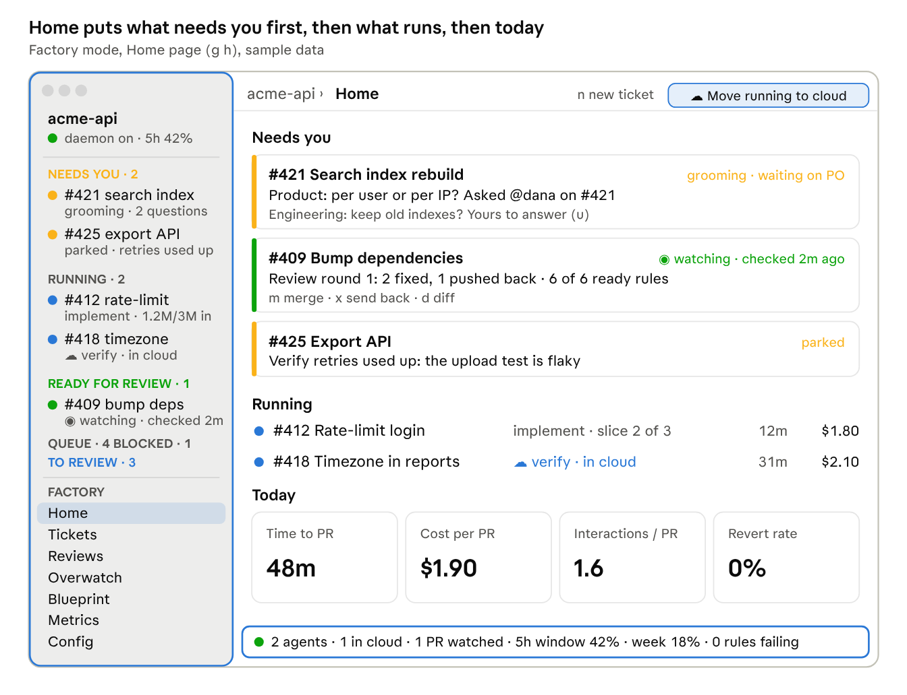
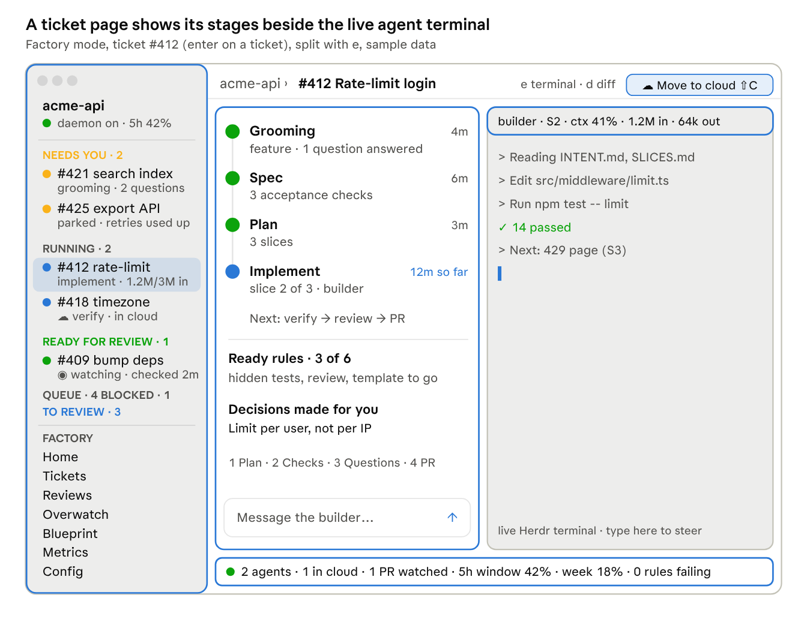
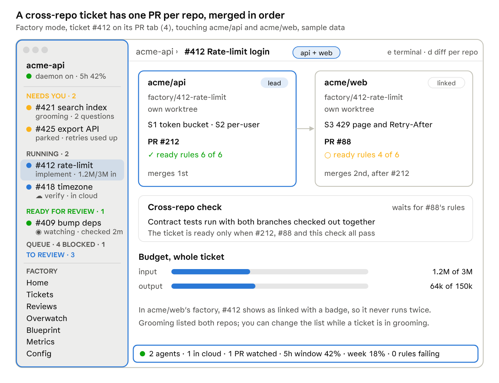
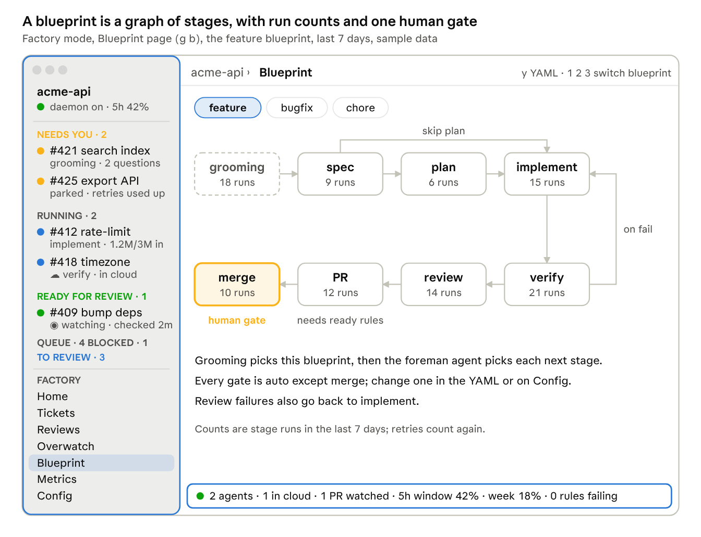
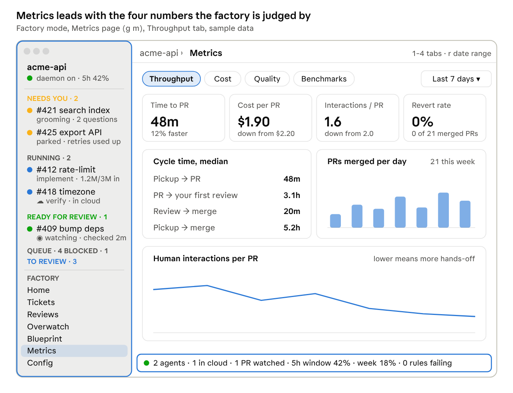
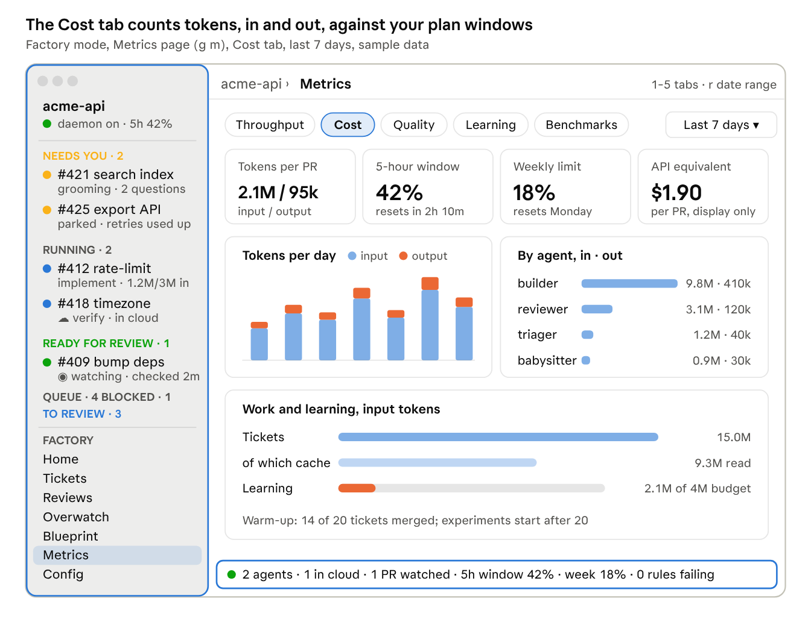
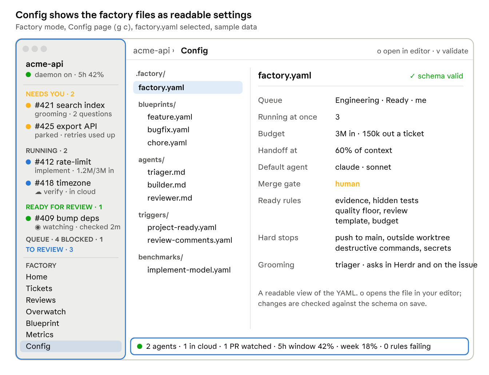
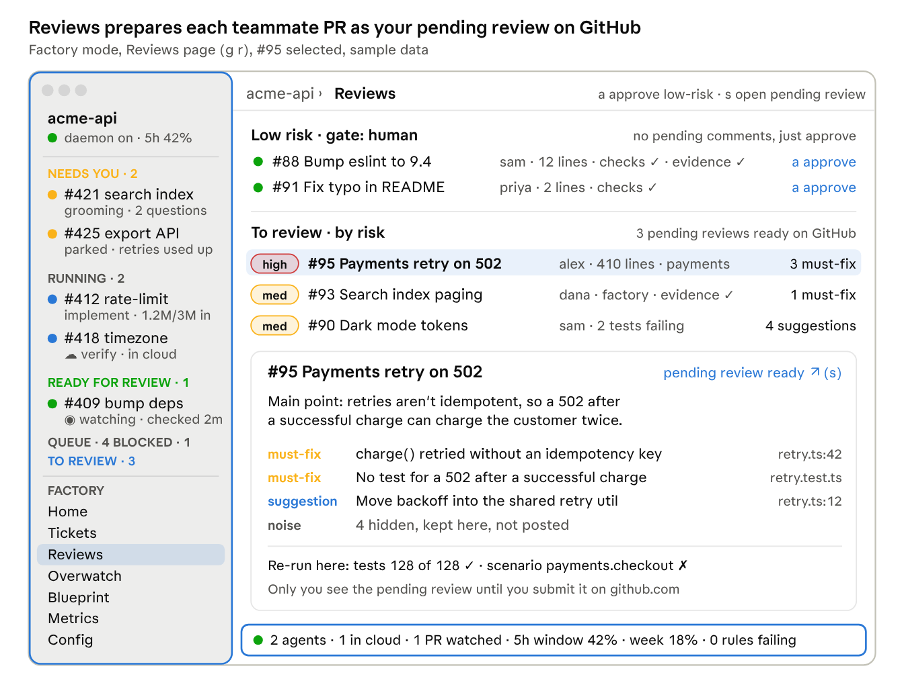
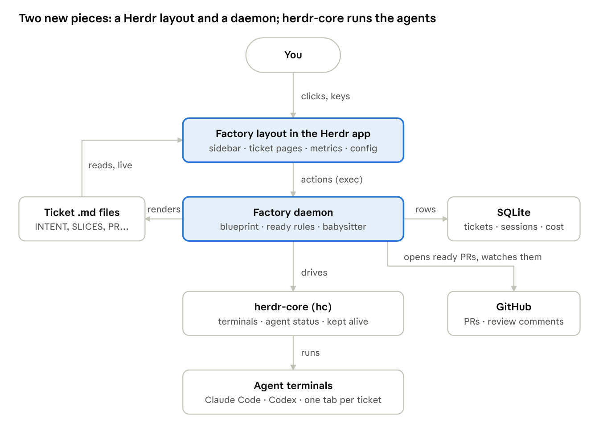

# Factory herdr mod plan


## TL;DR

Build the software factory as a Herdr app layout with its own mods, plus a small local daemon. It does not need a desktop app of its own.

- **Autonomous by default.** A ticket runs from pickup to a PR ready for review without waiting on anyone. Ready rules decide when a PR is ready, not approvals. Your default touchpoint is reviewing and merging.
- **The factory is code.** A `.factory/` folder defines it, and its blueprint is a graph of stages that an orchestrator agent moves through.
- **The whole window is ours.** Like [herdr-roundup](https://github.com/carstenlucke/herdr-roundup), the layout clones Herdr's sidebar, tabs, pane header and status bar and rebuilds them into a factory mode: a sidebar of live tickets with the factory menu at its foot, and pages for Home, a ticket, Tickets, Reviews, Overwatch, Blueprint, Metrics and Config.
- **Markdown in front, code behind.** Every view shows a ticket's Markdown; the diff and the agent terminals are one key away.
- **Measured.** Time to PR, cost per PR, human interactions per PR and revert rate are on screen, and benchmarks replay your own past tickets.
- **Local first, in a new repo.** Everything runs on your machine through herdr-core; a ticket can move to a Claude Code cloud session when the laptop sleeps. The repo is separate from flow-stack and copies the parts of flow-stack v1 that check finished work.

The PRD changes in one place: section 7.2's "Ship as a desktop app" becomes "Ship as a Herdr app layout plus a daemon".

## Decisions this plan settles

Earlier drafts and the research pulled in different directions. Each clash is settled here, and the rest of the doc follows these answers.

| Clash | Settled as |
| --- | --- |
| Human approval gates (spec, PR, approve in an inbox) vs. an autonomous factory | Autonomous after grooming. Questions are settled while the ticket is groomed; after that it runs to a ready PR without stopping, and you merge |
| A fixed list of stages vs. Warp's graph of stages | A graph. Each stage lists the stages that may follow, and an orchestrator agent picks one |
| Keep Herdr's shipped sidebar vs. our own | Our own. Shipped mods are cloned under a `factory-` prefix and rebuilt, as herdr-roundup does |
| Reuse flow-stack's task folders vs. a new repo | A new repo. flow-stack parts are copied in; its task folders are only test data for M1 |
| "Agents write their state to Markdown" vs. "only the daemon writes .md" | Agents write their prose outputs (INTENT, SLICES, PR). The daemon writes the state files (STATUS, EVIDENCE, GATES, REVIEW) from SQLite rows |
| A separate inbox mod vs. fewer mods | No inbox mod. "Needs you" is the top of Home, with a badge in the sidebar |
| Autonomy levels L0–L5 per loop vs. ready rules | A gate per blueprint stage, human or auto; merge is human by default. No GitHub labels anywhere. L0–L5 stays as the PRD's vocabulary |
| Quiet hours that hold gates overnight | Dropped. Nothing waits on a gate, so there is nothing to hold |
| Factory as code described in two sections | One section |
| Labels to start and route work vs. no labels | Your GitHub Project is the queue: an issue assigned to you in its Ready column joins it, or you add one by hand. The triage agent picks the blueprint |
| Benchmarks that propose factory changes vs. monitoring | Benchmarks are monitoring: they run apart from ticket runs and only report. Separately, the factory tunes the settings you mark tunable, between tickets, as overrides you can undo |
| Copy Warp's layout and page names vs. our own | Our own. The sidebar lists live tickets with the factory menu at the bottom, one factory per window, and the pages use our words (Tickets, Reviews, Overwatch, Metrics, Config). Warp was a reference for ideas only |

## Principles

1. **Markdown in front, code behind.** You manage work, not files. Every view shows a ticket's Markdown. The diff opens in Herdr's shipped `changes` panel with `d`, and the agent terminals with `e`.
2. **Rules, not approvals.** The factory never stops to ask permission for reversible work. It checks the result at the end of each stage, and a failure goes back to the agent. You see work only when it is ready, or when the factory is truly stuck.
3. **The factory is code.** `.factory/` defines everything the daemon does. You change it like any other code. Only the maintainer edits it, when you ask, through a PR; otherwise the factory only tunes settings you mark tunable, as overrides kept outside it.
4. **Measure everything.** Every session is recorded against its ticket. Four numbers are always on screen: time to PR, cost per PR, human interactions per PR and revert rate.

## Layout design

The factory is one Herdr app layout, `layouts/factory.json`, and it replaces the whole window, not just the panes. Herdr's own docs say nothing in its default interface is special: the spaces sidebar, the agents list, the tab bar and the status bar are mods like any other. herdr-roundup proves it, with cloned spaces, tabs, pane header, menu and confirm mods. `cmd-shift-f` switches between this layout and Herdr's normal one.

Factory mode has its own shape and its own words. Warp's app was a reference for ideas (a stage timeline per ticket, a metrics page), not a template. What makes it a Herdr mode:

- **It's a mode.** `cmd-shift-f` switches between factory mode and Herdr's normal window. Both show the same spaces, agents and terminals, so nothing is lost by switching.
- **One factory per window.** The factory is the repo of the space you're in; switching spaces with Herdr's own picker switches factories. There is no list of factories.
- **Agents are live, not transcripts.** A ticket's page splits to show its real agent terminal, and you can type into it. Overwatch is a Herdr terminal too.
- **Herdr's agent status stays.** Every ticket row carries Herdr's working, blocked, idle or done dot.
- **Keys first.** Every page and action has a key in the layout's own section of `keys.json`, and the layout ships its own theme.
- **Herdr's notifications.** A new Needs you item is a Herdr toast; clicking it opens the ticket.

The window has four parts:

- **Sidebar.** At the top, the factory's name, whether the daemon is running, and today's spend. In the middle, the live tickets grouped as Needs you, Running, Ready for review and Queue, then To review (teammates' PRs waiting on you), each row with its title, stage, cost and agent dot. At the bottom, the factory menu: Home, Tickets, Reviews, Overwatch, Blueprint, Metrics, Config. At the foot, the day's budget bar.
- **Header bar.** Where you are (`acme-api › Blueprint`) and the page's keys.
- **Main area.** A `stack` block that shows one page, switched with `layout.select`.
- **Status bar.** Running agents, PRs ready, spend against budget, and ready rules failing now.

### Pages

Each page is drawn below the table. All share one sidebar.

| Page | What it shows |
| --- | --- |
| Home | Needs you first (grooming questions, PRs ready to merge, parked tickets), what's running, and today's four numbers |
| Ticket | One ticket: its stage timeline (STATUS.md, HANDOFF.md), each stage with a plain summary, time and agent; ready rules; decisions made for you; once a PR exists, its watched badge and review rounds; a box to message the session running now. `e` splits in the live agent terminal; `1`–`4` show Plan, Checks, Questions and PR |
| Tickets | Every ticket, merged ones included, filtered by state and searchable. Its Runs view (press r) lists every agent session instead: stage runs, babysitter fixes, maintenance and benchmark runs, each with its time, cost and transcript |
| Overwatch | The overwatch agent (PRD 7.1) in a live Herdr terminal: ask what's blocked, start, pause or reorder tickets, and ask for changes to the factory, which it hands to the maintainer |
| Blueprint | Each blueprint as a graph, with run counts and gates per stage; `y` shows its YAML |
| Metrics | Throughput, Cost, Quality, Learning and Benchmarks tabs over a date range |
| Config | The `.factory/` files: a list, a readable view of the one selected, its schema check, and `o` to open it in your editor |
| Reviews | Teammates' PRs waiting on you, by risk, fast lane on top. Opening one shows what the factory found, the independent check results, and a link to your pending review on GitHub, where you finish and submit it |

**Metrics.** Throughput: time to PR, human interactions per PR, PRs merged, and cycle time split into pickup to PR, PR to your first review, and review to merge. Cost: cost per PR, spend per day against budget, spend by agent and model. Quality: revert rate per blueprint, ready rules passing on the first try, retries per ticket. Learning: the target over time, each tuning shift with an undo, experiments, the lesson store. Benchmarks: the latest report per stage and per blueprint.

#### Home



#### Ticket



#### Ticket, cross-repo



#### Tickets


#### Overwatch


#### Blueprint



#### Metrics



#### Metrics, Cost tab



#### Config



#### Reviews



### The mods

All mods carry a `factory-` prefix, since a mod folder's name is its identity in Herdr. A cloned mod starts from Herdr's with `mod.clone`, and the repo records which Herdr version it came from.

| Mod | Starts from | What it does |
| --- | --- | --- |
| `factory-chrome` | Herdr's `workspace-chrome` | Brand row (factory, daemon status, spend) and the budget bar |
| `factory-tickets` | Herdr's `spaces` | The sidebar's ticket groups |
| `factory-menu` | new | The factory menu at the bottom of the sidebar |
| `factory-header` | Herdr's `tabs` | Breadcrumb and page keys |
| `factory-status` | Herdr's `workspace-status` | The status bar |
| `factory-pane` | Herdr's `pane` | Header on agent terminals: ticket, stage, context fill, cost |
| `factory-home` | new | Home |
| `factory-ticket` | new | A ticket's page, rendered with `TextView.markdown` |
| `factory-list` | new | The Tickets page |
| `factory-blueprint` | new | Blueprint graphs and their YAML |
| `factory-metrics` | new | The five Metrics tabs |
| `factory-config` | new | The Config page |
| `factory-reviews` | new | The review queue, each PR's findings and check results, and the link to its pending review |

Overwatch needs no mod: it's a Herdr terminal running the overwatch agent, with `factory-pane` on top. Shipped `changes`, `files` and `agents` stay as they are.

### Keys

Every action is a click or a key, and each one is a single call to the daemon. The mods hold no state beyond what is selected.

| Key | Does |
| --- | --- |
| `cmd-shift-f` | Switch to factory mode and back |
| `g h`, `g t`, `g o`, `g b`, `g m`, `g c` | Home, Tickets, Overwatch, Blueprint, Metrics, Config |
| `j` / `k`, `enter` | Move through tickets, open one |
| `e` | The ticket's live agent terminal |
| `d` | The ticket's diff, in Herdr's `changes` panel |
| `n` | New ticket: an issue link or a one-line goal |
| `m` / `x` | Merge a ready PR (after a confirm) / send it back with a note |
| `u` | Answer a question and restart a waiting ticket |
| `p` | Pause or resume a ticket |
| `shift-c / shift-l` | Move the ticket to a cloud session / bring it back to local |
| `g r, then a / s` | Reviews; approve a low-risk PR / open the pending review on github.com |
| `b` | Change the ticket's budget |

## Architecture

Only two pieces are new: the layout with its mods, and the daemon. herdr-core runs every terminal and agent, and everything you read is a .md file under the ticket's folder.



The mods never talk to agents. They read the ticket folders and a `status.json` the daemon keeps up to date, wake on changes with `watchFolder`, and send every action to the daemon. The daemon is the one place that knows a ticket's state, so the window stays replaceable.

## Technical design

### Seamless handoff between sessions

A session never runs until it's full. When it reaches the handoff threshold, the next session picks up without you noticing anything but a counter.

1. **Watch.** The daemon reads each session's context use from Claude Code's status-line data (the same source herdr-roundup's context meter uses), plus the PreCompact hook as a backstop.
2. **Ask at a step boundary.** At the threshold (60% by default) the daemon sets a handoff flag. A narrow hook then lets the current tool call finish but refuses the next edit with "handoff requested: write HANDOFF.md now". The session never stops mid-edit.
3. **A fixed handoff format.** HANDOFF.md has required sections: goal, done, in progress (file, function, uncommitted diff), next step, open decisions, commands to re-run, gotchas. The daemon checks the sections are filled and asks once more if not. It also commits work in progress to the ticket branch.
4. **Start the next session.** Same worktree, same Herdr tab. Its brief is fixed and small: HANDOFF.md, the current slice from SLICES.md, INTENT's acceptance checks, `git diff --stat`, and the last check output. Its first action is to re-run the current check, so it starts from what's true, not what the last session believed.
5. **Cache-friendly order.** Every brief puts the stable parts first (role prompt, agent pack, repo map) and the ticket's parts last, so successive sessions reuse the cached prefix.
6. **What you see.** The pane header says "session 3 of #412", the timeline shows "handoff at 60%", and Runs keeps every session's transcript and tokens.

If a session hits a hard ceiling (80%) before handing off, the daemon stops it and builds the brief from its last commit and the PreCompact snapshot instead.

### What the learner learns, and how it works with the maintainer

The learner tunes decisions the factory makes over and over. Each one is logged with its context and its outcome, so it can be compared.

| Decision | Options it tries | Context it uses |
| --- | --- | --- |
| Model per stage | cheap, mid, strong per agent | blueprint, ticket size, area of the code |
| Verify depth | affected tests, feature scenarios, full suite | files touched, past reverts in that area |
| Context loaded at start | which files and lessons | stage, area |
| Handoff threshold | 50%, 60%, 70% | stage, model |
| Path through the blueprint | skip plan or not, extra review | ticket size, past rework |
| Review comment verdicts | how strict the noise filter is | reviewer, area |
| Grooming estimates | `headroom` for the ticket budget | blueprint, estimate error so far |

Each decision is a row: what was decided, the options, the choice, the context, and later its outcome (tokens, time, rework, ready-rule first-try pass, revert). The reward is your `learn.target`, under the quality floor.

**The learner decides; the maintainer writes.**

- Within `learn.tunable`, the learner changes settings itself, as overrides in SQLite, between tickets. No files change.
- When an override has held for `learn.promote_after` tickets (default 30), the learner files a maintainer request to make it permanent. The maintainer writes it into `.factory/` and opens the PR.
- Anything outside the tunables (a prompt change, a lesson that should be a lint rule or test, a new stage) is a suggestion. The learner files it as a maintainer request with its evidence; the maintainer drafts it, runs a benchmark against the current setup when it can, and opens the PR.
- The learner never writes files and the maintainer never decides a setting by itself, so every change has one source of evidence and one reviewable diff.

### Storage and dependencies

One SQLite file is enough for one person's factory on one machine.

- **One writer.** Only the daemon writes, through a single queue; agents report through the `factory` CLI, which talks to the daemon. WAL mode lets the mods and overwatch read while it writes.
- **Big things stay as files.** Transcripts stay where Claude Code writes them; screenshots, logs and benchmark output go under `~/.factory/<repo>/`. SQLite stores paths, not blobs.
- **What's in SQLite:** tickets and their states, sessions, runs and their tokens, decisions and outcomes, review rounds and verdicts, overrides, lessons and the queue. Full-text search over lessons and reviews uses FTS5; lessons are found by code area first, so no vector store is needed to start.
- **Scale.** Thousands of tickets and millions of rows are well within SQLite's range at a few writes per second.
- **Backups.** A nightly copy of the file, and schema migrations run by the daemon at start.

**Dependencies:** the Herdr app and herdr-core, git, the GitHub CLI, the Claude Code CLI (and any other harness you use), and the daemon itself as one binary. No Docker. Docker or another container runtime becomes optional later for two things only: sandboxing agents, and a shared team server (where SQLite would give way to Postgres).

## Autonomy: ready rules, not approvals

Once a ticket is groomed, the factory runs it to a ready PR on its own. What keeps that safe is a set of rules checked by the daemon, not a person approving each step.

**Ready rules.** A PR opens only when every rule passes. A failed rule sends the ticket back to the stage that can fix it, never to you.

- Every acceptance check has a PASS recorded after the last edit.
- The hidden tests written by the checker agent pass.
- The quality floor holds: the checks no change may break.
- The reviewer agent reports no blockers, decided by majority vote.
- PR.md follows the readable template (PRD 6.3).
- The ticket stayed within its budget.

**Grooming is the one stop.** As soon as an issue lands in your queue, the triage agent grooms it: it reads the ticket and the code, picks a blueprint, and lists open questions. The questions appear in Needs you and as a comment on the GitHub issue; an answer in either place counts, and the other is updated. The ticket waits until every question is answered, and you can change the blueprint it picked meanwhile. After grooming it runs to a ready PR without stopping. A question that only appears mid-run gets a best guess, recorded in GATES.md and listed in PR.md under "Decisions made for you".

**Product questions are never ours to answer.** Grooming sorts every question into one of two kinds:

- **Product** (what to build, for whom, what the user sees, pricing, wording, scope): it goes to the ticket's product owner as a comment on the issue, mentioning them, and shows in your Needs you as waiting on the PO. The factory never guesses one, not during grooming and not mid-run. A product question that turns up mid-run parks the ticket.
- **Engineering** (how to build it): it comes to you. During grooming the ticket waits for your answer; mid-run the agent takes its best guess and lists it under "Decisions made for you".

The product owner is the issue's author unless the Project has a PO field; `grooming.product_owner` in `factory.yaml` can name one per repo.

**Hard stops.** Only these are blocked on every action, because their damage can't be undone: pushing to main, writing outside the ticket's worktree, destructive commands (flow-stack v1's guard list), and secrets in output. Agents can't push at all; only the daemon opens PRs, and only when the ready rules pass. The daemon enforces the stops `factory.yaml` lists for local Claude sessions with a PreToolUse hook (`daemon/guard.ts`); a hit blocks the action, kills the session and parks the ticket. The checks are patterns on the tool's input, so they catch the usual ways, not every way. Codex sessions and cloud runs aren't covered: they get the stops in their brief only.

**Escalation.** A ticket parks in Needs you only when it is truly stuck: retries used up, budget reached, a hard stop hit, or a ticket the agent can't make sense of. Other tickets keep running.

| You touch the factory when | How often |
| --- | --- |
| A PR is ready: review it, then merge (`m`) or send it back with a note (`x`) | Every PR, unless its blueprint's merge gate is auto |
| A ticket is parked: answer it and restart (`u`) | Only when stuck |
| A benchmark shows a better setting: you edit `.factory/` | When you choose |
| The day's budget is used up: raise it or wait | Rarely |
| A ticket in grooming has questions: answer in Herdr or on the issue | Once per ticket, only if it has questions |

**Every gate is yours to set.** Each blueprint stage has `gate: human` or `gate: auto`. Merge is `human` in every shipped blueprint. Set it to `auto` on a blueprint for chores, say, and its ready PRs merge themselves. The factory warns when you turn a gate to auto and shows that blueprint's revert rate on Home, but it never refuses.

## Worktrees and sessions

**One isolated worktree per ticket.** When grooming finishes, the daemon creates a worktree on a ticket branch (`factory/412-rate-limit`) through Herdr's worktree support, nested under the repo's space. Every session for that ticket works there and nowhere else; no two tickets ever share one. Benchmark replays get their own throwaway worktrees. The worktree is removed after the PR merges or the ticket closes; the branch and the ticket's .md files stay.

**A fresh session for every unit of work, never one long chat.** Long sessions get slow, expensive and confused, so the factory never keeps one going:

- Each stage run, each slice of implement, and each review round starts a new agent session.
- A new session starts from files, not chat history: TICKET, INTENT, SLICES, HANDOFF and the diff so far. It loads only what its agent's `context` lists.
- A session that reaches the handoff threshold (60% of context by default) writes HANDOFF.md and stops; the next one picks up from there.
- The follow-up box on a ticket page messages the session running now. Your message is also appended to HANDOFF.md, so the next session sees it too.
- Sessions for one ticket run one at a time in its worktree. The Runs view lists every one, with its cost and transcript.

## Watching PRs

You can always tell what the factory is watching and what it has done:

- **Watched badge.** A ticket whose PR the babysitter watches shows an eye badge and when it last checked ("watching · checked 2m ago") in the sidebar, on Home and on the Tickets page. The status bar counts watched PRs. If checks stop (laptop asleep, daemon down), the badge turns grey and says since when.
- **Review rounds.** The ticket page gets a Review section, and the Tickets page a Rounds column. Each round lists its comments with their verdicts (fixed, pushed back, escalated), the commit that fixed each one, and the ready-rule result before the push. REVIEW.md keeps the same record by round.
- **On the PR itself.** Each round ends with one summary comment on the PR: what was fixed and in which commit, what was pushed back and why.

## Ticket lifecycle

A ticket is in one state at a time: grooming, queued, running, blocked, parked, ready, merged or closed. The sidebar shows Blocked as its own group. Tickets change after pickup, and the factory follows the change instead of finishing the wrong work.

- **Split.** Grooming, or any stage later, can find that a ticket is really several. It proposes sub-tickets with their scope and order, as GitHub sub-issues. Creating them is a gate (`tickets.split: human` by default; `auto` creates them itself). Work already done stays on the branch and moves to the sub-ticket it belongs to; the parent closes when all its children merge.
- **Blocked late.** If the issue gains a "blocked by" link, or an agent finds the ticket depends on unmerged work elsewhere, the ticket stops at the next step boundary: the session writes HANDOFF.md and ends, the worktree and branch stay, and the ticket shows "blocked by #430". It resumes by itself when the blocker merges. If the PO never marked the dependency, the factory comments on the issue so the board catches up (`tickets.notify_po: human` by default, so you see the comment first).
- **Scope changed.** If the issue's description or acceptance criteria change after pickup, the daemon compares them with INTENT.md. A real change sends the ticket back to grooming with the difference as questions; a cosmetic edit is noted and ignored.
- **Pulled back.** If the issue leaves the Ready column, is unassigned or closed, the ticket stops and asks you whether to keep or drop the branch.

## Cross-repo tickets

Some tickets touch more than one repo, say an API change and the web page that uses it.

- **Grooming finds the repos.** It lists every repo the ticket touches, from the issue and the code; you can change the list while the ticket is in grooming. Repos must be listed under `repos` in `factory.yaml`.
- **One lead repo.** The ticket lives in the factory of the repo whose Project it came from. The other repos show it as linked, with a badge, so it never runs twice.
- **One worktree and one PR per repo,** all on the same branch name, each PR linking the others. Each PR has to pass its own ready rules.
- **A cross-repo check.** The ticket's `ready` adds one check across the repos: the contract or integration tests run with every branch checked out together.
- **Merge order.** The plan records which PR merges first (usually the API before its user). The ticket is ready only when every PR is; the PRs are listed in that order on the ticket page.

## Closing the review loop

PRD 6.5, the authoring side. Nobody copies review comments into a session.

1. **Watch.** The babysitter polls every PR the factory opened and picks up new review comments, as a `pr_review_comment` trigger.
2. **Judge each comment.** Three questions decide the verdict: is it correct, is it required, how risky is it. A cheap model judges each comment seeing only the comment and the lines it points at; a product question goes to the PO. The verdict is **fix**, **push back** (a reply with the reasoning), or **escalate** (it goes to Needs you). Each comment and its verdict lands in REVIEW.md.
3. **Fix.** Never by resuming the session that wrote the PR. Once its prompt cache has expired (5 minutes by default, an hour at most), resuming it re-reads its whole history at full input price to change a few lines. Instead the daemon writes a fix brief, REVIEW-ROUND-2.md, with only the comments marked fix: the reviewer's words, file and line, the diff hunk, and the acceptance check each one touches. A fresh session starts in the ticket's worktree, updated to the PR branch, and loads the brief, the touched files and a short HANDOFF summary. Its model matches the work: a cheap one for renames and wording, the builder's for logic. The affected tests and ready rules run before anything is pushed. Each round has its own token cap (`review.round_budget`, a share of the ticket's budget); a round that reaches it parks instead of growing.
4. **Insistence.** After `review.max_pushbacks` (default 2), the factory makes the change the reviewer asked for. If that change breaks a ready rule, it keeps it on the branch, does not push a failing PR, and parks the ticket in Needs you with the failing check, so you decide. It defers on opinion, never silently on quality.
5. **Learn.** A comment that keeps coming up across PRs feeds the learning loop below.

Reviewing teammates' PRs (PRD 6.6) is the next section; it reuses the same verdicts and evidence format.

## Reviewing teammates' PRs

PRD 6.6, the reviewer side. The factory makes a lot of PRs, and so do your teammates; reviewing them is where your time goes. The factory prepares every review so you only read, adjust and submit.

**Intake.** The daemon uses the GitHub CLI to learn your teams and teammates (`gh api user/teams`, then each team's members), refreshed daily. Your review queue is:

- every PR that requests a review from you or one of your teams, and
- every open PR by a teammate in the factory's repos.

**Prep, as soon as a PR arrives.**

1. Check it out in its own read-only worktree, never one a ticket uses.
2. Read the PR and its evidence pack, if the author used a factory. That evidence is verified by re-running it, never trusted.
3. Re-run the checks independently: the affected tests, the feature scenarios it touches, lint.
4. A reviewer agent, built from your own reviewer pack (your taste plus examples of your past review comments), sorts findings into must-fix, suggestion and noise. Noise is hidden but kept.
5. Add the findings worth posting to your pending review on the PR, and keep the full record, noise included, in REVIEW-DRAFT.md.

**Output: a pending review on GitHub, as you.** The findings you'd want are added to a pending review under your account: inline comments on the right lines, and a summary with the main point first. A pending review is visible only to you until it's submitted, so you open the PR on github.com, edit or delete comments, pick approve, request changes or comment, and submit it yourself. Noise never makes it into the pending review; it stays in Herdr if you want to look.

**Low-risk PRs.** The queue is sorted by a risk score: size, sensitive areas touched, failing checks, missing evidence, an author new to the area. A PR under the low-risk bar gets no pending comments at all, just a one-screen summary. What happens next is a gate you set:

- `human` (default): you approve it, on github.com or with `a` in Herdr.
- `auto`: the factory submits an approving review as you, with a one-line summary. It warns you when you turn this on and shows how many auto-approved PRs were later reverted, but it never refuses.

```yaml
# .factory/factory.yaml
review:
  queue: [requested, teammates]   # PRs asking for you or your teams, plus teammates' PRs
  output: pending_review          # findings land as your pending review on GitHub
  low_risk:
    gate: human                   # human: you approve. auto: the factory approves as you
    max_lines: 80
    requires: [checks_pass, evidence_verified]
  never_low_risk: [auth, payments]
```

**It learns from what you submit.** When you submit, the daemon compares your final review with the pending one: which comments you kept, edited or deleted, what you added, and the verdict you chose. That trains the noise filter (a candidate for a small trained model, PRD 6.11) and your reviewer pack, with no extra step from you. Metrics shows how often comments survive unchanged, and your review minutes per day against `attention.review_minutes_per_day`.

When teammates run the factory too, the shared evidence format means more of their PRs fall under the low-risk bar.

## Learning loop

PRD 6.4 and 6.11. The factory tunes itself, but only inside limits you set.

- **You pick the target.** `learn.target` in `factory.yaml`: cost per PR, time to PR, human interactions per PR, or review rounds per PR (written `cost_per_pr`, `time_to_pr`, `interactions_per_pr`, `review_rounds_per_pr`).
- **You pick what it may change.** `learn.tunable` lists the settings it may move, such as the model per stage, how deep verify goes, and how much context loads at start. Prompts, gates, blueprints, ready rules and hard stops are never tunable.
- **A ticket's settings are fixed when it starts.** Nothing changes mid-run. Tuning happens between tickets: like a bandit experiment, the daemon tries a few values on similar tickets, compares them on the target, and shifts toward the winner.
- **The quality floor holds.** A setting that lowers ready-rule pass rates or raises the revert rate loses, however cheap it is.
- **Tuned values live outside `.factory/`.** They are overrides in SQLite, so the files stay yours. Config shows each override next to the file's value, `z` undoes one, and `factory learn export` writes them into a PR if you want to keep them.
- **Every decision is logged from day one,** with its outcome, as flow-stack's decisions table does. The same log feeds handoffs and tuning.
- **Lessons without prompt bloat.** A repeated review comment or failure becomes a suggested lint rule, test or scenario, which you merge like any PR. What can't be a check goes into a lesson store scoped to an area of the code, loaded only when a ticket touches that area. The daemon merges duplicate lessons and retires ones that never fire.
- **Small trained models later.** Once a narrow, repeated decision has thousands of labelled examples (the review-comment verdict, routing to a cheap or strong model, choosing which tests a change needs), a small classifier can replace the heuristic, under the same floor.

The Learning tab on Metrics shows the target over time, each shift with its evidence and an undo, running experiments, and the lesson store.

## Budgets

Budgets are counted in tokens, input and output separately, not dollars. On a Pro, Max or Enterprise subscription, an API-price estimate doesn't tell you how much of your 5-hour or weekly limit a ticket used, so dollars stay a display only: the API-equivalent cost shown beside the tokens. Every ticket has its own budget, and learning has a separate one, so the factory can't spend its way through your limits while it's still finding good settings.

- **Input and output, counted apart.** Output tokens cost more and run out faster, so each budget has both. Cache reads are counted as input but shown separately, since a well-cached session reads far more than it writes.
- **Your plan limits are a guard of their own.** The daemon reads the agents' own usage reports (the way herdr-roundup's pane header shows Claude Code and Codex plan limits) and knows where your 5-hour and weekly windows stand. When the 5-hour window passes `plan.pause_at`, nothing new starts and running tickets finish their current stage; the status bar shows when the window resets. On API keys this guard is off and the dollar estimate is exact.
- **A budget per ticket.** Grooming estimates a ticket's input and output tokens from past tickets on the same blueprint, and sets its budget to that times `headroom`. You can change it during grooming, or later with `b` on the ticket page. The sidebar and ticket page show use against it.
- **What happens at the limit.** At 80% the ticket shows a warning. At 100% it stops at the next step boundary, never mid-edit, and parks in Needs you: raise the budget or drop the ticket.
- **A daily cap,** also in tokens: when it's reached, nothing new starts.
- **A separate learning budget.** Experiments and benchmarks spend only from `budget.learning`, never from a ticket's budget. The first `learn.warmup_tickets` tickets run on defaults with no experiments, only logging. Experiments also pause when the 5-hour window or the day's budget passes `learn.pause_above`. The Cost tab shows work and learning use apart.

```yaml
# .factory/factory.yaml
budget:
  per_ticket: { input: 3M, output: 150k }   # the default; grooming sets each ticket's own
  headroom: 1.5
  per_day: { input: 40M, output: 2M }
  learning: 10%            # of per_day, for experiments and benchmarks only
  show_cost: api_equivalent
plan:
  pause_at: 85%            # of the 5-hour window; ignored on API keys
learn:
  warmup_tickets: 20
  pause_above: 70%         # of the 5-hour window or the day's budget
```

## First run: setup and migration

The first time factory mode opens in a space with no `.factory/` folder, it runs setup instead of Home. Every step can be skipped and rerun later from Config.

1. **Check the tools:** herdr-core, the GitHub CLI and its login, and at least one agent harness. Each missing one gets its install command.
2. **Start the daemon** as a login item (`factory service install`: a per-user launchd LaunchAgent with KeepAlive), so the babysitter and triggers keep running with the window closed.
3. **Connect the queue:** pick the GitHub Project, its Ready column and the assignee.
4. **Choose the basics:** budget per ticket and per day, the merge gate, `max_running`, the learning target and tunables.
5. **Write `.factory/`** with the default blueprints and agents, show the files, and commit them to a branch when you agree.

**Migrating from flow-stack.** Setup looks for `~/.flow-stack/profile.md`, a `.flow/` folder in the repo, and the flow-stack plugin. If it finds them, it offers to copy:

| From flow-stack v1 | Into the factory |
| --- | --- |
| Profile taste and rules | The agent prompts and `factory.yaml` |
| `.flow/lessons.md` | The lesson store, scoped by area where it can tell |
| The decisions table and traces | The decision log, so learning starts with history |
| Calibration | Default budgets |
| `.flow/features/` and verify drivers | Used as they are by the verify stage |
| Past task folders | Merged tickets on the Tickets page |

It copies and changes nothing in flow-stack, which keeps working for your normal sessions. Factory worker sessions start without the flow-stack plugin, so its hooks never run inside the factory.

## Changing the factory: Overwatch and the maintainer

You change the factory by asking for it. Overwatch is where you ask; the **maintainer** is the agent that does the work. It is separate from PRD 7.5's maintenance agent, which looks after the repo's code; the maintainer looks after the factory itself.

**Overwatch sorts every request.** A question ("what's blocking #425?") it answers itself. A ticket action (start, pause, reorder) it sends to the daemon. A change to the factory it turns into a maintainer request, listed on Tickets with a factory tag and on Config under Pending changes.

**What the maintainer handles:**

- **Configuration:** budgets, gates, `max_running`, tunables, the queue.
- **Rules:** a new ready rule, hard stop, lint rule or never-unattended area.
- **Blueprints and agents:** a new blueprint, a new stage, a new agent or a change to one's prompt.
- **Migrations:** importing old Claude Code sessions into Runs and the decision log, migrating flow-stack's lessons, profile and playbooks (each built-in or repo playbook becomes a blueprint draft), and later, moving between versions of the factory's own schema.

**Every change is a PR against `.factory/`.** The maintainer works in its own worktree, writes the files, runs the schema check, and for a blueprint does a dry run: it replays a few past tickets through the new graph and reports which path each took. The Blueprint page shows the draft graph beside the current one. Merging is a gate: `maintainer.gate: human` by default; small changes such as a budget can be set to `auto`.

**Adding your own blueprint** works either way:

- **Ask Overwatch:** "add a blueprint for database migrations with a human gate before the migration runs". The maintainer drafts `blueprints/db-migration.yaml` and any new agents, dry-runs it, and opens the PR. Once merged, it joins `grooming.blueprints`, so grooming can pick it.
- **Write it yourself:** `n` on the Blueprint page starts from a template and opens it in your editor; the schema check runs on save, and the draft graph updates as you type.

**First run is a conversation.** Setup (above) runs in Overwatch, and the maintainer does each step: "migrate my flow-stack playbooks", "import last month's sessions", "set budgets like my old calibration". Each one becomes a maintainer request, so setup leaves the same reviewable PRs as any later change.

Maintainer work counts against the daily budget and shows as its own line on the Cost tab.

## Local and cloud

Everything runs locally by default, so a sleeping laptop stops running tickets and the babysitter. Claude Code can also run sessions in the cloud, so the factory can hand a ticket over and take it back.

- **Move to cloud.** On a ticket page, `shift-c` commits the work in progress to the ticket's branch, pushes that branch (never main), and starts a Claude Code cloud session from it with HANDOFF.md as its brief. The ticket shows a cloud badge.
- **Bring back.** `shift-l` waits for the cloud session to stop at a step boundary, fetches the branch into the ticket's worktree, imports what the session wrote, and resumes locally with a fresh session.
- **Everything at once.** On Home, "Move running tickets to cloud" does it for every running ticket, for when you close the laptop. An optional setting does it automatically when the machine is about to sleep, and brings tickets back when it wakes.
- **Watching while asleep.** A scheduled cloud agent can watch factory PRs and handle review rounds while the laptop sleeps, using the same verdict rules.
- **What travels.** The branch, HANDOFF.md and the ticket's .md files, committed under `.factory-run/<ticket>/` on the branch and removed before the PR is marked ready. SQLite stays local: on return, the daemon reads that folder back into rows, including cost.

Cloud runs keep the same gates, ready rules and hard stops.

## Away mode

When tickets run in the cloud and you're away, nobody is there to ask, so the agents have to carry your judgement with them. The babysitter does most of the unattended work (review rounds, fixes, pushbacks), so most of this is about the babysitter.

- **An agent pack per ticket.** Before a ticket moves to the cloud, the daemon assembles each agent's prompt in layers: the role prompt, your taste and rules (from `factory.yaml`, or your flow-stack profile after migration), the repo map, the lessons for the areas this ticket touches, and, for the babysitter, a few of your own past review verdicts on similar comments as examples. The pack is written to `.factory-run/<ticket>/agents/` on the branch, so the cloud runs exactly the agents your laptop would. It's assembled per ticket, never appended to, so prompts don't grow.
- **The babysitter is checked against you before it runs alone.** A benchmark replays your past review comments and measures how often the babysitter's verdict (fix, push back, escalate) matches yours. Below the threshold (`away.min_agreement`, default 85%), it may not push back while you're away: it only fixes clear-cut comments and escalates the rest. The agreement rate is on Metrics.
- **A stricter policy while away.** `away:` in `factory.yaml` narrows what runs unattended: which blueprints, a lower budget, how many review rounds, and areas that never run unattended (auth, payments). Grooming questions still wait for you, and merge stays human.
- **A digest when you're back.** Home opens with what happened while you were away: each run, every decision made for you, every pushback and escalation. Correcting a decision there becomes a lesson or a suggested prompt change, so the next pack decides more like you.

The risk is a pack that sounds like you without deciding like you. The agreement benchmark is what catches that, so it ships before cloud handoff does.

## Factory as code: .factory/

The factory is defined by files in the repo it works on, so it can be branched, reviewed, rolled back and changed by a PR like any other code. The daemon reads them and hard-codes nothing. The idea comes from Warp Factories; here everything stays local.

Rules for every file:

- **Checked against a schema.** `factory validate` checks each file kind against its rules (`daemon/validate.ts`), and Config runs it on every save. Unknown keys and duplicate keys are errors, so a typo never silently does nothing. JSON Schemas for editors can be generated from the same rules.
- **Defaults are documented and inherited.** A factory can start from `factory.yaml` alone; every other file states only what it changes.
- **Files refer to each other by name,** never by path: a trigger names a blueprint, a stage names an agent.
- **Secrets by name only.** Values come from the macOS keychain or the environment.
- **The daemon never edits `.factory/`**, and never on its own initiative.

| File | What it holds | PRD |
| --- | --- | --- |
| `factory.yaml` | What the factory covers, defaults, budgets, ready rules, hard stops, merge policy | 4.1, 6.10, 6.11 |
| `blueprint.yaml` and `blueprints/<name>.yaml` | The graph of stages a ticket moves through | 6.1, 6.3 |
| `agents/<name>.md` | One role: a YAML header above a Markdown prompt | 6.2, 6.4, 7.4 |
| `triggers/<name>.yaml` | What starts work, and which blueprint runs | 6.5, 7.5 |
| `benchmarks/<name>.yaml` | A replay suite built from past tickets | 6.11 |

### factory.yaml: the root

| Field | What it sets | Default |
| --- | --- | --- |
| `repos` | The repos this factory may open worktrees in | the current repo |
| `tickets` | Where tickets come from: `github`, `linear`, or a local `TICKETS.md` | `github` |
| `defaults` | Harness, model and effort for any agent that doesn't set its own | `claude`, `sonnet`, `medium` |
| `budget` | Dollar caps per ticket and per day, and the context % that forces a handoff | $5, $50, 60% |
| `ready` | The ready rules a PR must pass | the six above |
| `quality_floor` | Checks no change may break, whatever the benchmarks say | the repo's test command |
| `hard_stops` | Actions blocked every time | the four above |
| `merge` | The merge gate's default, `human` or `auto`; a blueprint can override it | `human` |
| `secrets`, `mcp` | Secret names the agents may use, and MCP servers every agent gets | none |
| `queue` | Your queue: a GitHub Project, its Ready column, and the assignee to watch | none; manual tickets only |
| `grooming` | The triage agent, the blueprints it may pick from, and where questions go | all blueprints; Herdr and the issue |
| `max_running` | How many groomed tickets run at once; the rest wait in Project order | 3 |

```yaml
# .factory/factory.yaml
name: acme-api
repos: [acme/api]
queue: { github_project: acme/Engineering, column: Ready, assignee: me }
grooming:
  agent: triager
  blueprints: [feature, bugfix, chore]   # it picks one per ticket
  questions: [herdr, issue]              # an answer in either place counts
max_running: 3
defaults: { harness: claude, model: sonnet, effort: medium }
budget: { per_ticket_usd: 5, per_day_usd: 50, handoff_at_context: 60% }
ready: [evidence, holdout, quality_floor, review, template, budget]
quality_floor: [npm test, npm run typecheck]
hard_stops: [push-to-main, outside-worktree, destructive-commands, secrets-in-output]
merge: human                             # a blueprint can set its own
secrets:
  GITHUB_TOKEN: { from: keychain, item: factory-github }
```

### blueprint.yaml: the graph

Grooming picks one blueprint per ticket. Inside it, each stage names the agent or check that runs it, the .md file it must write, its gate, and the stages allowed to follow (`next`). The orchestrator agent picks among them at run time, so a small feature can go spec, implement, verify, review, PR without a plan. A failed check follows `on_fail`. The `pr` stage requires the ready rules, and `merge` is the only stage with a human gate by default.

```yaml
# .factory/blueprints/feature.yaml
name: feature
orchestrator: foreman
start: spec
stages:
  spec:      { agent: spec-writer, output: INTENT.md, next: [plan, implement] }
  plan:      { agent: planner, output: SLICES.md, next: [implement] }
  implement: { agent: builder, per: slice, next: [verify] }
  verify:    { check: evidence, next: [holdout], on_fail: implement, max_retries: 3 }
  holdout:   { agent: checker, next: [review], on_fail: implement }   # hidden tests
  review:    { agent: reviewer, next: [pr], on_fail: implement }
  pr:        { requires: ready, output: PR.md, template: pr-readable, next: [merge] }
  merge:     { gate: human, next: [end] }   # auto on a chore blueprint, if you choose
```

| Field | What it sets |
| --- | --- |
| `orchestrator` | The agent that picks the next stage |
| `start` | The first stage |
| `stages.<id>.agent` or `check` | Who does the work, or a check the daemon runs itself (`evidence`, `tests`, `lint`) |
| `stages.<id>.output` | The .md file the stage must write before it counts as done |
| `stages.<id>.next` | The stages allowed after this one |
| `stages.<id>.on_fail`, `max_retries` | Where a failed check goes, and how many times before the ticket parks |
| `stages.<id>.per` | `ticket` or `slice`: once, or once per slice in SLICES.md |
| `stages.<id>.requires` | Rules that must pass before the stage starts (`ready` on `pr`) |
| `stages.<id>.stages` | Stages nested inside this one, with their own orchestrator |
| `stages.<id>.gate` | human or auto: whether you must act before the stage counts as done. auto by default; merge defaults to human |

Other blueprints sit in `blueprints/<name>.yaml`, such as a short one for lint fixes, and grooming picks one per ticket; you can change its pick while the ticket is in grooming. The blueprint view draws this graph with run counts per stage.

### agents/\<name>.md: one role

The same format as Claude Code agents: a YAML header, then the prompt in Markdown. The default agents are ported from flow-stack v1 (reviewer, checker, advocate, builder) and live in the new repo.

| Field | What it sets |
| --- | --- |
| `role` | `orchestrator`, `triage`, `spec`, `plan`, `build`, `review`, `verify`, `scorer` or `maintain` |
| `harness`, `model`, `effort` | Overrides `factory.yaml`'s defaults, so each role can use a different tool or model |
| `from` | Starts from another agent in this factory and changes only what's listed |
| `tools`, `mcp`, `skills` | What the agent may use, on top of the defaults |
| `context` | Files and lessons loaded on demand, never the whole history (PRD 6.4, 7.4) |

```markdown
---
role: review
model: opus
context: [INTENT.md, EVIDENCE.md, lessons/auth.md]
---
Grade the diff against INTENT.md. Block on any acceptance check
without a PASS in EVIDENCE.md. Flag code that could be smaller.
```

### triggers/\<name>.yaml: when work starts

| Field | What it sets |
| --- | --- |
| `on` | `manual` (the `n` key), `project_ready` (an issue assigned to you reaches the Ready column), `pr_review_comment` or `schedule` |
| `filter` | Which events count: repos, authors, paths |
| `blueprint` | The blueprint to run |
| `concurrency` | How many tickets from this trigger run at once |

```yaml
# .factory/triggers/review-comments.yaml
on: pr_review_comment
filter: { pr_author: factory }
blueprint: address-review   # fix, push back, or escalate (PRD 6.5)
concurrency: 2
```

Triggers run the babysitter (review comments on factory PRs), the maintenance agent (stale checks, scheduled full test runs, drift) and intake from your GitHub Project queue. Since everything is local, the daemon polls GitHub every few minutes instead of receiving webhooks, so triggers fire only while the machine is awake.

## Benchmarks: monitoring on your own data

Benchmarks are monitoring. They run on their own schedule, never inside a ticket's run, and they produce reports, never changes. The honest answer to "is this model, harness or prompt better for us?" is to replay our own past tickets with it (PRD 6.11). Like Warp's, each suite targets one stage's agent (triage, spec, implement, review) or a whole blueprint, and comes in sizes: a smoke test, a mini suite, the full suite.

1. **Build tasks from merged PRs.** Each task is a past ticket, the commit before its PR, and the tests that PR added. Those tests are held out: the agent never sees them.
2. **Pick variants.** Each variant changes one setting, by a dotted path into any `.factory/` file: a model, a harness, a skill, verification depth, a stage in the blueprint.
3. **Replay** every task under every variant in fresh worktrees, a few at a time, under a dollar cap. Overnight is the normal slot.
4. **Score** each run: held-out tests passed, cost, wall time, and diff size against the merged PR.
5. **Report.** The daemon writes BENCHMARK.md with a cost-against-quality chart to the Benchmarks tab of Metrics. A winning variant is a recommendation: if you agree, you change `.factory/`.

```yaml
# .factory/benchmarks/implement-model.yaml
target: { stage: implement }      # or { blueprint: feature } for whole runs
size: mini                        # smoke, mini or full
tasks: { from: merged-prs, repo: acme/api, pick: 15, holdout: tests-added-by-pr }
variants:
  - name: baseline
  - name: sonnet-builder
    set: { agents.builder.model: sonnet }
score: [holdout_pass, cost_usd, minutes, diff_lines]
limits: { max_usd: 40, parallel: 3 }
schedule: weekly
```

Benchmarks inform you; the learning loop above is what tunes settings, on live tickets and within your limits.

## What the user reads per ticket

Each ticket has one folder of Markdown in the factory's data folder, `~/.factory/<repo>/tickets/<id>/`, so the repo it works on stays clean and worktrees stay disposable. The ticket page shows them: STATUS and HANDOFF as its timeline, the rest as numbered tabs.

| File | What it holds | Written by |
| --- | --- | --- |
| TICKET.md | The ticket as pulled from the tracker, with its link | Daemon |
| STATUS.md | One plain sentence, then one line per stage passed, the current one marked, cost so far | Daemon |
| INTENT.md | Goal, acceptance checks, approaches weighed | Spec agent |
| SLICES.md | The plan: slices, their order, which are done | Plan agent |
| EVIDENCE.md | Every check run, PASS or FAIL, with logs or screenshots | Daemon |
| GATES.md | Grooming questions and their answers, plus any mid-run guesses | Daemon, from agents' rows |
| PR.md | One plain sentence, then what changed, why, how it was verified, risk, decisions made for you | PR stage |
| REVIEW.md | Review comments, each with its verdict: fixed, pushed back, escalated | Daemon (babysitter) |
| HANDOFF.md | Decisions and open items, so a fresh session resumes cold | Agents |

Agents never write state files and the daemon never parses prose to decide anything: ready rules read SQLite rows.

## The repo

One repo, laid out like herdr-roundup so Herdr users recognise it, plus the daemon.

| Path | What |
| --- | --- |
| `layouts/factory.json`, `layouts/factory.svg` | The window, and its preview picture for Herdr's settings |
| `mods/factory-*/` | The mods above |
| `themes/factory.json` | The layout's own theme, light and dark |
| `keys.json` | Only the `layout:factory` section, so the user's other keys stay theirs |
| `daemon/` | TypeScript on Bun (decided 2026-11-21): SQLite via `bun:sqlite`, the blueprint runner, the babysitter, the benchmark runner; shares `lib/status.js` with the mods; `bun build --compile` makes the one binary |
| `schemas/` | A JSON Schema per `.factory/` file |
| `agents/` | The default agent prompts, ported from flow-stack v1 |
| `scripts/sync.sh` | Installs layout, mods and theme into `~/.config/herdr-app` (copies, as Herdr won't load a mod's SVGs through a symlink) |
| `scripts/smoke.sh` | Drives the layout in a second, isolated Herdr window and screenshots each view |
| `tests/` | Mod and daemon tests, run in CI |
| `RECIPE.md` | The brief to rebuild the layout from scratch, as Herdr's shared layouts carry |

## What comes from flow-stack v1

Parts carry over by copying, not by dependency. The flow-stack plugin is never installed in worker sessions, so none of its hooks run inside the factory.

| flow-stack v1 part | In the factory |
| --- | --- |
| Task folder: INTENT, SLICES, EVIDENCE, GATES, HANDOFF | Kept, as each ticket's .md files |
| `evidence.sh`: a check counts only if it passed after the last edit | Kept, as a ready rule |
| `checker` agent (blind checks) | Kept, as the hidden tests |
| `reviewer` agent, its vote, the `ready.sh` stamp | Kept, as the review stage and a ready rule |
| `advocate` / `challenge` | Kept, as an optional agent the orchestrator can call for large tickets |
| Feature map and `impact` | Kept: decides which scenarios a ticket must pass |
| Verify drivers | Kept: the verify stage runs them |
| Handoff | Kept, as the hard handoff at 60% context |
| `deslop` / `unslop` | Kept, inside the review stage |
| Guard hook | Kept, as the destructive-commands hard stop |
| Reflect and lessons | Changed: a lesson shows on Metrics as a suggested lint rule, test or prompt change, and you make it |
| Fence, seal, circuit, claims and read-guard hooks | Dropped: they stop the agent mid-work. Worktrees and end-of-stage checks replace them; the circuit becomes `max_retries` |
| Intent interview, the `gate` skill, rigor levels | Dropped: blueprints, ready rules and non-blocking questions replace them |
| `task.sh` and session ownership | Dropped: the daemon owns tickets in SQLite |
| Tour, brief, dojo, teach, board, status line, the herdr TUI plugin | Dropped: the layout is the UI |
| Profile taste | Moved into `factory.yaml` and agent prompts |

## Mapping to the PRD

| PRD section | Who covers it | How |
| --- | --- | --- |
| 4.1, oversight per type of work | `factory.yaml` | A gate per blueprint stage; merge is human by default |
| 5, harness-agnostic control plane | herdr-core | `hc` starts, reads, prompts and waits on any agent's terminal |
| 6.1, default loop | Daemon | Runs the blueprint graph, one worktree and Herdr tab per ticket |
| 6.2, evidence pack | Daemon | EVIDENCE.md, and the evidence ready rule |
| 6.3, readable output | Daemon | The template rule on PR.md and STATUS.md |
| 6.4, learning without bloat | Benchmarks | Lessons show on Metrics as suggestions you act on |
| 6.5, closing the review loop | Daemon (babysitter) | Polls factory PRs, writes REVIEW.md, resumes from HANDOFF.md |
| 6.7, oversight and attention | Layout | Needs you in the sidebar and on Home; Metrics; the status bar |
| 6.10, cost per PR | Daemon | Sessions to ticket to PR in SQLite, shown on the ticket page and the Cost tab of Metrics |
| 6.11, learning loop | Benchmarks | Replays and scores, on the Benchmarks tab of Metrics |
| 7.1, overwatch agent | Orchestrator | The blueprint's orchestrator; Home is its view |
| 7.5, maintenance agent | Triggers | Scheduled triggers; its PRs are tickets like any other |
| 6.8, voice | Later | Herdr's mod guide documents no audio input |
| 6.9, team layer | Later | Needs a shared store, not a laptop SQLite |

## Milestones

Each milestone ends when its "done when" passes on a real ticket.

1. **M1, The layout.** `layouts/factory.json`, the cloned and new mods, the theme and `keys.json`, reading ticket folders from fixtures. flow-stack v1 task folders serve as real test data.
   - Done when: `herdr-app check` passes on every mod, `scripts/smoke.sh` shows the sidebar, Home, every page in the Layouts tab and a blueprint picture, and `cmd-shift-f` switches back and forth.
2. **M2, The daemon runs the default blueprint.** SQLite, schema-checked `.factory/`, the graph runner through `hc`, ready rules and hard stops, the decision log, recording of every session with its cost, and first-run setup with flow-stack migration, run by the maintainer through Overwatch.
   - Done when: `n` with a ticket link produces a ready PR with nobody touching it before review, and Home shows its time to PR, cost and human interactions.
3. **M3, The babysitter and away mode.** Watches factory PRs, gives each comment a verdict in REVIEW.md, fixes in a fresh terminal from HANDOFF.md, and parks the ticket when an insisted change breaks a ready rule.
   - Done when: a review comment on a factory PR is fixed or pushed back without anyone touching a session.
4. **M4, Learning and benchmarks.** Tuning of the settings you mark tunable toward your target, with undo, the lesson store, and benchmark suites per stage and per blueprint built from merged PRs and run on a schedule, with BENCHMARK.md on the Benchmarks tab of Metrics.
   - Done when: a 15-task mini suite on the implement stage compares two models on held-out tests and cost, and its report is on the Benchmarks tab.
5. **M5, Auto gates and the maintenance agent.** A blueprint's merge gate can be set to auto, its revert rate shows on Home, and maintenance runs on scheduled triggers.
   - Done when: a chore blueprint with an auto merge gate runs for a week, with its revert rate on Home.
6. **M6, Reviewing teammates' PRs.** Team discovery through `gh`, the review queue with risk order and fast lane, pending reviews on GitHub with independent checks, the low-risk gate, and learning from what you submit.
   - Done when: a teammate's PR arrives, its draft is ready before you open it, and its findings are waiting as your pending review on github.com.

## Risks and open questions

| Risk | Why it matters | Mitigation |
| --- | --- | --- |
| Autonomous runs make mistakes nobody watched | Nothing stops between pickup and PR | Ready rules, hidden tests, merge stays human by default, revert rate on Home |
| Cloned mods drift from Herdr's | Herdr updates its shipped mods, and our clones miss the fixes | Record the Herdr version each clone came from; re-clone and diff on each Herdr release |
| Herdr app is a hard dependency | Every user installs it, and the mod API is young | All logic in the daemon; mods only read files and call it |
| herdr-core runs on the laptop | Triggers and the babysitter stop while the machine sleeps | herdr-core can run on another machine (`hc machine add`); move tickets to the cloud before sleep, and a scheduled cloud agent watches PRs meanwhile |
| No sandbox | Agents run with your credentials; a prompt-injected ticket can reach them | Least-privilege tokens per factory, hard stops, ticket text and review comments treated as untrusted; containers later |
| Benchmarks cost real money | Each suite replays many tickets under several variants | Dollar cap per run, small suites |
| Hiding code hides problems | A bad change can read fine in prose | PR.md must name risk and decisions made for you; `d` is one key away |

Open questions:

- Can a mod draw the blueprint graph and the Metrics charts itself, or does the daemon render SVGs the mod shows with `image()`? The SVG path works today.
- Does the orchestrator run as its own long-lived agent per ticket, or does the daemon call it once per stage change?
- Which Claude Code interface does the daemon use to start a cloud session from a branch and to fetch one back, and can it start worker sessions with the flow-stack plugin turned off? Both need checking before M3.

## Sources

- [Herdr app mod guide (defaults/AGENTS.md)](https://github.com/herdrdev/herdr-app/blob/HEAD/defaults/AGENTS.md) and [mods.md](https://github.com/herdrdev/herdr-app/blob/HEAD/docs/mods.md)
- [herdr-roundup](https://github.com/carstenlucke/herdr-roundup)
- [gpui-kit](https://gpui-kit.com/)
- [Warp: Factory as code](https://docs.warp.dev/factories/factory-as-code/)
- [Zach Lloyd, Engineer Your Coding Agents Like Any Other System (talk)](https://www.youtube.com/watch?v=0LeT996Hz3E)
- [AI Software Factory PRD](prd.md)
